<p align="center">
  
</p>

<p align="center">
  <a href="README.md">中文</a> · <b>English</b>
</p>

<p align="center">
  
  
  
  
</p>

# feiyu-memgate

A **memory access layer** for chatbots and agents. The chat program calls two endpoints: recall and remember. The gateway enforces, from configuration, who can read and write which memory, which retrieved candidates may be handed to the model, which checks run before a write, and whether the caller can tell when a backend fails.

It does not compete on retrieval algorithms. Storage and retrieval belong to the backend (four are built in: SQLite keyword, vector, hybrid and OpenViking; you can plug in your own). The gateway handles both ends of retrieval.

The result of comparing it with 12 other memory projects on the same held-out test set comes first:

| | feiyu-memgate (5 configurations; precise profile in brackets) | The other 12 projects (19 configurations) |
|---|---|---|
| Items delivered to the model by default (average per question) | 0.6 – 2.5 (0.4 – 1.2) | 0.3 – 93.5 |
| Share of delivered items that are correct | 57% – 89% (80% – 93%) | 0% – 47% |
| Share of questions with no answer in memory where nothing is delivered | 32.5% – 70.0% (40.0% – 75.0%) | mostly 0%, highest 82.5% |
| Retrieval ranking Hit@5 (no score threshold) | 81.7% – 98.3% | 13.3% – 98.3% |
| Share of questions where the default delivery contains the correct memory | 47% – 97% (39% – 88%) | 0% – 100% |
| When both the newer and the older memory are delivered, the newer one comes first | 80% – 100% (75% – 100%) | 10% – 100% |

The default threshold profile is the broad one (`broad`, since 2026-11-16). The first number in rows two to five is its value, the number in brackets is the precise profile (`[recall] profile = "precise"`, the previous default). The broad profile almost never misses an answer. The cost is that what it delivers is noisier, it speaks up more often when there is no answer, and the context per question is longer. The precise profile delivers about 1 item per question and most of it is correct. The cost is missed answers. The fourth row shows that retrieval itself is not better than the others: the vector configuration matches memsearch, mem0 and OpenViking, which also use bge-m3, and this row does not change with the profile. The number in the last row also depends on the profile: with the broad profile more items are delivered, so the older memory more often comes along. Full data, method and limits are in the [Benchmark](#benchmark).

## What it solves

This project was extracted from the memory module of a long-running private companion bot ("Xiao Feiyu"). Every row below is a problem that bot hit in production.

| Problem seen in production | Mechanism in the gateway |
|---|---|
| The chat program holds the store keys directly, so the group-chat code path can read private-chat memory | Store keys exist only in the gateway process. Each client token is bound to an access policy: which stores it can read, which it can write, its tenant scope, and whether the setting is public |
| The backend is down, the bot keeps answering, and it just looks like it "doesn't remember" | "Found nothing" and "the query failed" are returned separately: `failed` and `busy` counters, 503 when every store fails, and `/healthz?deep=1` reports the state of each store |
| The reply says "got it", but nothing was written | Write receipts have four outcomes: saved, definite failure, limit reached, unsure. For backends with asynchronous extraction, the gateway tracks whether the item eventually became a memory |
| Recall stuffs a dozen unrelated items into the prompt | Recall pipeline: absolute score threshold, relative score threshold, near-duplicate removal, character budget. An item that does not fit is dropped whole, and the caller is told how many remain |
| Text inside a memory is executed by the model as an instruction | Recall results are wrapped in a labelled data block, and same-name labels inside the memory text are escaped |
| Keys and phone numbers get written into memory and later read back out | Redaction runs once before the write and once before the response. Clients in public settings get an extra layer of personal-information masking |
| Group members flood writes and fill the store | Per-minute request limits and per-day write limits, counted per client and per tenant, plus a cross-tenant total limit |
| A fact has a newer and an older memory, and the older one comes first | `newer_first` stage: among candidates that pass the score thresholds, the one with the newer date comes first |
| One group-chat token can read every group | Optional tenant-bound token: one derived token per tenant, and the gateway trusts only the tenant inside the token |
| Memory only grows | Optional forgetting curve: down-weight, archive and delete by use, with recovery (experimental, off by default) |

## Architecture

<p align="center">
  <picture>
    <source media="(prefers-color-scheme: dark)" srcset="docs/assets/architecture.en.dark.png">
    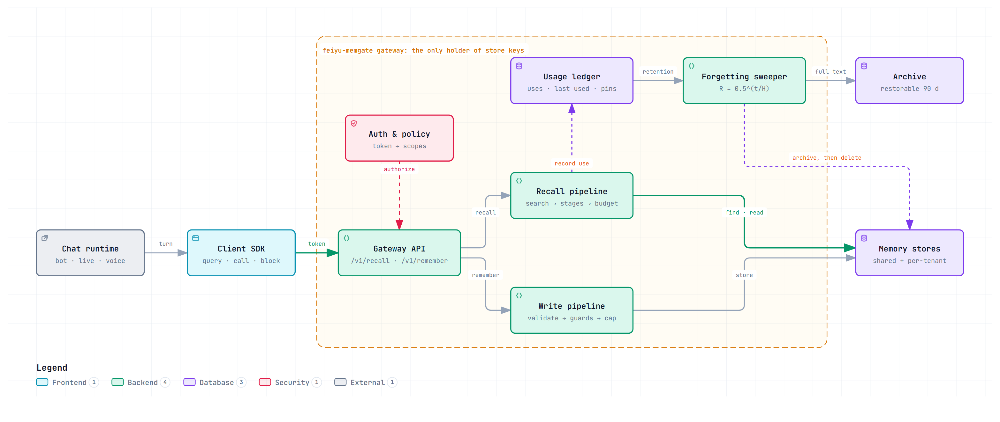
  </picture>
</p>

- **Trust boundary**. The dashed box is the gateway process, and only it holds the store keys. The chat program gets a gateway token. A leaked token can do no more than that client's policy allows.
- **Recall path**. After authentication, rate limiting and permission checks, every store the client can read is queried in parallel. Candidates pass through the recall stages in order (by default `min_score` → `relative_score` → `newer_first` → `fill_text` → `drop_oversize` → `redact` → `dedupe` → `budget`) and come back with score, date and source.
- **Write path**. Length and format are validated, then the write guards run (by default `redact` and `daily_cap`), and the item lands in a shared store or in the current tenant's own store.
- **Forgetting path** (optional). The ledger records only the address, time and use count, never the text. The sweeper archives memories whose retention has run out, then deletes them.
- **Interface surface**. Four routes only: `GET /healthz`, `POST /v1/recall`, `POST /v1/remember`, `POST /v1/used`. There is no network endpoint for deleting, listing or exporting. Those operations are available only through the command line on the local machine.

<details>
<summary>Sequence diagram of one recall</summary>
<p align="center">
  <picture>
    <source media="(prefers-color-scheme: dark)" srcset="docs/assets/recall-sequence.en.dark.png">
    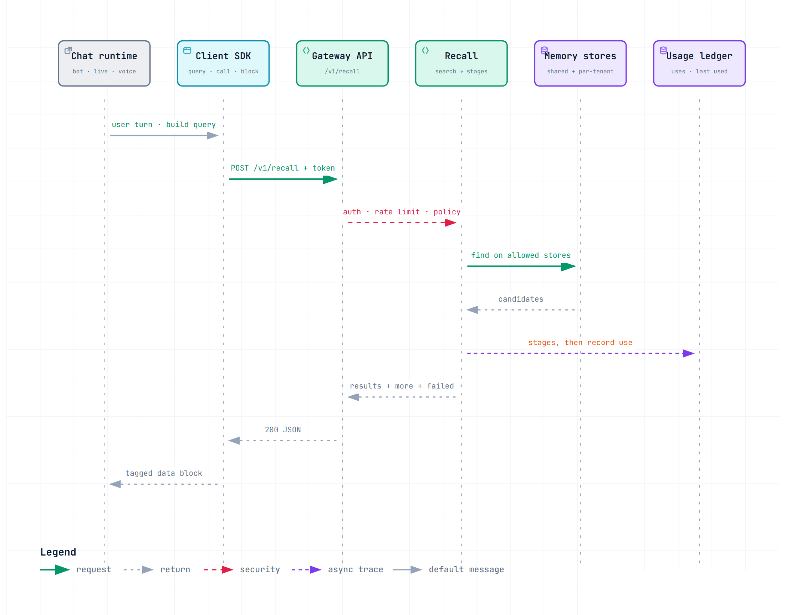
  </picture>
</p>
</details>

### Extension points

Each stage of the system is a slot with a fixed contract. A registry resolves it by name or by `module:Class`. A built-in implementation can be replaced in configuration with your own class, with no change to framework code.

| Slot | Contract | Built-in implementations |
|---|---|---|
| `backend` | Where memory is stored and how it is retrieved | `sqlite` (keyword, needs no service), `embedding` (vector), `hybrid` (multi-route fusion), `openviking`, `inmemory` |
| `recall_stage` | How candidates are filtered, ranked and limited | `min_score`, `relative_score`, `newer_first`, `source_weight`, `freshness`, `fill_text`, `drop_marker`, `drop_oversize`, `redact`, `dedupe`, `budget` |
| `write_guard` | Checks before a write reaches the store | `redact`, `daily_cap` |
| `redactor` | How text is cleaned | `secrets`, `public`, `none` |
| `tenants` | Where each tenant's own store comes from | `directory`, `keyfile` |
| `forgetting_curve` | How retention changes with time and use | `ebbinghaus` |

The gateway, the client and all built-in implementations use only the Python standard library. Only encrypted backup needs `cryptography`.

## Benchmark

The same memories and the same questions, 24 configurations of 13 projects. Each system uses its own retrieval code and default settings. The list of systems and the method come first. The data follows, by topic: ranking, delivery, question type, quiet questions, context, newer and older facts, and cost. The characteristics and trade-offs of each project are collected in [Characteristics and trade-offs of each project](#characteristics-and-trade-offs-of-each-project). The results of the same measurement on two larger public datasets, including where this project does poorly, are in [Public datasets: PerLTQA and LoCoMo](#public-datasets-perltqa-and-locomo).

### Systems compared

| Project | Version tested | Form | Retrieval | Default write calls an LLM | Default delivery |
|---|---|---|---|---|---|
| **feiyu-memgate** (this project) | 0.1.0 | Gateway: HTTP service or in-process | Keyword, vector, hybrid, or OpenViking | No | Up to 5 items, with score thresholds and a character budget; the default broad profile delivers about 0.6 – 2.5 items per question, `profile = "precise"` about 0.4 – 1.2 |
| [memsearch](https://github.com/zilliztech/memsearch) | 0.4.23 | Library plus DSH plugin | Hybrid: vector plus BM25 | The library does not; the plugin summarizes each turn with a model by default | Top 5, no score threshold, the model decides whether to retrieve |
| [mem0](https://github.com/mem0ai/mem0) | 2.2.1 | Library | Vector plus BM25 plus entities | Yes (can be turned off) | 20 items, score threshold 0.1 |
| [OpenViking](https://github.com/volcengine/OpenViking) | v0.5.3 | Service plus DSH plugin | Vector | Yes (not when memory files are written directly) | API default 10 items, no score threshold |
| [Graphiti](https://github.com/getzep/graphiti) | graphiti-core 0.31.2 | Library | Graph: hybrid retrieval over extracted facts | Yes | 10 items, cosine floor 0.6 |
| [SeekMemory](https://github.com/NeverENG/SeekMemory) | commit 794ec5d | Kernel library plus host adapter | Keyword: BM25 plus graph activation | Yes | Up to 8 items, 600-character budget, automatic injection on every turn |
| [dsh-mnemon](https://github.com/omdsh-dev/dsh-mnemon) | 0.5.45 | DSH plugin | Keyword plus entities plus graph signals; vector optional | Yes | The runtime memory snapshot is provided automatically; Memory Spaces are recalled by a model call, at most 4 items per call |
| [lingshu (dsh-memory)](https://github.com/FuRongJun-1999/dsh-memory) | 0.10.1 | DSH plugin | Keyword: BM25 | No | Automatic injection of the 4 most recent items of the session on every turn |
| [meow-memory](https://github.com/Phant0Meow/dsh-meow-memory) | 0.32.6 | DSH plugin | Keyword: BM25 | Written by the host model through a tool | Top 2 matches injected before every message |
| [dsh-fish-memory](https://github.com/Yuuyuko-uu/dsh-fish-memory) | 1.6.1 | DSH plugin | Keyword: word-rarity evidence score | Yes (the model decides what to store through the remember tool; the background keyword expansion makes a further model call) | Injected automatically every turn, with a query gate, an evidence threshold of 0.30, at most 6 items and an 800-character budget |
| [dsh-prime-memory](https://github.com/drscrewdriver/dsh-prime-memory) | 0.26.55 | DSH plugin | Keyword: FTS5 BM25; vector optional | Yes (by default a model distils the conversation; direct writes are possible) | Injected automatically before every message, score threshold 0.3, at most 5 items, 2000-character budget |
| [dsh-soul-md](https://github.com/Scorp1o117/dsh-soul-md) | 0.12.5 | DSH plugin | Keyword: word and Han-bigram hits | Written by the host model through a tool | From the second message on, injected every turn: 5 topics and 1600 characters by default, no score threshold |
| [Hindsight](https://github.com/vectorize-io/hindsight) | Server 1.2.1, DSH plugin 0.8.7 | Service plus DSH plugin | Four arms (semantic, keyword, graph, temporal) fused and reranked | Yes (can be turned off) | The plugin injects a model-written reflect text by default; its recall-only option has no item limit and no score threshold, budget 2000 tokens |

mem0 was tested in two modes, verbatim ingest and LLM extraction. dsh-mnemon was tested in its default mode and with vectors turned on. dsh-fish-memory was tested in its default mode and in two modes where deepseek-flash or claude-haiku-5-5 runs the background keyword expansion. dsh-prime-memory was tested in its default mode and with vectors turned on. Hindsight was tested in three configurations: without a model, with deepseek-flash and with claude-haiku-5-5. This project was tested in 5 configurations. That makes 24 in total. This project has 13 more variants: 4 lighter vector models, and for each configuration a version with the precise profile pinned (`-precise`; 9 in all, 5 of them in the tables below and the 4 for the lighter models in [Deployment tiers](#deployment-tiers)). Facts such as each project's forgetting mechanism and license are in [bench/results/design/features.en.md](bench/results/design/features.en.md).

Three more plugins from the DSH store were looked at and not measured, because the benchmark contract (return a ranked list of items for each question, then score it) cannot be applied to them. [dsh-engramory](https://github.com/tinqiao-oss/engramory) registers no write or search tool: it injects a MEMORY.md index and the model opens the files itself, so there is no ranked list to score. In [dsh-plugin-memory](https://github.com/LittleBlackTong/dsh-plugin-memory) the model writes wiki pages with file tools, the injected boot block does not depend on the question, and the only code that takes a query is a substring search the model runs on words it picks itself. [dsh-xingxi](https://github.com/Yuuyuko-uu/dsh-xingxi) is a viewer and archive reader over files made elsewhere and keeps no memory store of its own.

### Method

- **Data**. 240 memories and 160 questions, in Chinese, about a fictional person. The questions fall into four types: 45 lexical (the question uses the same words as the memory), 55 paraphrase (reworded), 20 updated (the same fact has an old and a new memory), and 40 quiet questions (no answer in memory, so the correct behavior is to deliver nothing).
- **Two kinds of metric**. *Ranking*: no score threshold, look at where the correct memory ranks (Hit@1, Hit@5). This measures retrieval itself. *Delivered by default*: with each system's default settings, what it actually hands to the model. This measures out-of-the-box behavior.
- **Fairness**. Each system uses its own real retrieval code and default settings. All systems that need vectors share one model (bge-m3). Third-party code runs only in containers: those without a model have no network, those with a model are connected only to reach the model provider's API. Each adapter runs alone, one after another.
- **No tuning on the test set**. The test set is frozen. This project's two sets of score thresholds (precise and broad profile) were chosen on a separate development set with completely different text (160 memories, 110 questions), by a rule written down in advance. The held-out test set was run only after the thresholds were fixed, and no setting was changed after the run. Both profiles were run once on the test set, and neither was chosen again for the sake of its numbers.
- **Default profile**. The gateway has two sets of score thresholds: `precise` and `broad`. Since 2026-11-16 the default is `broad`, because the project is used for chat companions, where a topic usually touches several memories and one item per turn is too few. This was a product decision, not a tuning step, and the values of both sets did not change. In the tables below, a row of "this project" means the result with the default profile (broad) unless it is marked "precise profile", which is the same configuration with the precise profile pinned.

The full rules are in [bench/CONTRACT.md](bench/CONTRACT.md) (Chinese). What each system was called with and what was bypassed is in the notes of [bench/results/summary.md](bench/results/summary.md) (Chinese). Reproduction steps and run logs are in [bench/README.md](bench/README.md) (Chinese).

### Overview: quality of what reaches the model

<p align="center">
  <picture>
    <source media="(prefers-color-scheme: dark)" srcset="docs/assets/charts/quality.en.dark.png">
    
  </picture>
</p>

*Delivered F1* is the harmonic mean of "the delivery contains the correct memory" and "the share of delivered items that are correct". It is high only when both are high. This project's four vector and hybrid configurations are at 71.6% – 82.7% by default (broad profile) and the keyword configuration is at 61.3%; with the precise profile pinned they are at 75.6% – 83.7% and 55.1%. Among the other projects the highest is dsh-mnemon with vectors turned on (53.6%), and the rest are at 0% – 40%. The gap comes mainly from precision: most systems deliver the top N items by default, and the three Hindsight configurations deliver 84 – 94 items per question with a precision of about 1% and a delivered F1 of 2.1% – 2.3%. The broad profile has lower precision than the precise one, so the delivered F1 of the vector and hybrid configurations is lower with it (`embedding` 82.1% → 71.6%, `hybrid` 75.6% → 74.7%); only the keyword configuration rises.

### Retrieval ranking

<p align="center">
  <picture>
    <source media="(prefers-color-scheme: dark)" srcset="docs/assets/charts/ranking.en.dark.png">
    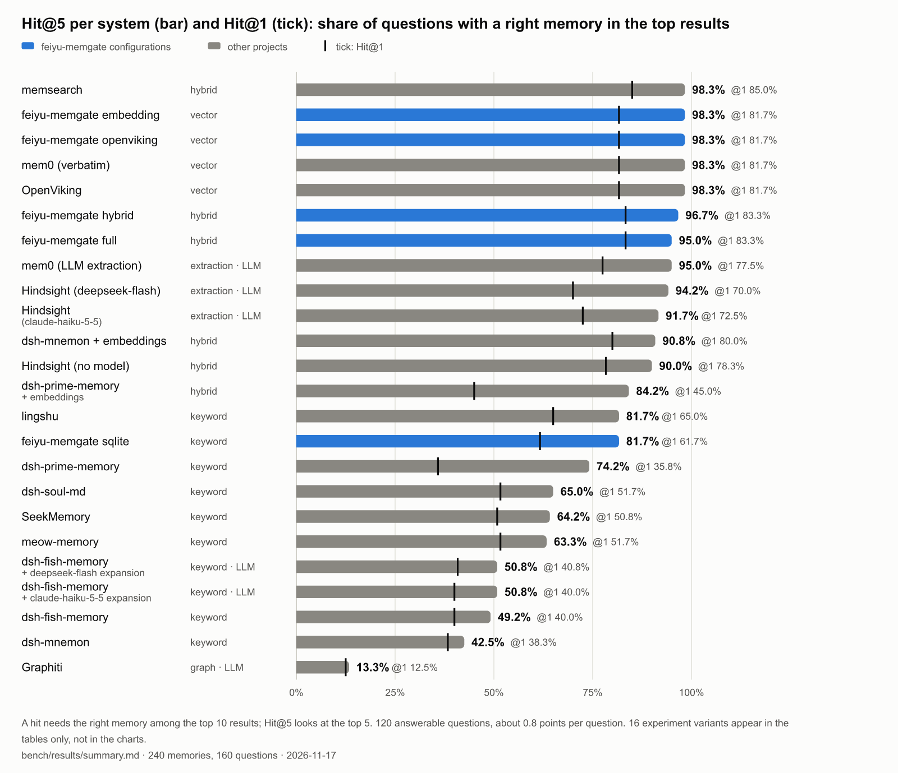
  </picture>
</p>

<p align="center">
  <picture>
    <source media="(prefers-color-scheme: dark)" srcset="docs/assets/charts/hit-at-k.en.dark.png">
    
  </picture>
</p>

- The vector configuration's Hit@5 is 98.3%, the same as memsearch, mem0 and OpenViking, which also use bge-m3. This column is decided mainly by the embedding model, not by the gateway. Hindsight, which also uses bge-m3, is at 90.0% – 94.2%, and dsh-prime-memory with vectors at 84.2%.
- memsearch ranks best: Hit@1 is 85.0%, and the correct memory is always within the top 8. This project's vector backend has a Hit@1 of 81.7%.
- This project's vector configurations, memsearch, mem0 (verbatim ingest) and OpenViking reach 93% – 96% within the top 2, and growth after that is slow. This is the basis for delivering 1 to 2 items per question with the precise profile. Hindsight is at 87.5% – 88.3% within the top 2, and dsh-prime-memory with vectors at 65.0%.
- The curves of the keyword systems are flatter: this project's keyword backend and lingshu reach 88.3% at the 10th item, dsh-prime-memory 79.2%, SeekMemory, meow-memory and dsh-soul-md about 70%, and dsh-fish-memory about 52%. They do not understand semantics, and paraphrase questions are their ceiling.
- The hybrid backend has a slightly higher Hit@1 (83.3%) and a slightly lower Hit@5 (96.7%). Both differences are within two or three questions.

### Delivered by default

<p align="center">
  <picture>
    <source media="(prefers-color-scheme: dark)" srcset="docs/assets/charts/delivered.en.dark.png">
    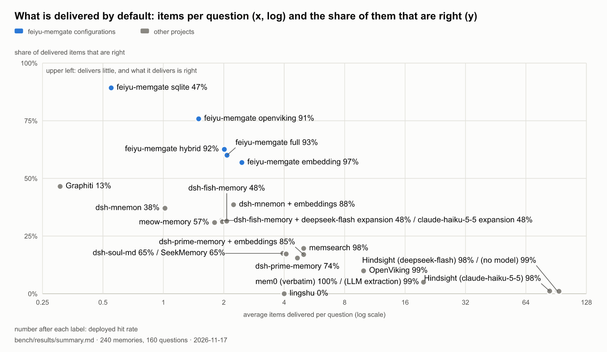
  </picture>
</p>

| System | Retrieval type | Hit@1 | Hit@5 | Avg. items delivered | Delivered hit | Precision | Delivered F1 | Quiet rate | p50 latency |
|---|---|---:|---:|---:|---:|---:|---:|---:|---:|
| **feiyu-memgate embedding** | vector | 81.7% | 98.3% | 2.46 | 96.7% | 56.9% | 71.6% | 32.5% | 24 ms |
| feiyu-memgate embedding (precise profile) | vector | 81.7% | 98.3% | 0.98 | 81.7% | 82.5% | 82.1% | 65.0% | 25 ms |
| **feiyu-memgate openviking** | vector | 81.7% | 98.3% | 1.50 | 90.8% | 75.9% | 82.7% | 40.0% | 26 ms |
| feiyu-memgate openviking (precise profile) | vector | 81.7% | 98.3% | 1.17 | 87.5% | 80.2% | 83.7% | 40.0% | 25 ms |
| **feiyu-memgate hybrid** | hybrid | 83.3% | 96.7% | 2.01 | 92.5% | 62.6% | 74.7% | 35.0% | 28 ms |
| feiyu-memgate hybrid (precise profile) | hybrid | 83.3% | 96.7% | 0.66 | 65.0% | 90.4% | 75.6% | 75.0% | 28 ms |
| **feiyu-memgate full** | hybrid + freshness | 83.3% | 95.0% | 2.08 | 93.3% | 60.1% | 73.1% | 35.0% | 33 ms |
| feiyu-memgate full (precise profile) | hybrid + freshness | 84.2% | 95.0% | 0.67 | 65.0% | 90.2% | 75.6% | 75.0% | 33 ms |
| **feiyu-memgate sqlite** | keyword | 61.7% | 81.7% | 0.55 | 46.7% | 89.3% | 61.3% | 70.0% | 2 ms |
| feiyu-memgate sqlite (precise profile) | keyword | 61.7% | 81.7% | 0.41 | 39.2% | 93.0% | 55.1% | 75.0% | 2 ms |
| memsearch | hybrid | 85.0% | 98.3% | 5.00 | 98.3% | 19.7% | 32.8% | 0.0% | 26 ms |
| mem0 (verbatim ingest) | vector | 81.7% | 98.3% | 20.00 | 100.0% | 5.0% | 9.5% | 0.0% | 35 ms |
| OpenViking | vector | 81.7% | 98.3% | 9.94 | 99.2% | 9.9% | 18.0% | 0.0% | 25 ms |
| mem0 (LLM extraction) | extraction | 77.5% | 95.0% | 19.76 | 99.2% | 5.0% | 9.6% | 0.0% | 69 ms ‡ |
| Hindsight (deepseek-flash) | extraction | 70.0% | 94.2% | 91.97 | 98.3% | 1.1% | 2.1% | 0.0% | 1550 ms |
| Hindsight (claude-haiku-5-5) | extraction | 72.5% | 91.7% | 84.01 | 97.5% | 1.2% | 2.3% | 0.0% | 1556 ms |
| dsh-mnemon + vector | hybrid | 80.0% | 90.8% | 2.24 | 87.5% | 38.6% | 53.6% | 0.0% | 78 ms |
| Hindsight (no model) | hybrid | 78.3% | 90.0% | 93.54 | 99.2% | 1.1% | 2.1% | 0.0% | 455 ms |
| dsh-prime-memory + embeddings | hybrid | 45.0% | 84.2% | 5.00 | 85.0% | 17.0% | 28.3% | 0.0% | 21 ms |
| lingshu | keyword | 65.0% | 81.7% | 4.00 | 0.0% | 0.0% | 0.0% | 0.0% | 2 ms |
| dsh-prime-memory | keyword | 35.8% | 74.2% | 4.66 | 74.2% | 15.5% | 25.6% | 2.5% | 1 ms |
| dsh-soul-md | keyword | 51.7% | 65.0% | 3.94 | 65.0% | 17.5% | 27.6% | 10.0% | 3 ms |
| SeekMemory | keyword | 50.8% | 64.2% | 4.09 | 65.0% | 17.2% | 27.3% | 22.5% | 2 ms |
| meow-memory | keyword | 51.7% | 63.3% | 1.80 | 56.7% | 30.9% | 40.0% | 10.0% | 2 ms |
| dsh-fish-memory + deepseek-flash expansion | keyword | 40.8% | 50.8% | 1.95 | 48.3% | 31.8% | 38.3% | 32.5% | 2 ms |
| dsh-fish-memory + claude-haiku-5-5 expansion | keyword | 40.0% | 50.8% | 1.97 | 47.5% | 31.2% | 37.7% | 32.5% | 2 ms |
| dsh-fish-memory | keyword | 40.0% | 49.2% | 2.07 | 48.3% | 31.5% | 38.1% | 32.5% | 1 ms |
| dsh-mnemon | keyword | 38.3% | 42.5% | 1.02 | 38.3% | 37.1% | 37.7% | 0.0% | 33 ms |
| Graphiti | graph | 12.5% | 13.3% | 0.31 | 13.3% | 46.5% | 20.7% | 82.5% | 391 ms ‡ |

*Delivered hit*: the share of questions where the default delivery contains the correct memory. *Precision*: the share of delivered items that are correct, counted only over answerable questions where something was delivered. *Delivered F1*: the harmonic mean of the two. *Quiet rate*: the share of the 40 quiet questions where nothing was delivered. Rows of this project: the bold one is the default (broad profile), the "precise profile" row after it is the same configuration with `[recall] profile = "precise"` pinned. The Hit@1 of `full` differs by one question between the profiles (83.3% against 84.2%): in this configuration the ranking is measured after the deliveries of the same question have been recorded as used, freshness reads that record, and the broad profile records more items. The ranking of the other configurations does not depend on the profile. ‡ These two rows use a paid mode and were not rerun in the final sequential run. Their latency comes from a machine that was also running other jobs.

The table shows four things:

1. **Most systems deliver the top N items by default.** So their delivered hit is close to 100%, their precision is only 1% – 39%, and they almost never stay quiet on quiet questions. This project by default (broad profile) delivers 0.55 – 2.46 items per question, with precision of 56.9% – 89.3% (56.9% – 75.9% for the vector and hybrid configurations) and a delivered hit of 46.7% – 96.7%; with the precise profile pinned it delivers 0.41 – 1.17 items per question, with precision of 80.2% – 93.0%.
2. **The default profile misses far fewer answers, and the cost is noise and less silence.** 24% – 43% of what the vector and hybrid configurations deliver is wrong. Of the 40 quiet questions only 32.5% – 40.0% get nothing (precise profile: 40.0% – 75.0%), so 60.0% – 67.5% of the questions with no answer get unrelated memories; and the characters delivered per question are 1.3 – 3.1 times those of the precise profile. This is the reverse of the earlier "few and accurate": more questions are answered, but there is more risk of forcing an unrelated memory into the conversation, and the context is longer.
3. **The cost of the precise profile is missed answers.** With `profile = "precise"` pinned, the delivered hit is 39.2% – 87.5%, lower than the systems that "give a few more". Paraphrase questions suffer most, see the next subsection.
4. **The hybrid backend does not beat vector alone on hits.** Delivered hit is 92.5% against 96.7% and ranking Hit@5 96.7% against 98.3%; its score thresholds are stricter, so it delivers less (2.01 items against 2.46). Afterwards, five fusion methods were compared on the development set, and two small models were tried in combination. None clearly beat vector alone: on reworded questions, the keyword score of the correct memory is lower than that of unrelated memories. If you have an embeddings endpoint, use `embedding`. If you do not, use `sqlite`.

Score thresholds are configuration. The default is the broad profile. If few and accurate items matter more (or the memory block stays in the conversation history and context has to be saved), write `[recall] profile = "precise"` to get the previous behavior. The measured trade-off is in [Deployment tiers](#deployment-tiers). [docs/backends.md](docs/backends.md) (Chinese) explains how the values of both profiles were chosen for each backend and how to choose again with your own data.

### By question type

<p align="center">
  <picture>
    <source media="(prefers-color-scheme: dark)" srcset="docs/assets/charts/by-type.en.dark.png">
    
  </picture>
</p>

<p align="center">
  <picture>
    <source media="(prefers-color-scheme: dark)" srcset="docs/assets/charts/delivered-by-type.en.dark.png">
    
  </picture>
</p>

Each cell is "ranking Hit@5 / delivered hit by default":

| System | Lexical (45) | Paraphrase (55) | Updated (20) |
|---|---:|---:|---:|
| **feiyu-memgate embedding** | 100.0% / 100.0% | 96.4% / 92.7% | 100.0% / 100.0% |
| feiyu-memgate embedding (precise profile) | 100.0% / 100.0% | 96.4% / 69.1% | 100.0% / 75.0% |
| **feiyu-memgate openviking** | 100.0% / 100.0% | 96.4% / 81.8% | 100.0% / 95.0% |
| feiyu-memgate openviking (precise profile) | 100.0% / 100.0% | 96.4% / 81.8% | 100.0% / 75.0% |
| **feiyu-memgate hybrid** | 100.0% / 100.0% | 92.7% / 85.5% | 100.0% / 95.0% |
| feiyu-memgate hybrid (precise profile) | 100.0% / 100.0% | 92.7% / 34.5% | 100.0% / 70.0% |
| **feiyu-memgate full** | 100.0% / 100.0% | 89.1% / 85.5% | 100.0% / 100.0% |
| feiyu-memgate full (precise profile) | 100.0% / 100.0% | 89.1% / 34.5% | 100.0% / 70.0% |
| **feiyu-memgate sqlite** | 100.0% / 97.8% | 63.6% / 3.6% | 90.0% / 50.0% |
| feiyu-memgate sqlite (precise profile) | 100.0% / 95.6% | 63.6% / 0.0% | 90.0% / 20.0% |
| memsearch | 100.0% / 100.0% | 96.4% / 96.4% | 100.0% / 100.0% |
| mem0 (verbatim ingest) | 100.0% / 100.0% | 96.4% / 100.0% | 100.0% / 100.0% |
| OpenViking | 100.0% / 100.0% | 96.4% / 98.2% | 100.0% / 100.0% |
| mem0 (LLM extraction) | 100.0% / 100.0% | 92.7% / 98.2% | 90.0% / 100.0% |
| Hindsight (deepseek-flash) | 100.0% / 100.0% | 89.1% / 96.4% | 95.0% / 100.0% |
| Hindsight (claude-haiku-5-5) | 100.0% / 100.0% | 83.6% / 94.5% | 95.0% / 100.0% |
| dsh-mnemon + vector | 100.0% / 100.0% | 85.5% / 78.2% | 85.0% / 85.0% |
| Hindsight (no model) | 100.0% / 100.0% | 80.0% / 98.2% | 95.0% / 100.0% |
| dsh-prime-memory + embeddings | 100.0% / 100.0% | 67.3% / 69.1% | 95.0% / 95.0% |
| lingshu | 100.0% / 0.0% | 63.6% / 0.0% | 90.0% / 0.0% |
| dsh-prime-memory | 97.8% / 97.8% | 47.3% / 47.3% | 95.0% / 95.0% |
| dsh-soul-md | 100.0% / 100.0% | 38.2% / 38.2% | 60.0% / 60.0% |
| SeekMemory | 97.8% / 97.8% | 32.7% / 32.7% | 75.0% / 80.0% |
| meow-memory | 97.8% / 97.8% | 30.9% / 25.5% | 75.0% / 50.0% |
| dsh-fish-memory + deepseek-flash expansion | 91.1% / 88.9% | 14.5% / 12.7% | 60.0% / 55.0% |
| dsh-fish-memory + claude-haiku-5-5 expansion | 88.9% / 88.9% | 16.4% / 14.5% | 60.0% / 45.0% |
| dsh-fish-memory | 88.9% / 88.9% | 12.7% / 12.7% | 60.0% / 55.0% |
| dsh-mnemon | 95.6% / 93.3% | 10.9% / 5.5% | 10.0% / 5.0% |
| Graphiti | 24.4% / 24.4% | 5.5% / 5.5% | 10.0% / 10.0% |

- **Lexical questions barely separate the systems.** When the question uses the same words as the memory, every system except Graphiti (24.4%) and dsh-fish-memory (88.9% – 91.1%) ranks above 95%.
- **Paraphrase questions separate keyword from vector.** The vector and hybrid systems rank at 67% – 96% (dsh-prime-memory with vectors is lowest at 67.3%, Hindsight at 80.0% – 89.1%) and the keyword systems at 11% – 64%.
- **The precise profile's misses are concentrated in paraphrase questions.** With the precise profile pinned, the vector backend ranks 96.4% but delivers 69.1%: the correct memory was found, but its score did not pass the threshold. The hybrid backend delivers only 34.5%, and the keyword backend 0.0%. The default broad profile closes that gap: the vector backend delivers 92.7%, the hybrid backend 85.5%, and the keyword backend still only 3.6% (its problem is retrieval, not the threshold). On lexical questions, delivery and ranking are almost the same.
- **Delivered hit can be higher than ranking Hit@5.** A system that delivers 10 to 20 items by default covers a wider range than the top 5; Hindsight delivers 84 – 94 items per question, and on paraphrase questions its delivered hit (94.5% – 98.2%) is 7 to 18 points above its ranking Hit@5 (80.0% – 89.1%).
- **On updated questions** this project delivers 95.0% – 100.0% by default (keyword backend 50.0%) and 70.0% – 75.0% with the precise profile (keyword backend 20.0%). When it does deliver, the order of newer and older is covered in "Order of newer and older facts" below.

### Questions with no answer

<p align="center">
  <picture>
    <source media="(prefers-color-scheme: dark)" srcset="docs/assets/charts/quiet.en.dark.png">
    
  </picture>
</p>

40 questions have no answer in memory. Delivering anything counts as not staying quiet. This project's configurations are at 32.5% – 70.0% by default (broad profile; 32.5% – 40.0% for the vector and hybrid configurations) and at 40.0% – 75.0% with the precise profile pinned. SeekMemory is at 22.5%, the three dsh-fish-memory configurations at 32.5% (nothing is delivered when the query gate stops it or no word matches), dsh-soul-md and meow-memory at 10%, dsh-prime-memory at 2.5%, and the other systems with no default score threshold at 0%, including the three Hindsight configurations. Graphiti is at 82.5%, and it also delivers very little on answerable questions (see the limits section). The new default is worse on this measure than the previous one: `embedding` falls from 65.0% to 32.5%, and on the questions with no answer it still delivers 2.12 items per question on average (precise profile: 0.57). For a companion bot, this measure decides whether it forces an unrelated old fact into the conversation.

### Context spent

<p align="center">
  <picture>
    <source media="(prefers-color-scheme: dark)" srcset="docs/assets/charts/context.en.dark.png">
    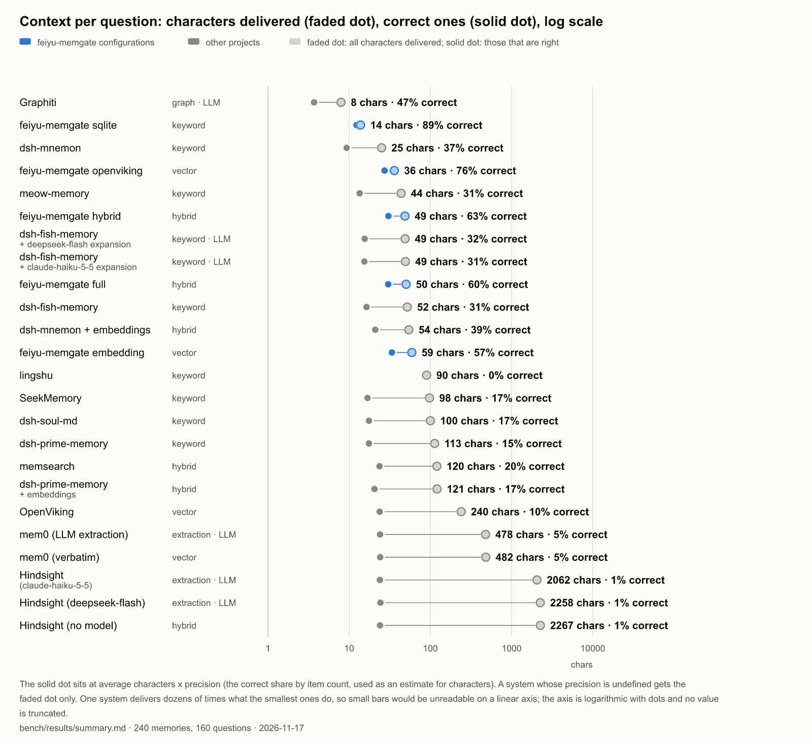
  </picture>
</p>

A memory in this data set is about 24 characters on average, so the character count follows the item count: this project delivers 14 – 59 characters per question by default (broad profile; 10 – 28 with the precise profile), meow-memory 44, dsh-fish-memory 49 – 52, dsh-mnemon with vectors turned on 54, lingshu 90, SeekMemory 98, dsh-soul-md 100, dsh-prime-memory 113 – 121, memsearch 120, OpenViking 240, mem0 about 480, and Hindsight about 2060 – 2270 (84 – 94 items per question). With the broad profile the vector and hybrid configurations (36 – 59 characters) are in the same range as meow-memory, dsh-fish-memory and dsh-mnemon with vectors, and still below lingshu and everything after it. Memories in real conversations are longer, and the absolute values scale up in proportion. Delivered content counts toward the prompt on every turn, so this measure maps directly to cost and to the chance that the model is distracted by unrelated content.

### Order of newer and older facts

<p align="center">
  <picture>
    <source media="(prefers-color-scheme: dark)" srcset="docs/assets/charts/fresh.en.dark.png">
    
  </picture>
</p>

In an updated question, the same fact has a newer and an older memory. The table below looks only at questions where the newer memory was delivered, and counts those where the older one did not come before it.

| System | Before adding `newer_first` | After |
|---|---:|---:|
| feiyu-memgate embedding |  | 16/20 |
| feiyu-memgate embedding (precise profile) | 9/15 | 15/15 |
| feiyu-memgate openviking |  | 19/19 |
| feiyu-memgate openviking (precise profile) | 9/15 | 15/15 |
| feiyu-memgate hybrid |  | 16/19 |
| feiyu-memgate hybrid (precise profile) | 8/14 | 14/14 |
| feiyu-memgate full |  | 19/20 |
| feiyu-memgate full (precise profile) |  | 14/14 |
| feiyu-memgate sqlite |  | 8/10 |
| feiyu-memgate sqlite (precise profile) | 3/4 | 3/4 |
| Hindsight (no model) | | 13/20 |
| memsearch, mem0 (LLM extraction) | | 12/20 |
| dsh-mnemon + vector | | 11/17 |
| mem0 (verbatim ingest), OpenViking | | 10/20 |
| dsh-fish-memory, dsh-fish-memory + deepseek-flash expansion | | 10/11 |
| dsh-prime-memory, dsh-prime-memory + embeddings | | 9/19 |
| SeekMemory | | 9/16 |
| dsh-fish-memory + claude-haiku-5-5 expansion | | 9/9 |
| meow-memory | | 8/10 |
| dsh-soul-md | | 7/12 |
| Hindsight (claude-haiku-5-5) | | 5/20 |
| Hindsight (deepseek-flash) | | 2/20 |

Systems where the newer memory was delivered on fewer than 5 questions are not listed (the keyword backend's 3/4 with the precise profile is left over from the earlier table). The two Hindsight model configurations deliver observations that a model consolidated, and the adapter gives them the id of the earliest memory among their source facts, so the numbers in those two rows depend on that id rule; in the configuration without a model each memory is an independent verbatim chunk and the rule does not apply. Other configurations of this project, default (broad profile): bge-small-zh 11/15, bge-base-zh 12/15, embeddinggemma 12/19, qwen3-embedding 14/19; precise profile: 11/11, 8/10, 9/9, 10/10. With the broad profile every configuration except `openviking` is short of all correct, because its score thresholds are wider than the range `newer_first` works on: this stage reorders only among candidates whose score is at least 85% of the best score, and candidates outside that range keep their original position.

`newer_first` reorders only the candidates that passed the score thresholds. It does not change which memories are delivered, so the numbers in the default delivery table above did not change because of it. It does not judge whether two memories contradict each other, and it does not invalidate the older one. It has no effect on a memory without a date. By the backend's own ranking (without the recall stages), every system ranks the newer memory before the older one between 5% and 65% of the time, and this project is also at 50% – 55%. The test set has only 20 updated questions and the development set has 12, so the sample is small.

### Cost

<p align="center">
  <picture>
    <source media="(prefers-color-scheme: dark)" srcset="docs/assets/charts/cost.en.dark.png">
    
  </picture>
</p>

| System | Latency p50 | Latency p95 | Ingest of 240 memories | LLM tokens used for writes | Cost |
|---|---:|---:|---:|---:|---:|
| **feiyu-memgate sqlite** | 2 ms | 3 ms | 0.01 s | 0 | 0 |
| **feiyu-memgate embedding** | 24 ms | 51 ms | 6.4 s | 0 | 0 |
| **feiyu-memgate hybrid** | 28 ms | 55 ms | 6.4 s | 0 | 0 |
| **feiyu-memgate full** | 33 ms | 54 ms | 6.4 s | 0 | 0 |
| **feiyu-memgate openviking** | 26 ms | 53 ms | 69.3 s | 0 | 0 |
| memsearch | 26 ms | 53 ms | 13.6 s | 0 | 0 |
| mem0 (verbatim ingest) | 35 ms | 80 ms | 9.3 s | 0 | 0 |
| OpenViking | 25 ms | 52 ms | 71.8 s | 0 | 0 |
| mem0 (LLM extraction) | 69 ms ‡ | 610 ms ‡ | 471 s ‡ | 2.06 million | 0.53 CNY |
| Hindsight (deepseek-flash) | 1550 ms | 1753 ms | 327 s | 2.47 million | 0.178 USD |
| Hindsight (claude-haiku-5-5) | 1556 ms | 2136 ms | 368 s | 3.28 million | 0.190 USD |
| dsh-mnemon + vector | 78 ms | 105 ms | 12.2 s | 0 | 0 |
| Hindsight (no model) | 455 ms | 542 ms | 10.6 s | 0 | 0 |
| dsh-prime-memory + embeddings | 21 ms | 23 ms | 4.3 s | 0 | 0 |
| lingshu | 2 ms | 3 ms | 4.1 s | 0 | 0 |
| dsh-prime-memory | 1 ms | 1 ms | 0.2 s | 0 | 0 |
| dsh-soul-md | 3 ms | 4 ms | 0.1 s | 0 | 0 |
| SeekMemory | 2 ms | 3 ms | 0.2 s | 0 | 0 |
| meow-memory | 2 ms | 3 ms | 0.2 s | 0 | 0 |
| dsh-fish-memory + deepseek-flash expansion | 2 ms | 3 ms | 109 s | 65.3 thousand | 0.011 USD |
| dsh-fish-memory + claude-haiku-5-5 expansion | 2 ms | 21 ms | 123 s | 103.7 thousand | 0.012 USD |
| dsh-fish-memory | 1 ms | 2 ms | 0.3 s | 0 | 0 |
| dsh-mnemon | 33 ms | 39 ms | 3.0 s | 0 | 0 |
| Graphiti | 391 ms ‡ | 848 ms ‡ | 1347 s ‡ | 1.18 million | about 2 CNY |

- The latency of the vector configurations is spent mainly on one query embedding: this project, memsearch, mem0 and OpenViking are at 24 – 35 ms and dsh-mnemon + vector at 78 ms, all measured while bge-m3 ran on the CPU. The four projects added later were measured after bge-m3 had moved to the GPU; dsh-prime-memory + embeddings is at 21 ms (including one embedding request), under conditions that are not quite the same as the earlier ones. Each Hindsight recall runs four retrieval arms and reranks with a local cross-encoder: 455 ms in the configuration without a model and about 1.55 s in the two model configurations (p95 1.75 – 2.14 s); these three figures were measured while other tests were running on the machine, and a repeat of the configuration without a model on an idle machine gave 428 ms. The keyword configurations without vectors are mostly at 1 – 3 ms, and dsh-mnemon in its default mode at 33 ms. The rows of this project are the default profile; with the precise profile pinned the latency differs by at most 1 ms and the ingest time is of the same order.
- This project makes no LLM calls on write. For most third-party systems the default write path needs an LLM. We bypassed it (verbatim ingest), so their token column is 0. mem0's LLM extraction mode, Graphiti and the two model configurations of Hindsight were run on the default path, and the two expansion configurations of `dsh-fish-memory` let the plugin's own background keyword expansion use a model (writes stay verbatim, the model only adds retrieval words).
- The two rows connected to OpenViking ingest slowly because its index is asynchronous, and the time includes waiting for indexing to finish.
- lingshu's ingest time does not include the waiting caused by its own write rate limit.

Model usage of the four new configurations that call a model (the two expansion configurations of `dsh-fish-memory` and the two model configurations of Hindsight), from the usage fields the provider's API returns:

| Configuration | Calls | Input tokens | of which cache hits | Output tokens | Cost |
|---|---:|---:|---:|---:|---:|
| dsh-fish-memory + deepseek-flash expansion | 121 | 62,465 | 36,864 | 2,874 | 0.011 USD |
| dsh-fish-memory + claude-haiku-5-5 expansion | 121 | 99,039 | 0 | 4,691 | 0.012 USD |
| Hindsight (deepseek-flash) | 423 | 2,399,585 | 1,510,272 | 67,298 | 0.178 USD |
| Hindsight (claude-haiku-5-5) | 400 | 3,167,514 | 2,034,305 | 112,097 | 0.190 USD |

All four have thinking disabled (`thinking` is set to `disabled` in the request), report no reasoning tokens and had no failed calls. The two paid runs of mem0 and Graphiti used the API's default thinking setting, so these four rows cannot be compared directly with their token counts and costs. The cost is computed at the list prices in [bench/external/prices.json](bench/external/prices.json) (read on 2026-11-16), in US dollars, not the Chinese yuan of the two rows above: DeepSeek is priced by the rate window each call was made in (peak or off-peak), claude-haiku-5-5 at its flat price, and cache hits at the cache price. The `dsh-fish-memory` calls are the background keyword expansion after each memory is written (121 calls, each asking for words for up to two memories that have none yet); the Hindsight calls are the server extracting facts and consolidating observations, counted as requests minus retried requests and including the one connection check at server start, and there was no model call while the 160 questions were answered.

### Limits of these numbers

- 240 memories is a small data set. One question is about 0.8 percentage points, so a gap of a few points is not a conclusion. The data is synthetic single-sentence Chinese about one fictional person.
- This project wrote the adapters. Each adapter's README states the entry point it calls and why. Bias in our choices cannot be ruled out entirely, and the authors of each project are welcome to correct us.
- For most third-party systems the default write path needs an LLM to extract or organize memories. We bypassed that (verbatim ingest) and measured only retrieval and delivery. mem0, Graphiti and Hindsight were also run in an LLM mode, and dsh-fish-memory in a mode where its background keyword expansion uses a model.
- Graphiti was run on a stack it does not recommend (embedded Kuzu plus a small model for extraction). Only 69 fact edges were extracted from the 240 memories. This result does not represent its performance on the recommended setup.
- lingshu injects the 4 most recent items of the session on every turn, without looking at the question. A delivered hit of 0 is by design, not a retrieval failure.
- dsh-mnemon's results vary by about ±5 percentage points between runs.
- memsearch does not inject memory content automatically, and the model also decides whether to retrieve from dsh-mnemon's Memory Spaces. Here, "delivered by default" is what the model receives when it calls the recall tool once. The runtime memory that dsh-mnemon provides automatically (snapshots of USER.md and MEMORY.md) is a separate mechanism and was not measured here.
- "Incorrect" is judged against the annotated expected memory. An item that is related but not annotated also counts as noise.
- In dsh-fish-memory and dsh-prime-memory the product's write path lets a model decide what to store and how to organize it (through the remember tool in the first, by distilling conversation in the second). Here every memory is written verbatim and that step was not measured. In dsh-soul-md each memory is written as one topic here, while a product topic usually merges several entries; its persona cards are not memory and were not measured.
- Hindsight's plugin injects a model-written reflect text by default, which is not a list of memories and was not measured; what was measured is the server's recall, with the same request body as the plugin's recall-only option. That recall is limited only by the 2000-token budget, with no item limit and no score threshold, so it delivers 84 – 94 items per question. The embedding model was replaced by bge-m3 (the server's default is an English model), and the database is PostgreSQL 17 with pgvector inside the container. The observations delivered by the two model configurations have no source id of their own; the adapter uses the id of the earliest memory among their source facts, and the rule and its counts are in the `notes` of the result files (`bench/results/raw/hindsight-llm-*.json`).
- The version of each project is the version at the time of testing. It may have changed since.

### Public datasets: PerLTQA and LoCoMo

The question set above was written for this project and has only 240 memories. To check the defaults on larger data that nobody here wrote, the same measurement was repeated on two public datasets: retrieval and delivery only, no answer generation, no judge model.

| Dataset | Content | Stores | Memories | Answerable questions | Questions with no answer |
|---|---|---:|---:|---:|---:|
| [PerLTQA](https://github.com/Elvin-Yiming-Du/PerLTQA) (Chinese part) | character profiles, social relationships, events, dialogue records; median memory length 260 characters | 32 | 2,155 | 8,588 | 0 |
| [LoCoMo](https://github.com/snap-research/locomo) | long English conversations, one turn per memory; median length 116 characters | 10 | 5,882 | 1,535 | 446 |

A "store" is one independent memory store: a character in PerLTQA, a conversation in LoCoMo. Every system builds each store separately and is asked that store's questions; which memory counts as correct comes from the dataset's own evidence labels. Both datasets are licensed CC BY-NC 4.0 and their files are not in this repository; neither is the code that loads them and runs the systems. The repository holds the result files (ids and numbers only) and the scripts that turn them into the tables and charts. The sources and revisions of the data, how the stores were built and the definition of every figure are in [bench/external/README.md](bench/external/README.md); all tables are in [bench/external/results/summary.md](bench/external/results/summary.md).

Three things differ from the question set above:

- **No setting was adjusted for these datasets.** This project runs with the default thresholds chosen on its own development set; the other systems run with their own defaults.
- **Configurations that call a language model ran with two models each.** mem0 with LLM extraction, Graphiti, Hindsight and the keyword expansion of dsh-fish-memory were each run with deepseek-flash and with claude-haiku-5-5, both with thinking mode turned off. Turning thinking off is a setting of this test, made to bound the running time; it is not the default of either model.
- **Some configurations ran on the first stores only.** mem0 with LLM extraction ran on every store. Graphiti and the dsh-fish-memory expansion call a model and ran only on the first few stores in id order. One Hindsight recall takes 2 – 3 seconds on the test machine (the server runs a local reranking model; measured alone, the median is 1.8 – 2.9 seconds), and the question phase of one store takes 25 – 65 minutes, so its three configurations, including the one without a model, also ran on the first stores only. These configurations are compared separately, next to this project's results on the same stores, in [Configurations run on a sample](#configurations-run-on-a-sample).

#### Overview

<p align="center">
  <picture>
    <source media="(prefers-color-scheme: dark)" srcset="docs/assets/charts/ext-overview.en.dark.png">
    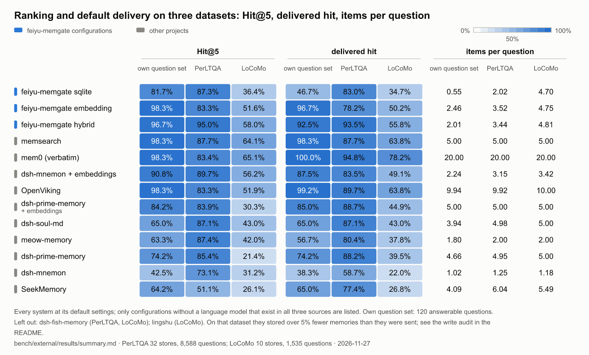
  </picture>
</p>

- **The same system ranks differently on the three datasets.** The four vector configurations that share a Hit@5 of 98.3% on the project's own question set (this project's `embedding`, memsearch, mem0 verbatim, OpenViking) are at 83.3% – 87.7% on PerLTQA and at 51.6% – 65.1% on LoCoMo.
- **This project's hybrid configuration ranks highest on PerLTQA (Hit@5 95.0%) and is mid-field on LoCoMo (58.0%).** Among the configurations that ran on every LoCoMo store, the highest is mem0 with LLM extraction (73.7%).
- **LoCoMo is harder for every system.** The configurations that ran on every store have a Hit@5 of 51.1% – 95.0% on PerLTQA and of 21.4% – 73.7% on LoCoMo.

<p align="center">
  <picture>
    <source media="(prefers-color-scheme: dark)" srcset="docs/assets/charts/ext-ranking.en.dark.png">
    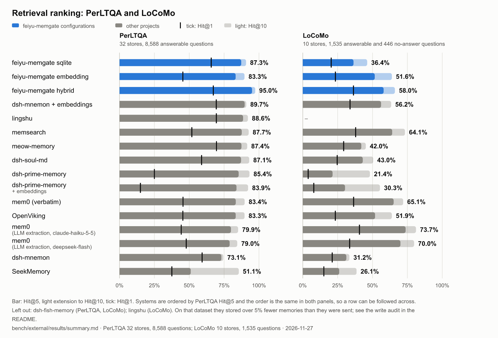
  </picture>
</p>

<p align="center">
  <picture>
    <source media="(prefers-color-scheme: dark)" srcset="docs/assets/charts/ext-delivered.en.dark.png">
    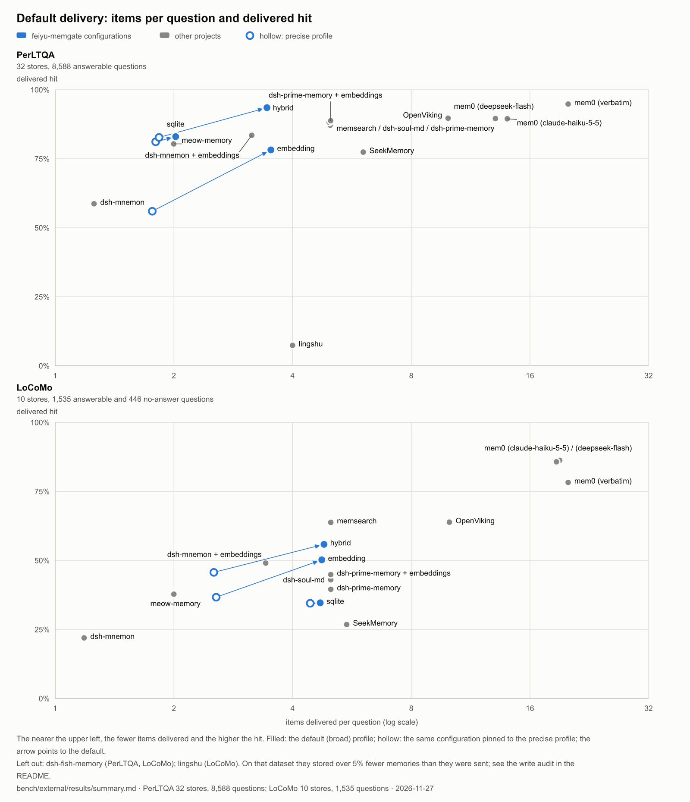
  </picture>
</p>

In the tables below the columns are defined as above. In this project's rows, bold is the default profile (broad) and the row after it is the same configuration pinned to the precise profile; the other systems are ordered by Hit@5, highest first.

#### PerLTQA

**PerLTQA, all 32 stores, 8,588 answerable questions**

| System | Retrieval | Hit@1 | Hit@5 | Hit@10 | Items delivered | Delivered hit | Precision | Delivered F1 | Characters |
|---|---|---:|---:|---:|---:|---:|---:|---:|---:|
| **feiyu-memgate sqlite** | keyword | 65.8% | 87.3% | 90.8% | 2.02 | 83.0% | 54.2% | 65.6% | 748 |
| feiyu-memgate sqlite (precise profile) | keyword | 65.8% | 87.3% | 90.8% | 1.80 | 81.1% | 58.1% | 67.7% | 671 |
| **feiyu-memgate embedding** | vector | 45.4% | 83.3% | 89.7% | 3.52 | 78.2% | 30.1% | 43.5% | 636 |
| feiyu-memgate embedding (bge-m3, precise profile) | vector | 45.4% | 83.3% | 89.7% | 1.76 | 56.0% | 41.6% | 47.7% | 317 |
| **feiyu-memgate hybrid** | hybrid | 67.3% | 95.0% | 97.3% | 3.44 | 93.5% | 35.4% | 51.3% | 862 |
| feiyu-memgate hybrid (precise profile) | hybrid | 67.3% | 95.0% | 97.3% | 1.83 | 82.7% | 57.0% | 67.5% | 498 |
| dsh-mnemon + embeddings | hybrid | 69.4% | 89.7% | 90.9% | 3.15 | 83.5% | 31.5% | 45.8% | 701 |
| lingshu | keyword | 69.4% | 88.6% | 92.1% | 4.00 | 7.4% | 1.9% | 3.0% | 1,473 |
| memsearch | hybrid | 51.9% | 87.7% | 92.6% | 5.00 | 87.7% | 17.5% | 29.2% | 1,165 |
| meow-memory | keyword | 69.5% | 87.4% | 91.6% | 2.00 | 80.4% | 40.3% | 53.6% | 644 |
| dsh-soul-md | keyword | 58.9% | 87.1% | 93.0% | 4.98 | 87.1% | 17.6% | 29.3% | 1,556 |
| dsh-prime-memory | keyword | 25.0% | 85.4% | 93.2% | 4.95 | 88.2% | 17.9% | 29.8% | 1,557 |
| dsh-prime-memory + embeddings | hybrid | 15.0% | 83.9% | 92.2% | 5.00 | 88.7% | 17.8% | 29.6% | 1,389 |
| mem0 (verbatim) | vector | 45.5% | 83.4% | 89.8% | 20.00 | 94.8% | 4.7% | 9.0% | 3,827 |
| OpenViking | vector | 45.4% | 83.3% | 89.7% | 9.92 | 89.7% | 9.2% | 16.6% | 1,873 |
| mem0 (LLM extraction, claude-haiku-5-5) | extraction | 44.3% | 79.9% | 85.0% | 14.02 | 89.5% | 6.7% | 12.5% | 3,882 |
| mem0 (LLM extraction, deepseek-flash) | extraction | 47.9% | 79.0% | 84.4% | 13.08 | 89.5% | 7.4% | 13.6% | 3,576 |
| dsh-mnemon | keyword | 59.2% | 73.1% | 74.4% | 1.25 | 58.7% | 49.5% | 53.7% | 466 |
| dsh-fish-memory | keyword | 34.6% | 60.2% | 62.5% | 1.52 | 45.3% | 31.1% | 36.9% | 544 |
| SeekMemory | keyword | 37.6% | 51.1% | 85.5% | 6.04 | 77.4% | 15.3% | 25.5% | 633 |

1. **The hybrid configuration ranks highest, and its default delivery is close to the systems that hand over everything.** `hybrid` has a Hit@5 of 95.0%; the other configurations that ran on every store are between 51.1% and 89.7%. By default it delivers 3.44 items per question with a delivered hit of 93.5%; the only higher delivered hit is mem0 verbatim, which delivers 20 items per question (94.8%).
2. **The keyword configuration, which uses no model at all, is enough here.** `sqlite` has a Hit@5 of 87.3%, delivers 2.02 items per question, with a delivered hit of 83.0% and a precision of 54.2%. The 7 configurations with the highest Hit@1 all use a keyword signal (58.9% – 69.5%), and the three that use vectors only (this project's `embedding`, OpenViking, mem0 verbatim) are all at 45.4% – 45.5%.
3. **The trade-off between the two profiles points the same way as on the project's own data.** Moving `hybrid` from the precise profile to the default raises the delivered hit from 82.7% to 93.5% and the items per question from 1.83 to 3.44, and lowers precision from 57.0% to 35.4%.
4. **Extraction by a language model did not improve mem0's retrieval ranking.** mem0 with LLM extraction has a Hit@5 of 79.0% – 79.9%, mem0 verbatim 83.4%.

#### LoCoMo

**LoCoMo, all 10 stores, 1,535 answerable questions**

| System | Retrieval | Hit@1 | Hit@5 | Hit@10 | Items delivered | Delivered hit | Precision | Delivered F1 | Characters | Quiet rate |
|---|---|---:|---:|---:|---:|---:|---:|---:|---:|---:|
| **feiyu-memgate sqlite** | keyword | 20.4% | 36.4% | 46.2% | 4.70 | 34.7% | 9.1% | 14.4% | 1,273 | 0.0% |
| feiyu-memgate sqlite (precise profile) | keyword | 20.4% | 36.4% | 46.2% | 4.43 | 34.5% | 10.9% | 16.5% | 1,201 | 0.4% |
| **feiyu-memgate embedding** | vector | 23.4% | 51.6% | 63.9% | 4.75 | 50.2% | 12.6% | 20.1% | 535 | 0.2% |
| feiyu-memgate embedding (bge-m3, precise profile) | vector | 23.4% | 51.6% | 63.9% | 2.56 | 36.7% | 21.4% | 27.0% | 293 | 10.8% |
| **feiyu-memgate hybrid** | hybrid | 36.4% | 58.0% | 66.1% | 4.81 | 55.8% | 13.3% | 21.5% | 953 | 0.0% |
| feiyu-memgate hybrid (precise profile) | hybrid | 36.4% | 58.0% | 66.1% | 2.53 | 45.7% | 29.0% | 35.5% | 501 | 18.4% |
| mem0 (LLM extraction, claude-haiku-5-5) | extraction | 40.7% | 73.7% | 81.2% | 19.04 | 86.3% | 5.8% | 10.8% | 3,058 | 0.0% |
| mem0 (LLM extraction, deepseek-flash) | extraction | 33.6% | 70.0% | 79.8% | 18.68 | 85.7% | 5.8% | 10.8% | 2,917 | 0.0% |
| mem0 (verbatim) | vector | 36.5% | 65.1% | 72.0% | 20.00 | 78.2% | 4.7% | 8.9% | 2,588 | 0.0% |
| memsearch | hybrid | 37.9% | 64.1% | 73.3% | 5.00 | 63.8% | 13.9% | 22.8% | 689 | 0.0% |
| dsh-mnemon + embeddings | hybrid | 33.9% | 56.2% | 63.4% | 3.42 | 49.1% | 16.5% | 24.7% | 432 | 0.0% |
| OpenViking | vector | 23.3% | 51.9% | 63.8% | 10.00 | 63.8% | 7.1% | 12.8% | 1,124 | 0.0% |
| dsh-soul-md | keyword | 24.7% | 43.0% | 50.5% | 5.00 | 43.0% | 9.1% | 15.0% | 968 | 0.0% |
| meow-memory | keyword | 29.3% | 42.0% | 45.2% | 2.00 | 37.8% | 19.2% | 25.5% | 302 | 0.0% |
| lingshu | keyword | 20.1% | 33.7% | 38.7% | 4.00 | 1.7% | 0.4% | 0.7% | 773 | 0.0% |
| dsh-fish-memory | keyword | 17.2% | 31.4% | 34.7% | 3.32 | 28.4% | 10.5% | 15.3% | 633 | 0.4% |
| dsh-mnemon | keyword | 21.1% | 31.2% | 33.4% | 1.18 | 22.0% | 18.5% | 20.1% | 225 | 0.0% |
| dsh-prime-memory + embeddings | hybrid | 7.9% | 30.3% | 55.4% | 5.00 | 44.9% | 9.4% | 15.6% | 639 | 0.0% |
| SeekMemory | keyword | 15.1% | 26.1% | 38.6% | 5.49 | 26.8% | 6.0% | 9.8% | 524 | 0.0% |
| dsh-prime-memory | keyword | 3.8% | 21.4% | 48.1% | 5.00 | 39.5% | 8.2% | 13.5% | 658 | 0.0% |

1. **This project is mid-field on this dataset.** `hybrid` has a Hit@5 of 58.0%, below mem0 (verbatim 65.1%, LLM extraction 70.0% – 73.7%) and memsearch (64.1%).
2. **The default delivery also hits less often than the systems that deliver more.** `hybrid` delivers 4.81 items per question with a delivered hit of 55.8%; mem0 delivers about 19 – 20 items with 78.2% – 86.3%; memsearch with 5 items and OpenViking with 10 are both at 63.8%.
3. **The thresholds of the default profile do almost nothing here.** This project's default profile delivers 4.70 – 4.81 items per question, close to the cap of 5; on the 446 questions with no answer its quiet rate is 0.0% – 0.2%, and 0.4% – 18.4% with the precise profile. On the project's own data the default profile's quiet rate is 32.5% – 70.0%. The thresholds were chosen on a development set of short Chinese sentences and do not separate answerable from unanswerable questions on LoCoMo. The other systems have a quiet rate of 0.0% – 2.1% on these questions.
4. **Keyword retrieval is low across the board on this dataset.** The keyword-only configurations have a Hit@5 between 21.4% and 43.0%; this project's `sqlite` is at 36.4%. The configurations with vectors are all at 51.6% or above, except dsh-prime-memory with vectors (30.3%).
5. **Extraction by a language model raised mem0's ranking here.** mem0 with LLM extraction is 4.9 – 8.6 points of Hit@5 above mem0 verbatim.

<p align="center">
  <picture>
    <source media="(prefers-color-scheme: dark)" srcset="docs/assets/charts/ext-thresholds.en.dark.png">
    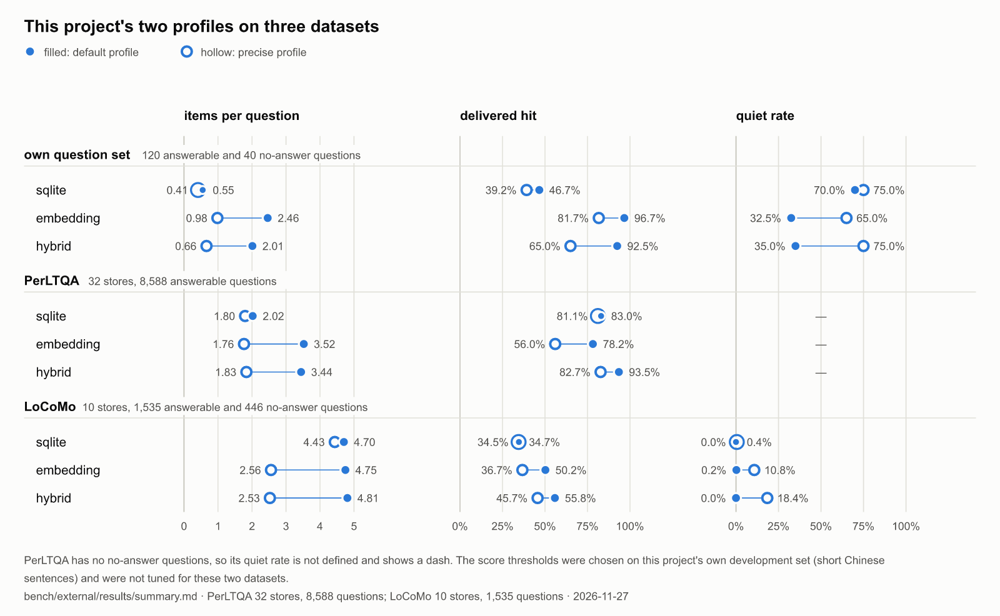
  </picture>
</p>

#### By question type

<p align="center">
  <picture>
    <source media="(prefers-color-scheme: dark)" srcset="docs/assets/charts/ext-by-type.en.dark.png">
    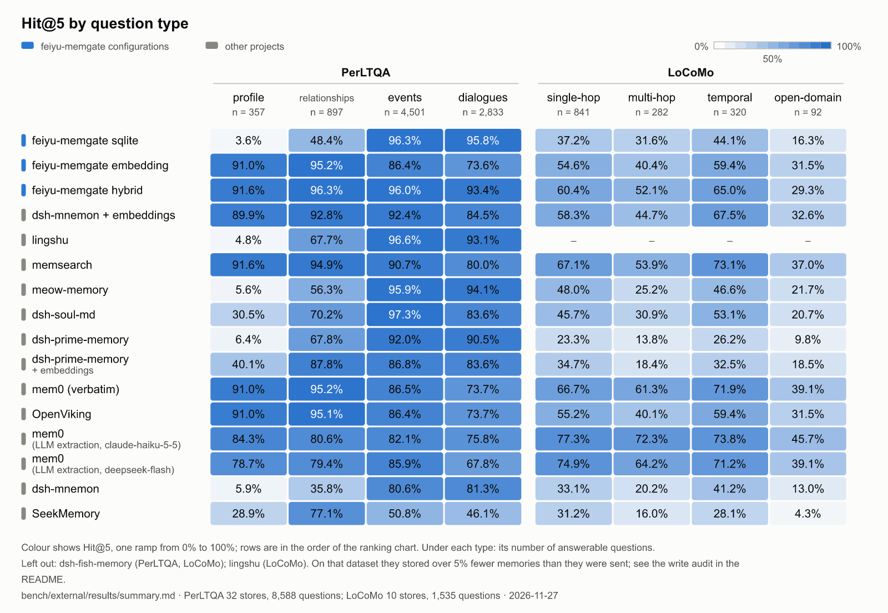
  </picture>
</p>

The figures of the chart are also in the by-type tables of [bench/external/results/summary.md](bench/external/results/summary.md).

- **The profile questions of PerLTQA separate keyword from vector.** There are 357 of them. The keyword-only configurations have a Hit@5 of 0.3% – 30.5%, this project's `sqlite` 3.6%; the configurations with vectors are all at 78.7% or above (89.9% – 91.6% for those without model extraction), except dsh-prime-memory with vectors (40.1%).
- **The event and dialogue questions go the other way.** On the event questions (4,501) and the dialogue questions (2,833), `sqlite` is at 96.3% and 95.8%, and the vector-only `embedding` at 86.4% and 73.6%.
- **The hybrid configuration is the only one above 91% on all four PerLTQA types** (91.6%, 96.3%, 96.0%, 93.4%).
- **On all four LoCoMo types this project's `hybrid` is below mem0.** It is 6.3 – 9.8 points below mem0 verbatim and 6.2 – 20.2 points below mem0 with LLM extraction; the largest gap is on the multi-hop questions (52.1% against 72.3%).
- **The open-domain questions are the hardest for every system.** There are only 92 of them; the configurations have a Hit@5 of 4.3% – 45.7%, and `hybrid` 29.3%.

#### Configurations run on a sample

<p align="center">
  <picture>
    <source media="(prefers-color-scheme: dark)" srcset="docs/assets/charts/ext-samples.en.dark.png">
    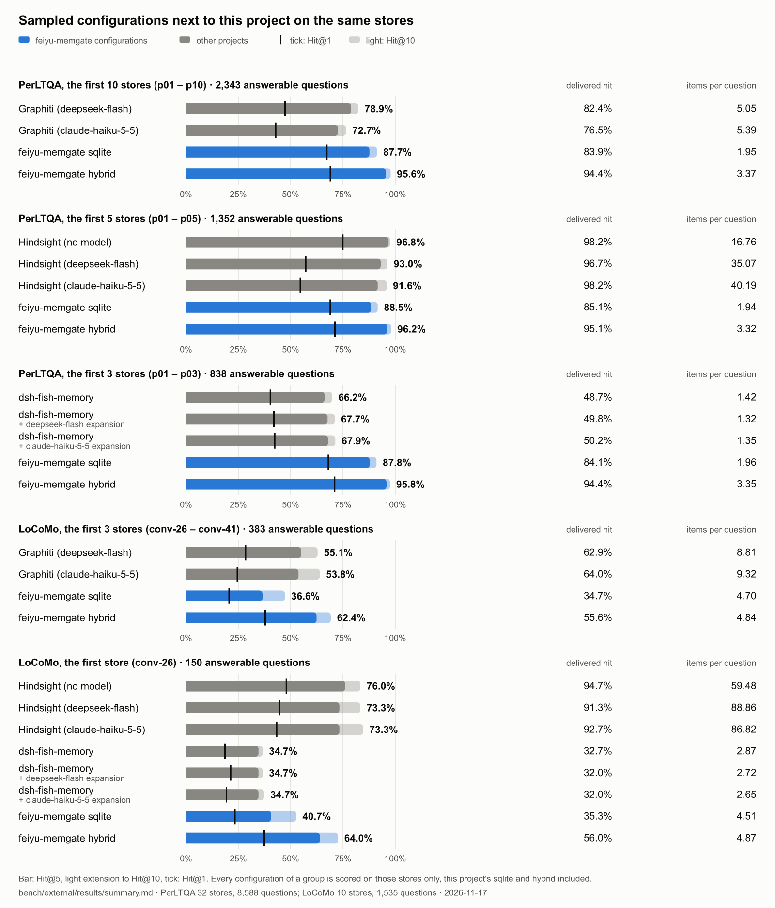
  </picture>
</p>

**PerLTQA, the first 10 stores (p01 – p10), 2,343 answerable questions**

| System | Retrieval | Hit@1 | Hit@5 | Hit@10 | Items delivered | Delivered hit | Precision | Delivered F1 | Characters |
|---|---|---:|---:|---:|---:|---:|---:|---:|---:|
| Graphiti (deepseek-flash) | graph | 47.3% | 78.9% | 82.4% | 5.05 | 82.4% | 25.1% | 38.5% | 1,101 |
| Graphiti (claude-haiku-5-5) | graph | 42.9% | 72.7% | 76.5% | 5.39 | 76.5% | 22.8% | 35.1% | 1,023 |
| **feiyu-memgate sqlite** | keyword | 67.3% | 87.7% | 91.3% | 1.95 | 83.9% | 55.9% | 67.1% | 711 |
| **feiyu-memgate hybrid** | hybrid | 69.0% | 95.6% | 97.8% | 3.37 | 94.4% | 36.2% | 52.3% | 832 |

**PerLTQA, the first 5 stores (p01 – p05), 1,352 answerable questions**

| System | Retrieval | Hit@1 | Hit@5 | Hit@10 | Items delivered | Delivered hit | Precision | Delivered F1 | Characters |
|---|---|---:|---:|---:|---:|---:|---:|---:|---:|
| Hindsight (no model) | hybrid | 74.9% | 96.8% | 97.6% | 16.76 | 98.2% | 6.8% | 12.7% | 2,709 |
| Hindsight (deepseek-flash) | extraction | 57.2% | 93.0% | 96.3% | 35.07 | 96.7% | 2.9% | 5.6% | 10,268 |
| Hindsight (claude-haiku-5-5) | extraction | 54.7% | 91.6% | 95.9% | 40.19 | 98.2% | 2.6% | 5.0% | 11,772 |
| **feiyu-memgate sqlite** | keyword | 68.9% | 88.5% | 91.6% | 1.94 | 85.1% | 56.7% | 68.1% | 724 |
| **feiyu-memgate hybrid** | hybrid | 71.2% | 96.2% | 98.0% | 3.32 | 95.1% | 37.2% | 53.5% | 848 |

**PerLTQA, the first 3 stores (p01 – p03), 838 answerable questions**

| System | Retrieval | Hit@1 | Hit@5 | Hit@10 | Items delivered | Delivered hit | Precision | Delivered F1 | Characters |
|---|---|---:|---:|---:|---:|---:|---:|---:|---:|
| dsh-fish-memory | keyword | 40.3% | 66.2% | 69.8% | 1.42 | 48.7% | 35.8% | 41.2% | 531 |
| dsh-fish-memory + deepseek-flash expansion | keyword | 42.0% | 67.7% | 71.1% | 1.32 | 49.8% | 38.9% | 43.6% | 491 |
| dsh-fish-memory + claude-haiku-5-5 expansion | keyword | 42.4% | 67.9% | 71.4% | 1.35 | 50.2% | 38.5% | 43.6% | 496 |
| **feiyu-memgate sqlite** | keyword | 68.0% | 87.8% | 91.1% | 1.96 | 84.1% | 55.8% | 67.1% | 753 |
| **feiyu-memgate hybrid** | hybrid | 71.0% | 95.8% | 97.5% | 3.35 | 94.4% | 36.1% | 52.3% | 878 |

**LoCoMo, the first 3 stores (conv-26 – conv-41), 383 answerable questions**

| System | Retrieval | Hit@1 | Hit@5 | Hit@10 | Items delivered | Delivered hit | Precision | Delivered F1 | Characters | Quiet rate |
|---|---|---:|---:|---:|---:|---:|---:|---:|---:|---:|
| Graphiti (deepseek-flash) | graph | 28.5% | 55.1% | 62.9% | 8.81 | 62.9% | 8.4% | 14.7% | 1,548 | 0.0% |
| Graphiti (claude-haiku-5-5) | graph | 24.5% | 53.8% | 64.0% | 9.32 | 64.0% | 7.9% | 14.1% | 1,498 | 0.0% |
| **feiyu-memgate sqlite** | keyword | 20.6% | 36.6% | 47.3% | 4.70 | 34.7% | 9.3% | 14.7% | 1,285 | 0.0% |
| **feiyu-memgate hybrid** | hybrid | 37.9% | 62.4% | 69.2% | 4.84 | 55.6% | 12.4% | 20.3% | 1,013 | 0.0% |

**LoCoMo, the first store (conv-26), 150 answerable questions**

| System | Retrieval | Hit@1 | Hit@5 | Hit@10 | Items delivered | Delivered hit | Precision | Delivered F1 | Characters | Quiet rate |
|---|---|---:|---:|---:|---:|---:|---:|---:|---:|---:|
| Hindsight (no model) | hybrid | 48.0% | 76.0% | 83.3% | 59.48 | 94.7% | 2.0% | 3.9% | 8,989 | 0.0% |
| Hindsight (deepseek-flash) | extraction | 44.7% | 73.3% | 83.3% | 88.86 | 91.3% | 1.3% | 2.6% | 15,298 | 0.0% |
| Hindsight (claude-haiku-5-5) | extraction | 43.3% | 73.3% | 84.7% | 86.82 | 92.7% | 1.4% | 2.8% | 14,995 | 0.0% |
| dsh-fish-memory | keyword | 18.7% | 34.7% | 36.7% | 2.87 | 32.7% | 13.9% | 19.5% | 594 | 2.1% |
| dsh-fish-memory + deepseek-flash expansion | keyword | 21.3% | 34.7% | 36.7% | 2.72 | 32.0% | 13.6% | 19.1% | 556 | 2.1% |
| dsh-fish-memory + claude-haiku-5-5 expansion | keyword | 19.3% | 34.7% | 37.3% | 2.65 | 32.0% | 14.3% | 19.8% | 544 | 2.1% |
| **feiyu-memgate sqlite** | keyword | 23.3% | 40.7% | 52.7% | 4.51 | 35.3% | 10.4% | 16.1% | 1,298 | 0.0% |
| **feiyu-memgate hybrid** | hybrid | 37.3% | 64.0% | 72.7% | 4.87 | 56.0% | 11.8% | 19.5% | 1,022 | 0.0% |

- **Graphiti.** On the first 10 PerLTQA stores its Hit@5 is 72.7% – 78.9%; this project's `hybrid` is at 95.6% on the same stores. On the first 3 LoCoMo stores it is at 53.8% – 55.1% and `hybrid` at 62.4%; it delivers 8.8 – 9.3 items per question with a delivered hit of 62.9% – 64.0%, and `hybrid` delivers 4.84 items with 55.6%.
- **Hindsight.** On the first 5 PerLTQA stores the configuration without a model is level with `hybrid` (Hit@5 96.8% against 96.2%, delivered hit 98.2% against 95.1%) and delivers 16.76 items per question against 3.32. With a model its Hit@1 is 54.7% – 57.2%, without one 74.9%; with a model it delivers 35 – 40 items per question, about 10,000 – 12,000 characters, with a delivered hit of 96.7% – 98.2%. On the first LoCoMo store its three configurations have a Hit@5 of 73.3% – 76.0% and `hybrid` 64.0%; it delivers 59 – 89 items per question with a delivered hit of 91.3% – 94.7%, and `hybrid` delivers 4.87 items with 56.0%.
- **The dsh-fish-memory expansion.** On the first 3 PerLTQA stores it moves Hit@5 from 66.2% to 67.7% – 67.9%; on the first LoCoMo store it leaves Hit@5 unchanged (34.7%).
- The samples are small: the first LoCoMo store has only 150 answerable questions, so one question is about 0.7 points.

#### Model usage and cost

What the configurations that call a language model used while writing, counted from the token numbers the API returned and priced at the two providers' list prices ([bench/external/prices.json](bench/external/prices.json), prices of 2026-11-16; deepseek-flash at the peak or off-peak rate of the window each call was made in). This project's configurations call no language model, so this item is zero for them.

<p align="center">
  <picture>
    <source media="(prefers-color-scheme: dark)" srcset="docs/assets/charts/ext-cost.en.dark.png">
    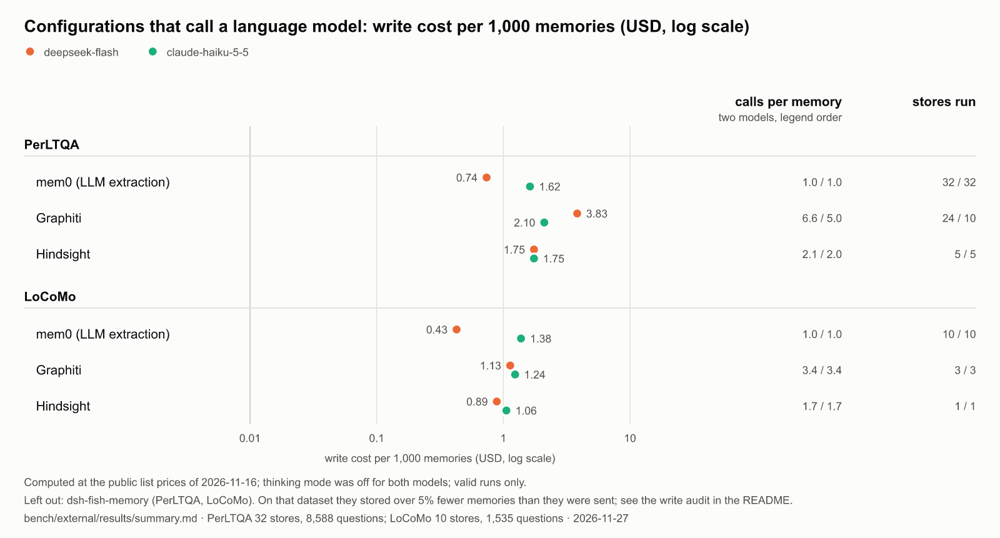
  </picture>
</p>

**LLM usage**

| System | Dataset | Stores | Memories | Calls | Input tokens (of which cache hits) | Output tokens | Cost (USD) | Per 1,000 memories (USD) | Write time (s per memory) |
|---|---|---:|---:|---:|---:|---:|---:|---:|---:|
| dsh-fish-memory + claude-haiku-5-5 expansion | PerLTQA | 3 | 225 | 100 | 152,190 (0) | 18,074 | 0.024 | 0.11 | 0.8 |
| dsh-fish-memory + deepseek-flash expansion | PerLTQA | 3 | 225 | 80 | 65,259 (29,184) | 3,040 | 0.007 | 0.03 | 0.4 |
| Graphiti (claude-haiku-5-5) | PerLTQA | 10 | 664 | 3,347 | 11,144,644 (0) | 564,289 | 1.397 | 2.10 | 5.4 |
| Graphiti (deepseek-flash) | PerLTQA | 24 | 1,589 | 10,553 | 17,996,457 (1,879,415) | 1,035,447 | 6.089 | 3.83 | 6.0 |
| Hindsight (claude-haiku-5-5) | PerLTQA | 5 | 361 | 716 | 7,047,823 (3,646,443) | 506,158 | 0.630 | 1.75 | 3.5 |
| Hindsight (deepseek-flash) | PerLTQA | 5 | 361 | 747 | 5,175,865 (2,749,056) | 429,449 | 0.630 | 1.75 | 3.4 |
| mem0 (LLM extraction, claude-haiku-5-5) | PerLTQA | 32 | 2,155 | 2,155 | 32,527,632 (0) | 489,304 | 3.497 | 1.62 | 1.9 |
| mem0 (LLM extraction, deepseek-flash) | PerLTQA | 32 | 2,155 | 2,155 | 20,000,381 (16,344,832) | 328,494 | 1.589 | 0.74 | 1.8 |
| dsh-fish-memory + claude-haiku-5-5 expansion | LoCoMo | 1 | 419 | 79 | 69,572 (0) | 3,851 | 0.009 | 0.02 | 0.2 |
| dsh-fish-memory + deepseek-flash expansion | LoCoMo | 1 | 419 | 77 | 43,549 (29,312) | 1,580 | 0.003 | 0.01 | 0.2 |
| Graphiti (claude-haiku-5-5) | LoCoMo | 3 | 1,451 | 4,955 | 14,865,175 (0) | 619,415 | 1.796 | 1.24 | 4.2 |
| Graphiti (deepseek-flash) | LoCoMo | 3 | 1,451 | 5,001 | 8,463,882 (839,296) | 326,362 | 1.645 | 1.13 | 3.8 |
| Hindsight (claude-haiku-5-5) | LoCoMo | 1 | 419 | 697 | 6,566,072 (3,558,585) | 214,131 | 0.443 | 1.06 | 1.6 |
| Hindsight (deepseek-flash) | LoCoMo | 1 | 419 | 696 | 4,312,975 (2,438,400) | 138,612 | 0.372 | 0.89 | 1.4 |
| mem0 (LLM extraction, claude-haiku-5-5) | LoCoMo | 10 | 5,882 | 5,882 | 79,031,305 (0) | 404,502 | 8.105 | 1.38 | 1.2 |
| mem0 (LLM extraction, deepseek-flash) | LoCoMo | 10 | 5,882 | 5,882 | 50,523,528 (44,444,800) | 355,384 | 2.517 | 0.43 | 1.3 |

- Only valid runs are in the table. They add up to 12.85 USD (deepseek-flash) and 15.90 USD (claude-haiku-5-5); debugging, interrupted and failed runs cost more and are not counted.
- mem0 makes one model call per memory written, each with about 9,000 – 15,000 input tokens, because extraction is given the existing memories. Graphiti makes about 3 – 7 calls per memory.
- The cost per 1,000 memories is between 0.43 and 3.83 USD (0.11 USD or less for the dsh-fish-memory expansion). "Write time" was measured while several stores ran in parallel and shows the order of magnitude only.
- Cache writes of claude-haiku-5-5 are priced here at the normal input rate; the provider bills them at a higher cache-write rate, so the Hindsight row that uses the cache is slightly underestimated.
- Graphiti with deepseek-flash ran on 24 PerLTQA stores, of which the comparison uses the first 10; the table shows the usage of all 24.

#### Latency

<p align="center">
  <picture>
    <source media="(prefers-color-scheme: dark)" srcset="docs/assets/charts/ext-latency.en.dark.png">
    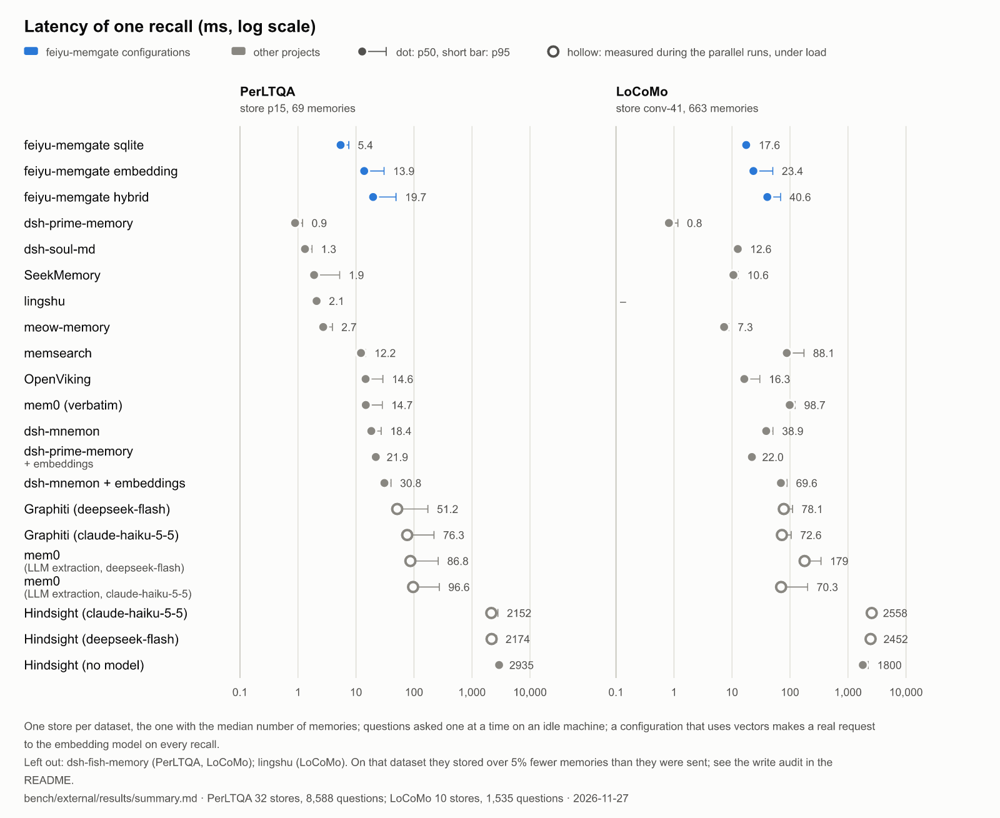
  </picture>
</p>

Latency is the time of one recall, from sending the question to receiving what is delivered, in milliseconds. For each dataset the store with the median number of memories was used (PerLTQA `p15`, 69 memories and 214 questions; LoCoMo `conv-41`, 663 memories and 193 questions), with the questions asked one at a time on a machine doing nothing else. Configurations that use vectors make a real request to the embedding model on every recall (bge-m3, running on the GPU), and that request is part of the latency.

- The median latency of this project's three configurations is 5 – 20 ms on PerLTQA and 18 – 41 ms on LoCoMo. `sqlite` takes 5.4 ms and 17.6 ms; the 7 other keyword-only configurations take 0.6 – 18.4 ms on PerLTQA and 0.8 – 38.9 ms on LoCoMo, and 6 of them are faster than it on both datasets.
- Among the systems with vectors, this project's `embedding` and `hybrid` take 14 – 20 ms on PerLTQA and 23 – 41 ms on LoCoMo; the other systems, Hindsight aside, take 12 – 31 ms and 16 – 99 ms.
- Hindsight has a median latency of 1.8 – 2.9 seconds, two orders of magnitude above the other systems.
- Rebuilding the store of a configuration that calls a language model would cost its fee again, so these were not measured separately; the table shows their figures from the parallel runs, which give the order of magnitude only.
- The two profiles differ by less than 2 ms (5 ms for `hybrid` on LoCoMo).

The p50 and p95 of every configuration are in the latency table of [bench/external/results/summary.md](bench/external/results/summary.md).

#### Limits of this section

- Only retrieval and delivery were measured, not the quality of the final answer. Systems that extract facts or write summaries deliver something other than the original text, and how much that helps the answer may not match "is the labelled memory among the delivered items".
- LoCoMo is English. This project's thresholds and its keyword backend were developed on Chinese data and were not adjusted for English in any way.
- Every language model ran with thinking mode off; the results do not show how the projects do at the models' default settings.
- dsh-prime-memory shortens a memory over 500 characters when it injects it; a shortened item counts as that memory delivered, and its characters are counted as injected (about 13% – 16% of its delivered items on PerLTQA, none on LoCoMo).
- With a model, Hindsight delivers observations written by the model; an observation counts as a memory only when it can be traced to its source memory, and as noise when it cannot (about 6% – 11% of the delivered items on PerLTQA). The plugin's default reflect injection is a text written by a model and was not measured.
- LongMemEval-S was downloaded too but is not part of the comparison: each of its 500 questions has its own store of about 490 memories, and the systems that call a model would need hundreds of hours. The reasons, and one run of this project's keyword configuration, are in [bench/external/README.md](bench/external/README.md).
- The adapters were written by this project. Bias cannot be ruled out entirely; corrections from the projects' authors are welcome.

## Characteristics and trade-offs of each project

Each project is written in the same format: what it is, the strengths that were measured, and the costs that were measured or stated in its documentation. The numbers come from the tests above. The mechanisms come from the source code of each project's tested version and from its own documentation. Items marked "inferred" were read from the code and not measured. This project is written first, to the same standard.

### Prompt placement, caching and background calls

Model providers bill a repeated prompt prefix at a low price. So content that changes on every turn and sits early in the prompt keeps everything after it from hitting the cache. Another kind of cost is the model calls that a memory system starts by itself in the background. Neither shows up in the retrieval metrics, so they are listed separately:

| Project | Put into the prompt without a model request | Position | Changes every turn | Background model calls and limits |
|---|---|---|---|---|
| feiyu-memgate 0.1.0 | The recalled data block, fixed format, no current time | Recommended: appended to the end of the current message and kept out of history; the integrator decides. The default broad profile delivers more items per turn, so context grows faster when the block stays in the history | Varies with the question; placed as recommended, it affects only the end | None |
| memsearch 0.4.23 (DSH plugin 0.1.8) | A fixed retrieval hint, with no memory content | After this turn's message | No | The plugin summarizes the conversation with a model once per turn by default; no per-session limit on the count was found |
| mem0 2.2.1 | None; the application assembles the prompt | – | – | Each default write calls a model once |
| OpenViking v0.5.3 | Not checked | Not checked | Not checked | Extracts with a model when a session is committed |
| Graphiti 0.31.2 | None; the caller assembles the prompt | – | – | Every write needs a model (measured at about 2.5 calls per item) |
| SeekMemory (794ec5d) | Recalled content, capped at 600 characters; a persona block | Before this turn's message (inferred); the persona is in the host context | Recall varies with the question; the persona rarely changes | Extraction at most 2 times per day; nightly consolidation at most 12 calls and 60,000 tokens per night |
| dsh-mnemon 0.5.45 | A fixed protocol description; a snapshot of runtime memory | The protocol is in the system prompt; the snapshot is appended after the current message and stays in history | No; a new snapshot is appended only when memory changes | Idle review is on by default: at least 5 minutes apart, at most 20 per session, uses the main model, and the count resets on restart by default |
| lingshu 0.10.1 | A window of the 4 most recent memories and the 10 most recent messages | The host's context block, appended only when the content changes | Probably yes (inferred: the window refers to the most recent messages) | Off by default |
| meow-memory 0.32.6 | Fixed usage guidance; a snapshot before the first message; the top 2 keyword matches before every message | The guidance is in the system prompt; the rest is before the current message | Matches vary with the question; only appended, not repeated | Reflection: one extra round after 7 consecutive tool-call steps. Consolidation: at most once per time window, 6-hour cooldown, uses the main model |

The host program assembles the final prompt. What this table verified is what each plugin hands to the host and what its own documentation says. The host-side code was not read. None of the projects has published measured cache hit rate data, and this project did not measure it either. The prompt placement of the four projects added later (dsh-fish-memory, dsh-prime-memory, dsh-soul-md, Hindsight) was not verified in the way this table requires, so they are not listed. Two background model calls are known: dsh-fish-memory expands keywords after each write (each call asks for words for up to two memories that have none yet; 121 calls for 240 writes), and the Hindsight server extracts facts and consolidates observations at write time.

### feiyu-memgate (this project)

A gateway layer outside storage and retrieval. Retrieval is left to the backend.

- **Strengths**
  - More complete delivery by default (broad profile): the vector and hybrid configurations deliver about 1.5 – 2.5 items per question with a delivered hit of 90.8% – 96.7%, and the vector backend delivers 92.7% on paraphrase questions. For few and accurate items, write `[recall] profile = "precise"`: about 0.4 – 1.2 items per question, precision of 80.2% – 93.0%, and nothing delivered in 40.0% – 75.0% of the cases where there is no answer.
  - Writes call no LLM, and there are no background model calls. The keyword tier needs no service.
  - Access policy, rate limits, the daily write cap, redaction, and the distinction between failure and empty result are enforced by the gateway in one place. The chat program never gets the store keys.
  - The retrieval backend, the recall stages and the threshold profiles can all be replaced. There are measured data for six tiers, from no model to a 1.16 GB model.
  - When both the newer and the older memory are delivered, the newer one comes first (15/15 for the vector configuration with the precise profile; 16/20 for the default broad profile, see "Order of newer and older facts" above).
- **Costs**
  - The default broad profile delivers noisier items: precision of 56.9% – 75.9% for the vector and hybrid configurations, 60.0% – 67.5% of the questions with no answer get something (quiet rate 32.5% – 40.0%), 1.5 – 2.5 items per question, and about 1.3 – 3.1 times the context of the precise profile. Switching to `profile = "precise"` gives the previous behavior, at the cost of missed answers: a delivered hit of 39.2% – 87.5%; on paraphrase questions the vector backend delivers only 69.1%, the hybrid backend 34.5%, and the keyword backend 0.0%.
  - Retrieval itself is not better than that of systems using the same model. Hit@1 is lower than memsearch.
  - It stores original text only, with no extraction, merging or rewriting. An old fact is not invalidated, only ranked later.
  - It is a service or library that you have to integrate yourself, not a plugin that works once installed.
  - Where the memory block goes is decided by the integrator. The bundled AstrBot example attaches it to the current message as a temporary part that is not kept in the history. When the host does not support temporary parts, it falls back to appending the block to the text of the current message: the system prompt and the earlier history still do not change, but the block stays in the history with that message, so the context grows.
  - The vector backend is a brute-force scan. Only a few hundred items were tested here, and latency will grow linearly at larger scale. This version, after the rework into a framework, has not yet run in production for a long time.

### [memsearch](https://github.com/zilliztech/memsearch)

Memory is Markdown files, and the index can be rebuilt at any time. Hybrid retrieval of vector plus BM25.

- **Strengths**: The best ranking in this test (Hit@1 85.0%, Hit@5 98.3%, and the correct memory is always within the top 8). People can read and edit the memory directly and put it in git. It puts no memory content into the prompt, only a fixed hint, so the cache is not affected.
- **Costs**: No score threshold or character budget. It delivers the top 5 (precision 19.7%, quiet rate 0%). Whether retrieval happens depends on whether the model calls it. The DSH plugin summarizes the conversation with a model once per turn by default. No forgetting or decay.

### [mem0](https://github.com/mem0ai/mem0)

A library that, by default, uses an LLM at write time to extract the conversation into separate facts.

- **Strengths**: Extraction turns colloquial speech into facts (240 memories give 248 facts) and resolves names and dates. In verbatim mode, ranking matches memsearch and OpenViking, which also use bge-m3 (Hit@5 98.3%). It supports a per-item expiry date.
- **Costs**: The default write calls a model once per item (240 items take about 2.06 million tokens, 0.53 CNY and 471 seconds of ingest). Extraction mode ranks slightly lower (Hit@1 77.5%, Hit@5 95.0%). It returns 20 items with score threshold 0.1 by default, and measured about 20 items per question at precision 5%. Its BM25 and entity parts depend on English models and do not work for Chinese. The application assembles the prompt itself.

### [OpenViking](https://github.com/volcengine/OpenViking)

A standalone memory service. It extracts with a model when a session is committed, and retrieves by vector.

- **Strengths**: Ranking is level with memsearch and mem0, which also use bge-m3 (Hit@5 98.3%). The service form can be shared by several programs. Connected behind this project's gateway, it is the combination with the highest delivered F1 in this test (82.7% with the default broad profile, 83.7% with the precise profile).
- **Costs**: The API returns 10 items by default with no score threshold (precision 9.9%, quiet rate 0%). The index is asynchronous, and after 240 items are written it takes about 70 seconds before they can be retrieved. The normal write path needs model extraction, which was not tested here. The service and the vector model have to be deployed separately. The default behavior of its DSH plugin was not verified.

### [Graphiti](https://github.com/getzep/graphiti)

A temporal knowledge graph: it uses an LLM to extract entities and time-stamped facts, and retrieves over the facts.

- **Strengths**: It handles "fact superseded" explicitly: an old fact is marked invalid instead of coexisting. Facts carry time. It has a cosine floor, and delivers nothing in 82.5% of the cases where there is no answer.
- **Costs**: Nothing can be written without an LLM, and it was measured at about 2.5 calls per item (240 items take about 1.18 million tokens, about 2 CNY and 22 minutes). This run used a stack it does not recommend (embedded Kuzu plus a small model) and extracted only 69 fact edges. Hit@5 is 13.3%, which does not represent its performance on the recommended setup.

### [SeekMemory](https://github.com/NeverENG/SeekMemory)

A host-independent kernel plus adapters. BM25 plus graph activation. A full lifecycle with reinforcement, decay and reversible forgetting.

- **Strengths**: It reinforces a memory only when a reply actually used it, fully automatic. It discloses in grades by degree of fit. The injection on each turn has a hard cap of 600 characters and an evidence threshold (quiet rate 22.5%). Background consolidation has explicit limits. Latency 2 ms.
- **Costs**: No vector retrieval: paraphrase questions 32.7%, Hit@5 64.2%, precision 17.2%. Normal writes depend on extraction by the host model, which was bypassed here. The DSH adapter version is 0.0.1.

### [dsh-mnemon](https://github.com/omdsh-dev/dsh-mnemon)

A DSH plugin. Two mechanisms: runtime memory provided automatically with the conversation, and Memory Spaces recalled by a model call (keyword plus entities plus graph signals, vector optional).

- **Strengths**: Memory Spaces have their own score thresholds and admission rules, and deliver only 1 to 2 items per question by default (1.02 in the default mode, 2.24 with vectors turned on); meow-memory (1.80) and dsh-fish-memory (about 2) are in the same range. With vectors turned on, Hit@5 is 90.8% and delivered F1 is 53.6%, the highest among the other projects. The current version was designed specifically to keep the cached prefix stable: the system prompt does not change when memory is written, and when memory changes a new snapshot is appended after the conversation. Idle review has an interval and a count limit.
- **Costs**:
  - In the default mode (vectors off) Hit@5 is 42.5% and paraphrase questions 10.9%. Results vary by about ±5 percentage points between runs. Quiet rate 0%.
  - Idle review is on by default, uses the main model, and its count resets on restart by default. The discussion of cost in its public feedback centers on this item.
  - When memory changes, the whole snapshot is appended, not a diff. One consolidation runs on a correction, on a deletion, or when the accumulated snapshots reach 5. The conversation after the consolidation point has to be billed once more as uncached. How often this consolidation happens in a long session has no published measurement.
  - Earlier versions (0.2.4 and before, 0.3.2 to 0.3.5, 0.5.7 and before) had a problem where writes invalidated the cached prefix. It was fixed in 0.2.5, 0.3.6 and 0.5.8 respectively. The project itself states that it has no measured cache hit rate data.
  - With vectors turned on, latency is 78 ms, higher than this project's vector configurations (24 – 33 ms) and lower than Hindsight without a model (455 ms).

### [lingshu (dsh-memory)](https://github.com/FuRongJun-1999/dsh-memory)

A DSH plugin. Write gating, deduplication and indexing are all rule-based code. BM25 retrieval. Memory is ordinary files.

- **Strengths**: Writes call no model, and background maintenance is off by default. When retrieving by question, its ranking is the best among the keyword systems (Hit@5 81.7%, level with this project's keyword backend). Writes have a gate (accept, merge, discard, defer) and a rate limit, and injection has a character cap. Latency 2 ms.
- **Costs**: What it injects on every turn is the 4 most recent items of the session and the 10 most recent messages, without looking at the question, so its delivered hit by question is 0. Retrieval by question needs the model to call a tool. No vectors: paraphrase questions 63.6%. The injected window refers to the most recent messages and probably differs on every turn, so the context grows with it (inferred). The write rate limit (8 per minute) slows bulk ingest.

### [meow-memory](https://github.com/Phant0Meow/dsh-meow-memory)

A DSH plugin. One SQLite file plus BM25. The host's model writes through a tool and fills in the keywords.

- **Strengths**: Very light to deploy: one SQLite file, with no extra service or model. It injects only 2 items per message, without repeats, at the end of the conversation (just before the current message), and the guidance in the system prompt is fixed. Delivered F1 is 40.0%, the highest among the third-party configurations without vectors (precision 30.9%). 97.8% on lexical questions, latency 2 ms.
- **Costs**: No vectors: paraphrase questions 30.9%, Hit@5 63.3%. No score threshold (quiet rate 10%). Keyword quality depends on how well the model fills them in at write time, and this test used its own tokenizer instead. Background reflection and consolidation use the main model.

### [dsh-fish-memory](https://github.com/Yuuyuko-uu/dsh-fish-memory)

A DSH plugin. A memory is a JSON row in a per-session store (text, time, importance, optional emotion and tags, expansion words). The model writes through a remember tool, there is no search tool, and recall runs and injects automatically every turn.

- **Strengths**: Automatic injection every turn, with a query gate (a message with too little information recalls nothing) and an evidence threshold of 0.30; about 2 items and about 50 characters per question, latency 1 – 2 ms, no service needed. Lexical questions 88.9% – 91.1%. When the newer memory was delivered, the older one came before it on at most 1 question (10/11, 10/11, 9/9). At write time near-duplicates are reinforced, and a row almost identical to a newer one is marked superseded and never recalled.
- **Costs**: It does not understand semantics: paraphrase questions 12.7% (14.5% and 16.4% with expansion), Hit@5 49.2%, delivered hit 47.5% – 48.3%, precision 31.2% – 31.8%. On the quiet questions it speaks up in 67.5% (quiet rate 32.5%). The background keyword expansion uses a model: deepseek-flash and claude-haiku-5-5 made 121 calls each (about 65 thousand and 104 thousand tokens, 0.011 and 0.012 USD, ingest 109 and 123 seconds against 0.3 seconds by default), and Hit@5 goes from 49.2% to 50.8%, two more questions. In the product a model decides what to store, which was not measured here.

### [dsh-prime-memory](https://github.com/drscrewdriver/dsh-prime-memory)

A DSH plugin. Memories are L1 records in SQLite (with L2 scene blocks and an L3 persona on top); by default a model distils conversation into memories, and they can also be written directly through a tool. Before every new user message it searches and injects, and the model can also call memory_search.

- **Strengths**: The default configuration uses no model and no vectors, with Hit@5 74.2%, second among the third-party keyword configurations without vectors after lingshu (81.7%), latency 1 ms and ingest 0.2 seconds. Lexical questions 97.8%, delivered hit on updated questions 95.0%. With the plugin's optional remote-embedding mode (bge-m3) Hit@5 is 84.2% and paraphrase questions rise from 47.3% to 67.3%. Records already injected in a session are not injected again.
- **Costs**: The score threshold of 0.3 has almost no effect on this data: it delivers 4.66 items per question (5.00 in the vector mode), with precision of 15.5% and 17.0% and a quiet rate of 2.5% and 0.0%. With vectors on, Hit@1 is 45.0%, latency 21 ms and ingest 4.3 seconds, and an embeddings endpoint is needed. Delivered hit on paraphrase questions is 47.3% and 69.1%. In the product a model distils the conversation to write, which was not measured here; it depends on npm packages such as jieba and sqlite-vec.

### [dsh-soul-md](https://github.com/Scorp1o117/dsh-soul-md)

A DSH plugin: persona cards plus file-based long-term memory; only the memory half was measured. Memory is Markdown files (a resident core.md and on-demand topic files) that the model writes through memory_append and memory_rewrite. The standing system prompt holds an index of every topic, from the second message on the plugin injects possibly relevant topics every turn, and the model can also call memory_search.

- **Strengths**: No model, vectors or service needed; memory is files you can edit directly; latency 3 ms and ingest 0.1 seconds. Lexical questions 100.0%, Hit@5 65.0%, the same range as SeekMemory and meow-memory.
- **Costs**: No vectors: paraphrase questions 38.2%. There is no score threshold, and one shared term makes a candidate, so it delivers 3.94 items per question with precision of 17.5% and a quiet rate of 10.0%. Updated questions 60.0%, and on 5 of the 12 questions where the newer memory was delivered the older one came before it (7/12). The topic index that sits in the system prompt every turn is not counted as "delivered" here. The model decides what to write and under which topic; here each memory is one topic.

### [Hindsight](https://github.com/vectorize-io/hindsight)

A standalone memory service (PostgreSQL with pgvector); the DSH plugin is a client of it. By default a model extracts facts from the content and consolidates them into observations; recall runs four arms (semantic, keyword, graph, temporal), fuses them, reranks with a local cross-encoder and cuts by a token budget. By default the plugin injects a model-written reflect text at the first prompt of a session, which is not a list of memories and was not measured; what was measured is the server's recall.

- **Strengths**: Good ranking: Hit@5 90.0% – 94.2%, lexical questions 100.0%, and a delivered hit of 94.5% – 98.2% on paraphrase questions. The configuration without a model (each memory stored as one verbatim chunk) works too, with 10.6 seconds of ingest. The model-extraction configurations have a Hit@5 1.7 – 4.2 points higher than the one without a model and a Hit@1 5.8 – 8.3 points lower. The service form (HTTP) can be called by several clients.
- **Costs**:
  - Recall is limited only by the 2000-token budget: 84 – 94 items and about 2060 – 2270 characters per question, precision of 1.1% – 1.2%, delivered F1 of 2.1% – 2.3%; all 40 quiet questions get a delivery (82.7 – 92.8 items per question on average).
  - Latency: 455 ms without a model, about 1.55 seconds in the two model configurations (measured while other tests were running on the machine; a repeat without a model on an idle machine gave 428 ms).
  - The default write path needs a model: the deepseek-flash configuration made 423 calls, about 2.47 million tokens, 0.178 USD, ingest 327 seconds; the claude-haiku-5-5 configuration made 400 calls, about 3.28 million tokens, 0.190 USD, ingest 368 seconds (thinking disabled in both).
  - Order of newer and older: in the model configurations, on 18 and 15 of the 20 questions where the newer memory was delivered the older one came before it (2/20 and 5/20), which depends on the observation id rule (see the limits above).
  - It needs PostgreSQL with pgvector, a local reranking model (torch on CPU) and an embeddings endpoint; the container was limited to 3 GB of memory. The plugin's default injection (reflect) was not measured.

## Design self-check

Properties beyond retrieval, measured one by one on this project with probe scripts. This section rates only this project. ✓ holds, ◐ partly holds.

| Property | Result | What was measured |
|---|:-:|---|
| Redaction before write | ✓ | After writing fake keys, passwords and tokens, nothing remains in the store |
| Redaction before return | ✓ | Keys written into the store directly, bypassing the gateway, do not appear in recall results |
| Memory delivered as data, cannot cross the boundary | ✓ | For a memory containing a closing tag and a fake instruction, the tags inside the data block are escaped and the boundary is exactly one pair |
| Credential-level isolation | ◐ | Clients are isolated from each other by token. Tenant binding is optional, and in the default mode the tenant id is reported by the caller |
| Failure distinguishable from empty result | ✓ | When every store errors, the reply is 503. On partial failure the reply is 200 with a `failed` count |
| Writes are capped | ✓ | With a daily cap of 5, 32 concurrent writes succeed exactly 5 times |
| Output is bounded, whole items kept or dropped | ✓ | Item limit 10. Within the character budget an item is kept whole or dropped. An oversize item is dropped whole |
| Forgetting is recoverable | ✓ | A forgotten memory is archived first and can be restored unchanged during the retention period |
| Writes do not need an LLM | ✓ | With the network disconnected, all writes and recalls on the SQLite path succeed |
| Minimal network surface, authentication required | ✓ | Only 4 routes. The other 199 combinations of method and path all return 404 or 405 |

How each check was done, the numbers, and the places where a check did not pass are in [bench/results/design/self-check.en.md](bench/results/design/self-check.en.md). The probes were written and run by this project, and they show only that these checks hold on this version.

**What other projects have and this one does not:**

- Reinforcing a memory only when a reply actually used it, fully automatic (SeekMemory). Here the chat program has to report through `/v1/used`.
- Graded disclosure by relevance: full text, paraphrase, hint, or silence (SeekMemory). Here access control is all or nothing per store.
- Marking an old fact as invalid when a new fact supersedes it (Graphiti, SeekMemory). Here the newer one is only put first, and the older one is still delivered.
- Using an LLM to extract, merge and rewrite memories from conversation (mem0, Graphiti, OpenViking and others). Here only the original text is stored, and extraction is the backend's job.
- Deduplication and merging at write time (lingshu, meow-memory, mem0). Here deduplication happens only at recall time.
- Narrowing read scope per turn (dsh-mnemon), a per-item expiry date (mem0), and memory as directly editable Markdown that can go into git (memsearch).

## Deployment tiers

Deployment has three independent choices, and the calling code does not change with them. The full description and advice on choosing are in [docs/deployment.md](docs/deployment.md) (Chinese).

**Process layout.** The gateway can run as a separate process (`feiyu-memgate serve` plus `MemoryClient`), or directly inside the chat process (`LocalClient`: no service, no port, no token). The two clients have the same methods and return values. The cost of running in-process is that the trust boundary is gone: the chat process holds the store keys itself, so the access policy guards only against mistakes in your own code, not against a compromised process.

**Retrieval tier.** Six tiers, from no model to a 1.16 GB model. The vector backend has built-in score conversion and default score thresholds for these five models.

<p align="center">
  <picture>
    <source media="(prefers-color-scheme: dark)" srcset="docs/assets/charts/tiers.en.dark.png">
    
  </picture>
</p>

| Tier | Model file | Resident memory | Hit@1 | Hit@5 | Delivered hit | Precision | Delivered F1 | Quiet rate | p50 latency |
|---|---:|---:|---:|---:|---:|---:|---:|---:|---:|
| `sqlite` (no model) | none | negligible | 61.7% | 81.7% | 46.7% | 89.3% | 61.3% | 70.0% | 2 ms |
| bge-small-zh-v1.5 | 48 MB | 175 MiB | 75.8% | 92.5% | 86.7% | 69.0% | 76.8% | 20.0% | 6 ms |
| bge-base-zh-v1.5 | 110 MB | 238 MiB | 82.5% | 93.3% | 88.3% | 70.2% | 78.2% | 37.5% | 19 ms |
| embeddinggemma | 622 MB | 761 MiB | 81.7% | 99.2% | 97.5% | 63.8% | 77.1% | 37.5% | 13 ms |
| qwen3-embedding 0.6B | 639 MB | 1.20 GiB | 84.2% | 95.8% | 94.2% | 70.7% | 80.8% | 32.5% | 75 ms |
| bge-m3 | 1.16 GB | 1.36 GiB | 81.7% | 98.3% | 96.7% | 56.9% | 71.6% | 32.5% | 24 ms |

The quality columns come from the held-out test set, with each model using its own preset and the default profile (broad); the numbers with the precise profile pinned are in the threshold profile table below. Model file size and resident memory were measured during the development-set run (CPU, with the container loading only that one model).

- **The smallest vector model is already much better than keywords.** At 175 MiB of memory, delivered F1 goes from 61.3% to 76.8% (precise profile: 55.1% to 78.0%), and the delivered hit on paraphrase questions from 3.6% to 80.0%, so they are no longer a blind spot.
- **The cost of a small model is in ranking.** The two small Chinese models have a Hit@5 5 – 6 percentage points below bge-m3 (92.5% and 93.3% against 98.3%), and they support Chinese only.
- **embeddinggemma matches bge-m3 with a little over half the memory.** Its Hit@5 and quiet rate are both at least as high as bge-m3, and the same holds on the development set.
- **The order between neighboring tiers is not stable, and it changes with the threshold profile.** qwen3-embedding was the worst on the development set. On the test set, with the precise profile it has the highest delivered hit (85.0%) and delivered F1 (83.4%) but the lowest quiet rate (37.5%) and the highest latency (75 ms); with the broad profile the highest delivered hit is embeddinggemma's (97.5%) and qwen3-embedding has 94.2%. bge-base-zh matched bge-m3 on the development set and ranks a little below it on the test set; its delivered F1 is above bge-m3's with the broad profile (78.2% against 71.6%) and below it with the precise profile (78.7% against 82.1%). Only the three points above are reliable.
- **The score threshold has to follow the model.** Using bge-m3's precise-profile score thresholds unchanged on bge-base-zh gives a delivered hit of only 27.5% on the development set. For a model outside the built-in presets, the backend prints a one-line warning at startup.

**Threshold profile.** The default is the broad profile (`broad`): it delivers more and almost never misses an answer. `[recall] profile = "precise"` is the precise profile (the previous default): few and accurate. The measured comparison on the test set, default profile first for each configuration:

| Configuration | Profile | Delivered hit | Precision | Items delivered per question | Quiet rate |
|---|---|---:|---:|---:|---:|
| `sqlite` | broad (default) | 46.7% | 89.3% | 0.55 | 70.0% |
|  | precise | 39.2% | 93.0% | 0.41 | 75.0% |
| `embedding` (bge-m3) | broad (default) | 96.7% | 56.9% | 2.46 | 32.5% |
|  | precise | 81.7% | 82.5% | 0.98 | 65.0% |
| `hybrid` | broad (default) | 92.5% | 62.6% | 2.01 | 35.0% |
|  | precise | 65.0% | 90.4% | 0.66 | 75.0% |
| `full` | broad (default) | 93.3% | 60.1% | 2.08 | 35.0% |
|  | precise | 65.0% | 90.2% | 0.67 | 75.0% |
| `openviking` | broad (default) | 90.8% | 75.9% | 1.50 | 40.0% |
|  | precise | 87.5% | 80.2% | 1.17 | 40.0% |
| `embedding` (bge-small-zh) | broad (default) | 86.7% | 69.0% | 1.79 | 20.0% |
|  | precise | 76.7% | 79.4% | 0.94 | 47.5% |
| `embedding` (bge-base-zh) | broad (default) | 88.3% | 70.2% | 1.51 | 37.5% |
|  | precise | 72.5% | 86.2% | 0.77 | 65.0% |
| `embedding` (embeddinggemma) | broad (default) | 97.5% | 63.8% | 2.04 | 37.5% |
|  | precise | 76.7% | 85.8% | 0.81 | 72.5% |
| `embedding` (qwen3-embedding) | broad (default) | 94.2% | 70.7% | 1.76 | 32.5% |
|  | precise | 85.0% | 81.9% | 0.97 | 37.5% |

For the eight vector and hybrid configurations (everything except `sqlite`), the broad profile has a delivered hit 3.3 – 28.3 points higher than the precise one, precision 4.3 – 30.2 points lower, a quiet rate 0.0 – 40.0 points lower, and delivers 0.33 – 1.48 more items per question. The broad profile of `embedding` (bge-m3) almost never misses an answer (96.7%). The cost is one and a half more items per question and half the quiet rate. More than half of what it delivers is still correct (56.9% – 75.9% for the vector and hybrid configurations), while systems that deliver the top 5 to 20 items by default are at 5% – 20%. `openviking` differs least, because its precise thresholds are already wide. For the keyword backend the change is small (delivered hit 39.2% → 46.7%), because its misses come from retrieval itself.

<p align="center">
  <picture>
    <source media="(prefers-color-scheme: dark)" srcset="docs/assets/charts/profiles.en.dark.png">
    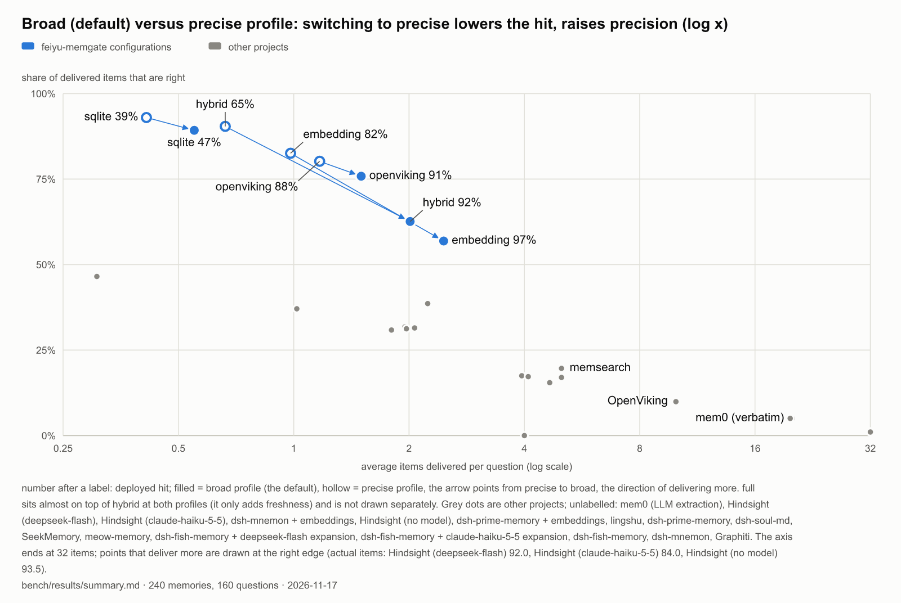
  </picture>
</p>

## Forgetting curve (experimental, off by default)

<p align="center">
  <picture>
    <source media="(prefers-color-scheme: dark)" srcset="docs/assets/memory-lifecycle.en.dark.png">
    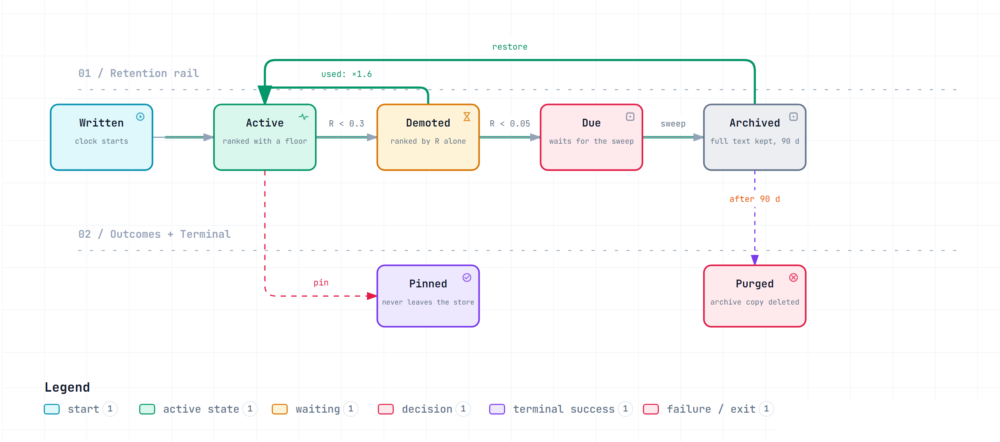
  </picture>
</p>

- **Retention**. `R = 0.5 ^ (days / half-life)`, where half-life = base × 1.6 ^ min(use count, 8) and the base defaults to 90 days. The more a memory is used, the more slowly it is forgotten.
- **Two clocks**. The retention used for ranking is counted from the memory's own date or its last use. The retention used for deletion is counted from when the ledger started managing the memory, or its last use. So turning on forgetting on a store that has existed for a long time deletes nothing that day.
- **Ranking**. The `freshness` stage multiplies the score by a factor between 0.7 and 1. It affects only order and does not take part in the score threshold check.
- **Sweep**. Expired memories are written to the archive and then deleted. Each sweep handles at most `max(5, 2%)` items per store. The archive is kept for 90 days, and during that time `feiyu-memgate forget restore` writes an item back unchanged.
- **Pin**. Memories pinned by address wildcard, by client or by hand are not down-weighted and not forgotten.

Simulation results (hybrid backend, 540 days, all 240 memories ingested on the same day; the score-threshold profile is pinned to precise and the simulation was not repeated with the broad profile; the questions fall into three groups: asked often, asked occasionally, never asked):

| Setting | Items in store | Asked often Hit@5 | Asked occasionally Hit@5 | Never asked Hit@5 | Items delivered per question | Noise |
|---|---:|---:|---:|---:|---:|---:|
| No forgetting (baseline) | 240 | 70.0% | 62.5% | 62.5% | 0.77 | 15.2% |
| Default | 57 | 70.0% | 62.5% | 0.0% | 0.49 | 10.2% |
| Default + pin identity memories | 85 | 70.0% | 62.5% | 15.0% | 0.55 | 10.6% |
| Aggressive (half-life 30 days) | 55 | 70.0% | 60.0% | 0.0% | 0.47 | 8.8% |

The store shrinks to about a quarter, and the hit rate for questions that were ever asked is essentially unchanged. Facts nobody ever asks about are almost all forgotten, which is both the design goal and the cost. Noise does not improve consistently: it fell on the hybrid backend, but on the keyword backend the default group rose from 7.8% to 10.5%.

<details>
<summary>Curves from the simulation</summary>
<p align="center">
  <picture>
    <source media="(prefers-color-scheme: dark)" srcset="docs/assets/charts/forgetting.en.dark.png">
    
  </picture>
</p>
</details>

This feature has been verified only in simulation. Traffic was generated from a fixed distribution, there are no real usage records, and the default parameters were not tuned on real data. The mechanism, configuration and full results are in [docs/forgetting.md](docs/forgetting.md) (Chinese) and [bench/results/forgetting/summary.md](bench/results/forgetting/summary.md) (Chinese).

## Quick start

Python 3.11 or later is required. The minimal setup needs no vector model and no docker.

```bash
git clone https://github.com/N0rmal-114/feiyu-memgate.git
cd feiyu-memgate
pip install -e .
```

Prepare a token for the client (at least 32 characters) and put it in an environment variable:

```bash
export GATEWAY_TOKEN_OWNER="$(python -c 'import secrets; print(secrets.token_urlsafe(32))')"
```

```powershell
$env:GATEWAY_TOKEN_OWNER = python -c "import secrets; print(secrets.token_urlsafe(32))"
```

Check the configuration and start:

```bash
feiyu-memgate check --config examples/quickstart/gateway.toml
```

```bash
feiyu-memgate serve --config examples/quickstart/gateway.toml
```

In another terminal, write one memory and query it:

```python
import os
from feiyu_memgate.client import MemoryClient

client = MemoryClient("http://127.0.0.1:8080", token=os.environ["GATEWAY_TOKEN_OWNER"])
# Example memory text, in Chinese: "I am allergic to peanuts and like going to the zoo on weekends"
print(client.remember_status("我对花生过敏，周末喜欢去动物园"))   # saved
# Example query, in Chinese: "where do I like to go on weekends"
print(client.recall_detail("周末喜欢去哪"))
```

The interface is plain HTTP with JSON, so curl works too. A Windows terminal may not send Chinese text as UTF-8, and the gateway then replies 400. In that case use the Python client above.

## Using it in a chat program

```python
from feiyu_memgate.client import MemoryClient, BlockFormatter, build_query

client = MemoryClient("http://127.0.0.1:8080", token="<gateway token>")
formatter = BlockFormatter(labels={"private": "你们私聊里的"})   # label text, Chinese: "from your private chat"

def before_llm(current_message, previous_message):
    query = build_query(current_message, previous_message)   # filler replies and bare emoji are not worth a query; returns None
    if query is None:
        return ""
    detail = client.recall_detail(query)                      # does not raise; returns None if the query failed
    if not detail:
        return ""
    return formatter.format(detail["results"], more=detail["more"])

# Example memory text, in Chinese: "The owner is allergic to peanuts"
status = client.remember_status("主人对花生过敏")   # "saved" / "failed" / "limited" / "unsure"
```

We suggest appending the data block that `before_llm` returns to the end of the current message when sending it to the model. Do not store it in the conversation history and do not put it in the system prompt. That keeps the system prompt identical on every turn, so the earlier history can hit the model provider's prefix cache.

If a reply did use certain memories, report them with `client.report_used(...)`. The forgetting curve uses this to lengthen their half-lives.

If you do not want to run a separate gateway process, switch to the in-process client. The rest of the code stays the same ([examples/embedded](examples/embedded/), described in [docs/embedded.md](docs/embedded.md) (Chinese)):

```python
from feiyu_memgate.client import LocalClient

client = LocalClient.from_config("gateway.toml", client="owner")   # no service, no token
```

An AstrBot integration example is in [integrations/astrbot](integrations/astrbot/).

### DeepSeek Harness (DSH) plugins

Two DSH plugin packages live under `plugins/` in this repository. Each is published to npm:

| Package | What it does |
|---|---|
| [dsh-feiyu-memgate](plugins/dsh-feiyu-memgate/README.md) | Adds long-term memory to DSH conversations: it ships this gateway and starts it by itself, recalls at the start of every turn, gives the model a remember tool and a search tool, and has a settings page. Each feature can be switched off on its own. The default is keyword retrieval, which needs no model and downloads nothing. |
| [dsh-feiyu-memgate-embed](plugins/dsh-feiyu-memgate-embed/README.md) | Optional add-on: runs an embedding model on this machine, on the CPU only, so that reworded questions find their memories too. A model is downloaded only after you press "Download and enable" on the settings page. |

To install, add `dsh-feiyu-memgate` on DSH's plugin page, or run `dsh plugin --profile <name> add dsh-feiyu-memgate`. Requirements, settings and what was tested are in each package's README.

## Configuration examples

To switch to the vector backend, change only the store section ([examples/hybrid](examples/hybrid/gateway.toml) is a hybrid keyword plus vector configuration, and [examples/openviking](examples/openviking/gateway.toml) connects to OpenViking):

```toml
[stores.private]
type = "embedding"
path = "data/vector.db"
url = "http://127.0.0.1:11434/v1"     # any OpenAI-compatible embeddings endpoint
model = "bge-m3"                      # for a smaller model, change only this line and the store file; the score threshold preset is chosen automatically by model name
```

Multi-tenant: each group gets its own store, and a group-chat token cannot read the private-chat store ([examples/multi-tenant](examples/multi-tenant/gateway.toml)):

```toml
[tenants.group]
type = "directory"
path = "data/groups"
create = false                        # only registered groups have memory

[clients.group]
token_env = "GATEWAY_TOKEN_GROUP"
tenants = "group"                     # every request must carry tenant_id
recall = ["@tenant"]                  # "@tenant" is the current group's own store
write = "@tenant"
public = true                         # public setting: stricter redaction
daily_writes = 20                     # per group, per day
daily_writes_total = 500              # all groups combined, per day
# tenant_binding = "token"            # optional: one derived token per group, minted with feiyu-memgate tenants token
```

Write your own recall stage ([full code](examples/custom-stage/recency_stage.py)):

```python
from feiyu_memgate.pieces import RecallStage

class Recency(RecallStage):
    def prepare(self, candidates, ctx):
        for candidate in candidates:
            candidate.score *= self._factor(candidate.date)
        return candidates
```

```toml
[recall]
stages = ["min_score", { type = "recency_stage:Recency", half_life_days = 30 }, "redact", "dedupe", "budget"]
```

Put the class file next to the configuration file. No installation is needed. The contract and usage of each of the six slots are in [docs/pieces.md](docs/pieces.md) (Chinese).

## Command line

| Command | Purpose |
|---|---|
| `feiyu-memgate serve --config <file>` | Start the gateway |
| `feiyu-memgate check --config <file>` | Check the configuration and print how each component was assembled (tokens are not shown) |
| `feiyu-memgate pieces` | List all registered components |
| `feiyu-memgate eval` | Evaluate recall with your own example memories, to help choose score thresholds |
| `feiyu-memgate forget status / sweep / archive / restore / pin / unpin / explain` | Forgetting curve: status, sweep, archive, restore, pin, and explain a single item (memory text is not shown) |
| `feiyu-memgate backup` | Encrypted backup and export |
| `feiyu-memgate tenants` | Manage tenant key files. `tenants token` mints a token bound to a single tenant |

## Documentation

| Document | Contents |
|---|---|
| [docs/architecture.md](docs/architecture.md) (Chinese) | What one recall and one write go through |
| [docs/deployment.md](docs/deployment.md) (Chinese) | Deployment options: process layout, retrieval tier and threshold profile, with the data for each and advice on choosing |
| [docs/embedded.md](docs/embedded.md) (Chinese) | Running in-process: usage, limits, and how it differs from a separate service |
| [docs/configuration.md](docs/configuration.md) (Chinese) | Every configuration option and the HTTP interface |
| [docs/backends.md](docs/backends.md) (Chinese) | How each backend works, and where the default score thresholds came from |
| [docs/pieces.md](docs/pieces.md) (Chinese) | Slot contracts, and how to choose, replace and implement them |
| [docs/forgetting.md](docs/forgetting.md) (Chinese) | Mechanism, configuration and operation of the forgetting curve |
| [docs/security.md](docs/security.md) (Chinese) | What it defends against, how, and what it cannot defend against |
| [docs/roadmap.md](docs/roadmap.md) (Chinese) | What is not done yet |
| [docs/design/](docs/design/) (Chinese) | Original design documents from the project this was extracted from, and the audit done before the rework |
| [bench/](bench/README.md) (Chinese) | Benchmark data, rules, adapters and reproduction steps |
| [bench/results/design/](bench/results/design/features.en.md) | Feature comparison of the projects, and this project's design self-check |
| [plugins/](plugins/dsh-feiyu-memgate/README.md) | The DeepSeek Harness plugin and its embedding add-on |
| [research/](research/) (Chinese) | Survey reports on similar memory projects: how they work, how mature they are, what can be borrowed |

## Status and limits

Version 0.1.0. Running the tests needs no installation:

```bash
python -m unittest discover -s tests -t .
```

There are currently 1394 tests. The gateway's approach comes from the version that actually ran in the project it was extracted from, but note the following:

- This version, after the rework into a framework, has not yet run in production for a long time.
- The forgetting curve has been verified only in simulation and is off by default.
- The logic of the AstrBot integration example is tested against stand-ins for AstrBot's interface. It has not been run in a real AstrBot.
- The DSH plugins were tested on Windows in an installed DeepSeek Harness 0.2.2-rc.1 with an isolated configuration: loading, the bundled gateway, the settings page and a local embedding model. They were not tested on macOS or Linux, in the desktop application's own window, or in a conversation with a real model. Their tests run with `node --test` in each package's folder and are not part of the number above.
- By default, a multi-tenant client still has the caller report its tenant id, and one token can read any registered tenant. To give a token to a program that is not fully trusted, use tenant-bound tokens (`tenant_binding = "token"`). A bound token has no expiry date. Revoke it by raising the generation or removing the tenant.
- When running in-process (`LocalClient`) there is no trust boundary, see "Deployment tiers" above.
- Redaction is regex-based. It cannot recognize an isolated key with no keyword hint, and instruction-like text inside memories is not rewritten.
- Limit counters are in memory and reset on restart. The forgetting archive is stored unencrypted. `/healthz?deep=1` needs no token.
- The default broad profile delivers more items and noisier ones, speaks up more often when there is no answer, and makes the context grow faster when the memory block stays in the conversation history. For few and accurate items write `[recall] profile = "precise"`; the cost is that paraphrase questions are missed often, see the data above.
- `newer_first` reorders by date only. It does not recognize whether two memories really contradict each other.
- The score threshold presets of the lighter models were each chosen on a single Chinese development set only. Multilingual behavior, concurrency, and scale beyond a few tens of thousands of items have not been tested.

## License

[MIT](LICENSE) © N0rmal
