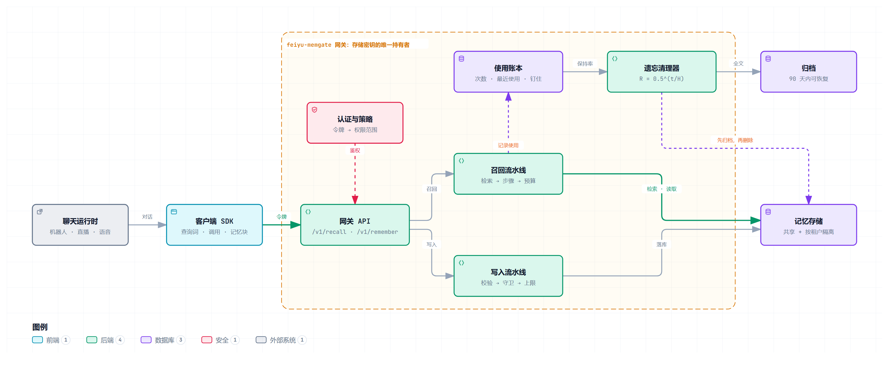
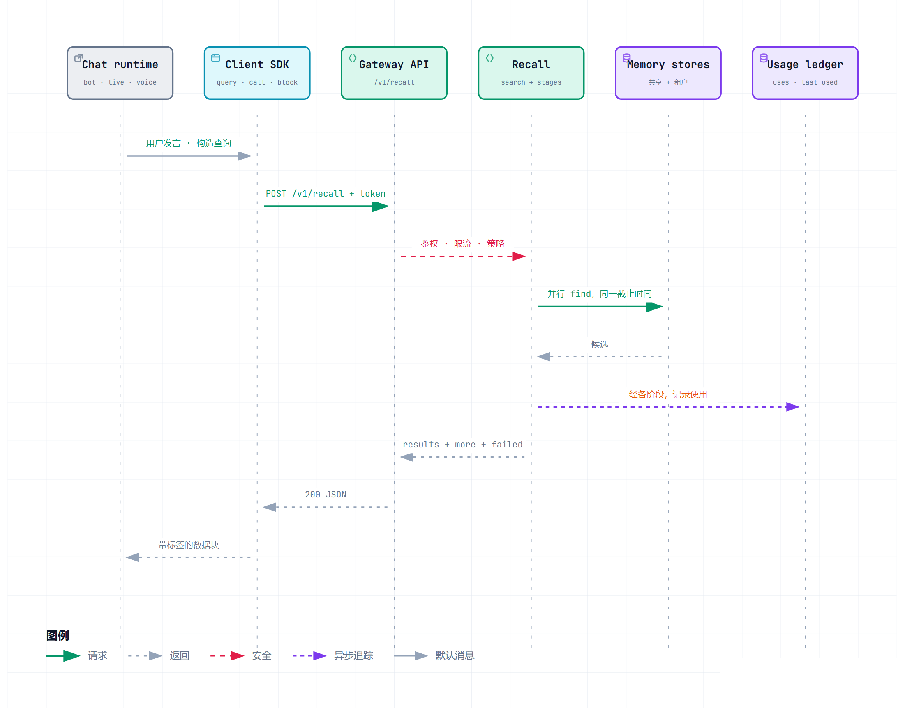
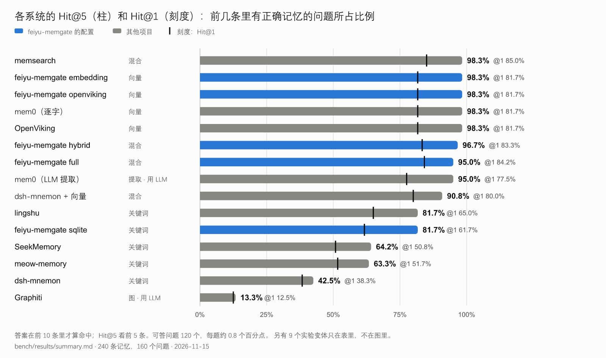
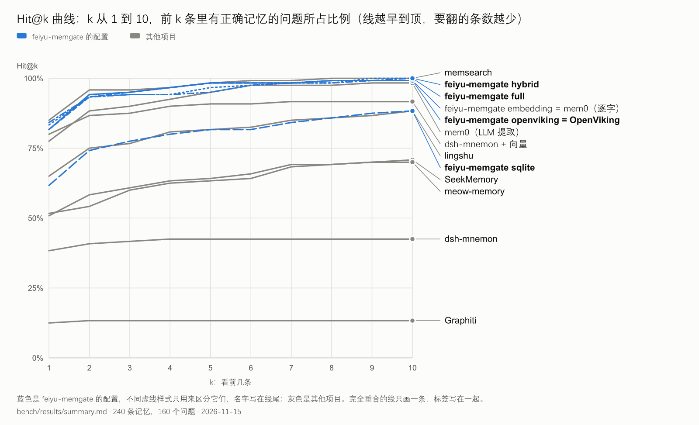
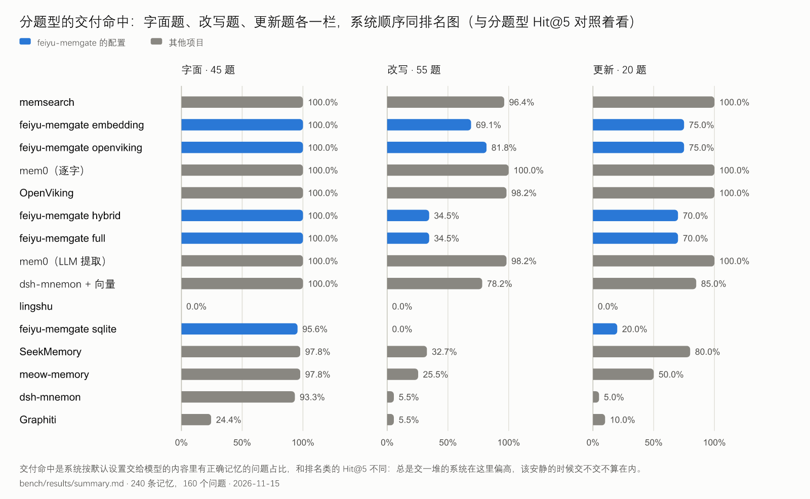
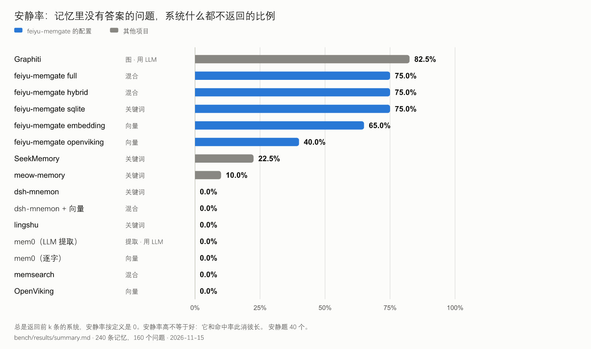
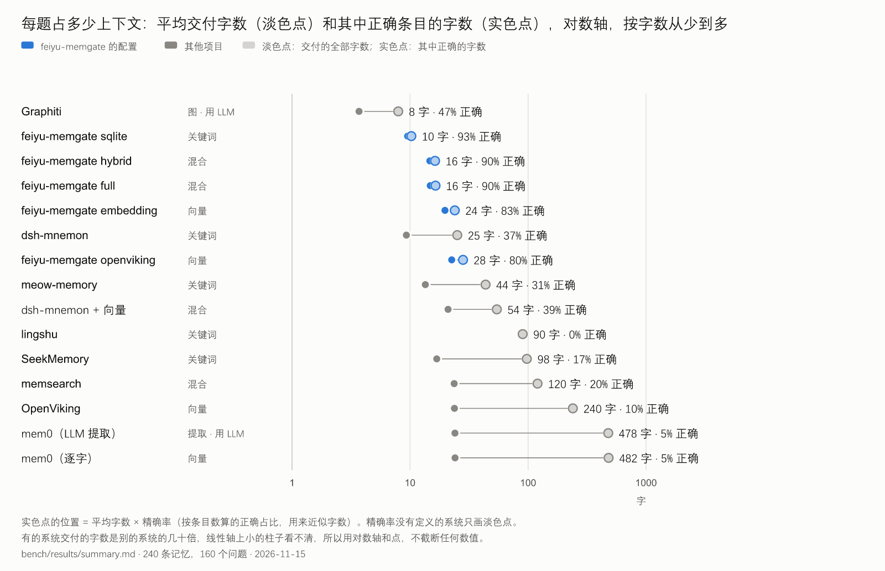
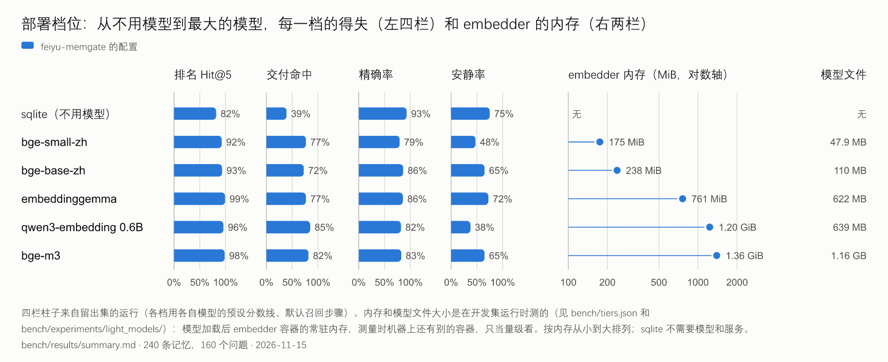
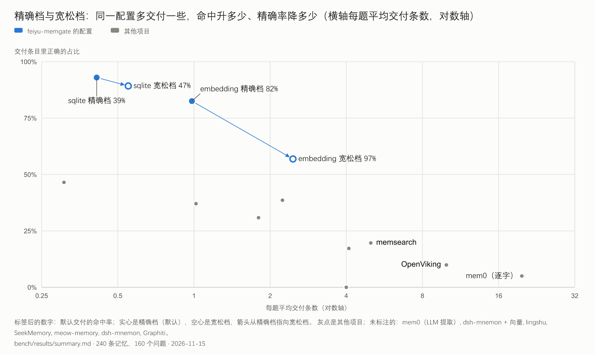

<p align="center">
  
</p>

<p align="center">
  <b>中文</b> · <a href="README.en.md">English</a>
</p>

<p align="center">
  
  
  
  
</p>

# feiyu-memgate

聊天机器人与智能体的**记忆访问层**。聊天程序只调两个接口：查记忆、记下来。谁能读写哪一份记忆、检索到的候选里哪些可以交给模型、写入之前过哪些检查、后端出故障时调用方能不能知道，都由网关按配置执行。

它不参加检索算法的竞赛。存储和检索交给后端（内置 SQLite 关键词、向量、混合、OpenViking 四种，也可以接自己的），网关管的是检索的两端。

在同一份测试集上和另外 8 个记忆项目对比后的结论，先放在这里：

| | feiyu-memgate（5 种配置） | 其他 8 个项目（10 种配置） |
|---|---|---|
| 默认交给模型的条数（每个问题平均） | 0.4 – 1.2 条 | 0.3 – 20 条 |
| 交出去的内容里正确的占比 | 80% – 93% | 0% – 47% |
| 记忆里没有答案时什么都不交的比例 | 40% – 75% | 多数为 0%，最高 82.5% |
| 检索排名 Hit@5（不设阈值） | 81.7% – 98.3% | 13.3% – 98.3% |
| 默认交付里含正确记忆的比例 | 39% – 88% | 0% – 100% |
| 新旧两条记忆都被交付时，新的排在旧的前面 | 75% – 100%（默认的向量配置 100%） | 50% – 80% |

前三行和最后一行是这层网关的作用。第四行说明检索本身并不比别人强：向量配置和同样使用 bge-m3 的系统持平。第五行是代价：交得少，漏掉的也多；不能接受的话可以切到“宽松”分数线档位，见[部署档位](#部署档位)。完整数据、方法和限制见[基准测试](#基准测试)。

## 它解决什么问题

这个项目从一个长期运行的私人陪伴机器人（“小肥鱼”）的记忆模块里拆出来。下面每一行都是那边在线上遇到过的问题。

| 线上遇到的问题 | 网关里对应的机制 |
|---|---|
| 聊天程序直接持有存储密钥，群聊的代码路径能读到私聊的记忆 | 存储密钥只在网关进程里。每个客户端令牌绑定一份访问策略：可读的存储、可写的存储、租户范围、是否公开场合 |
| 后端挂了，机器人照常回答，看起来只是“不记得” | “没查到”和“没查成”分开返回：`failed`、`busy` 计数，全部失败回 503，`/healthz?deep=1` 报告每个存储的状态 |
| 回复说“记住了”，实际没有写进去 | 写入回执分四种：已保存、确定失败、达到上限、不确定；对有异步抽取的后端跟踪最终有没有变成记忆 |
| 召回把十几条不相干的内容塞进提示词 | 召回管线：绝对分数线、相对分数线、近似去重、字数预算；放不下的整条不放，并告知还剩几条 |
| 记忆里的文字被模型当成指令执行 | 召回结果包在带标签的资料块里，记忆正文里的同名标签被转义 |
| 密钥、手机号被写进记忆，之后又被读出来 | 写入前和返回前各脱敏一次；公开场合的客户端多遮一层个人信息 |
| 群成员刷写入，把存储灌满 | 每分钟请求数和每天写入数的上限，按客户端、按租户分别计，另有跨租户的总量上限 |
| 同一件事有新旧两条记忆，旧的排在前面 | `newer_first` 步骤：通过分数线的候选里，日期新的排在前面 |
| 一个群聊令牌能读所有群 | 可选的租户绑定令牌：每个租户一个派生令牌，网关只认令牌里的租户 |
| 记忆只增不减 | 可选的遗忘曲线：按使用情况降权、归档、删除，可恢复（实验性，默认关闭） |

## 架构

<p align="center">
  <picture>
    <source media="(prefers-color-scheme: dark)" srcset="docs/assets/architecture.zh.dark.png">
    
  </picture>
</p>

- **信任边界**。虚线框内是网关进程，只有它持有各存储的密钥。聊天程序拿到的是网关令牌，令牌泄露时能做的事不超过这个客户端的策略。
- **召回路径**。认证、限流、权限检查之后，并行查询该客户端可读的每个存储，候选依次经过召回步骤（默认是 `min_score` → `relative_score` → `newer_first` → `fill_text` → `drop_oversize` → `redact` → `dedupe` → `budget`），返回带分数、日期和来源的结果。
- **写入路径**。校验长度和格式，依次经过写入守卫（默认是 `redact` 和 `daily_cap`），落到一个共享存储或当前租户自己的存储。
- **遗忘路径**（可选）。账本只记地址、时间和使用次数，不存正文。清理器按保持率把到期的记忆先写进归档再删除。
- **接口面**。只有四个路由：`GET /healthz`、`POST /v1/recall`、`POST /v1/remember`、`POST /v1/used`。没有删除、列出、导出的网络接口，这些操作只能在本机用命令行做。

<details>
<summary>一次召回的时序图</summary>
<p align="center">
  <picture>
    <source media="(prefers-color-scheme: dark)" srcset="docs/assets/recall-sequence.zh.dark.png">
    
  </picture>
</p>
</details>

### 扩展点

每个环节是一个有固定契约的插槽，由注册表按名字或按 `模块:类` 解析。内置实现可以在配置里替换成自己的类，不需要改框架代码。

| 插槽 | 契约 | 内置实现 |
|---|---|---|
| `backend` | 记忆存在哪、怎么检索 | `sqlite`（关键词，不需要任何服务）、`embedding`（向量）、`hybrid`（多路融合）、`openviking`、`inmemory` |
| `recall_stage` | 候选怎么筛、怎么排、放多少 | `min_score`、`relative_score`、`newer_first`、`source_weight`、`freshness`、`fill_text`、`drop_marker`、`drop_oversize`、`redact`、`dedupe`、`budget` |
| `write_guard` | 写入落库前的检查 | `redact`、`daily_cap` |
| `redactor` | 文字怎么清洗 | `secrets`、`public`、`none` |
| `tenants` | 每个租户的独立存储从哪来 | `directory`、`keyfile` |
| `forgetting_curve` | 保持率怎么随时间和使用变化 | `ebbinghaus` |

网关、客户端和全部内置实现只用 Python 标准库；只有加密备份需要 `cryptography`。

## 基准测试

同一批记忆、同一批问题，9 个项目的 15 种配置，每个系统用自己的检索代码和默认设置。下面先列对比对象和方法，再按“排名、交付、题型、安静、上下文、新旧、成本”逐项给数据；每个项目的特点和取舍汇总在[各项目的特点与取舍](#各项目的特点与取舍)。

### 对比对象

| 项目 | 测试的版本 | 形态 | 检索方式 | 默认写入是否调用大模型 | 默认交付 |
|---|---|---|---|---|---|
| **feiyu-memgate**（本项目） | 0.1.0 | 网关：HTTP 服务或进程内 | 关键词、向量、混合，或接 OpenViking | 否 | 默认 5 条，有分数线和字数预算 |
| [memsearch](https://github.com/zilliztech/memsearch) | 0.4.23 | 库加 DSH 插件 | 混合：向量加 BM25 | 库不调用；插件默认用模型总结每轮对话 | 前 5 条，无分数线，由模型决定是否检索 |
| [mem0](https://github.com/mem0ai/mem0) | 2.2.1 | 库 | 向量加 BM25 加实体 | 是（可以关掉） | 20 条，分数线 0.1 |
| [OpenViking](https://github.com/volcengine/OpenViking) | v0.5.3 | 服务加 DSH 插件 | 向量 | 是（直接写记忆文件时不调用） | API 默认 10 条，无分数线 |
| [Graphiti](https://github.com/getzep/graphiti) | graphiti-core 0.31.2 | 库 | 图：在抽取出的事实上做混合检索 | 是 | 10 条，余弦下限 0.6 |
| [SeekMemory](https://github.com/NeverENG/SeekMemory) | 提交 794ec5d | 内核库加宿主适配器 | 关键词：BM25 加图激活 | 是 | 最多 8 条，600 字预算，每轮自动注入 |
| [dsh-mnemon](https://github.com/omdsh-dev/dsh-mnemon) | 0.5.45 | DSH 插件 | 关键词加实体加图信号；向量可选 | 是 | 运行时记忆的快照自动提供；记忆空间由模型调用召回，每次最多 4 条 |
| [lingshu（dsh-memory）](https://github.com/FuRongJun-1999/dsh-memory) | 0.10.1 | DSH 插件 | 关键词：BM25 | 否 | 每轮自动注入会话里最新的 4 条 |
| [meow-memory](https://github.com/Phant0Meow/dsh-meow-memory) | 0.32.6 | DSH 插件 | 关键词：BM25 | 由宿主模型通过工具写入 | 每条消息前注入命中的前 2 条 |

mem0 测了逐字入库和 LLM 提取两种模式，dsh-mnemon 测了默认模式和打开向量的模式，本项目测了 5 种配置，合计 15 种。本项目另有 6 个变体（4 个更轻的向量模型、2 个宽松档位），放在[部署档位](#部署档位)一节。各项目的遗忘机制、许可证等功能事实见 [bench/results/design/features.md](bench/results/design/features.md)。

### 方法

- **数据**。240 条记忆、160 个问题，中文，虚构人物。问题分四类：字面题 45 个（问法和记忆用词相同）、改写题 55 个（换了说法）、更新题 20 个（同一件事有新旧两条记忆）、安静题 40 个（记忆里没有答案，正确做法是什么都不交）。
- **两类指标**。*排名*：不设阈值，看正确的记忆排在第几（Hit@1、Hit@5），衡量检索本身。*默认交付*：按各系统的默认设置，它真正会交给模型的是什么，衡量开箱即用的效果。
- **公平性**。每个系统用自己真实的检索代码和默认设置；所有需要向量的系统共用同一个模型（bge-m3）；第三方代码只在断网的容器里运行；每个适配器单独顺序运行。
- **不看测试集调参**。测试集冻结。本项目的默认分数线在另一份文字完全不同的开发集（160 条记忆、110 个问题）上按一条事先写定的规则选出，选定后才跑测试集，跑完没有再改任何设置。

完整规则见 [bench/CONTRACT.md](bench/CONTRACT.md)，每个系统调用了什么、绕过了什么见 [bench/results/summary.md](bench/results/summary.md) 的备注，复现步骤和运行记录见 [bench/README.md](bench/README.md)。

### 总览：交给模型的内容质量

<p align="center">
  <picture>
    <source media="(prefers-color-scheme: dark)" srcset="docs/assets/charts/quality.zh.dark.png">
    
  </picture>
</p>

*交付 F1* 是“交付里有没有正确记忆”和“交付的内容里正确的占多少”的调和平均，两个都高才高。本项目的四种向量配置在 75.6% – 83.7%，关键词配置 55.1%；其他项目最高的是打开向量的 dsh-mnemon（53.6%），其余在 0% – 40%。差距主要来自精确率：多数系统默认把前 N 条都交出去。

### 检索排名

<p align="center">
  <picture>
    <source media="(prefers-color-scheme: dark)" srcset="docs/assets/charts/ranking.zh.dark.png">
    
  </picture>
</p>

<p align="center">
  <picture>
    <source media="(prefers-color-scheme: dark)" srcset="docs/assets/charts/hit-at-k.zh.dark.png">
    
  </picture>
</p>

- 向量配置的 Hit@5 是 98.3%，和同样使用 bge-m3 的 memsearch、mem0、OpenViking 相同。这一列主要由嵌入模型决定，不是网关的功劳。
- memsearch 的排名最好：Hit@1 85.0%，前 8 条里一定有正确记忆。本项目的向量后端 Hit@1 是 81.7%。
- 向量系统在前 2 条就达到 93% – 96%，之后的增长很慢；这是“每题交 1 到 2 条”可行的依据。
- 关键词系统的曲线更平：本项目的关键词后端和 lingshu 到第 10 条是 88.3%，SeekMemory、meow-memory 约 70%。它们不理解语义，改写题是上限。
- 混合后端的 Hit@1 略高（83.3%），Hit@5 略低（96.7%），差别都在两三个问题以内。

### 默认交付

<p align="center">
  <picture>
    <source media="(prefers-color-scheme: dark)" srcset="docs/assets/charts/delivered.zh.dark.png">
    
  </picture>
</p>

| 系统 | 检索类型 | Hit@1 | Hit@5 | 平均交付条数 | 交付命中 | 精确率 | 交付 F1 | 安静率 | p50 延迟 |
|---|---|---:|---:|---:|---:|---:|---:|---:|---:|
| **feiyu-memgate embedding** | 向量 | 81.7% | 98.3% | 0.98 | 81.7% | 82.5% | 82.1% | 65.0% | 25 ms |
| **feiyu-memgate openviking** | 向量 | 81.7% | 98.3% | 1.17 | 87.5% | 80.2% | 83.7% | 40.0% | 26 ms |
| **feiyu-memgate hybrid** | 混合 | 83.3% | 96.7% | 0.66 | 65.0% | 90.4% | 75.6% | 75.0% | 29 ms |
| **feiyu-memgate full** | 混合 + 新鲜度 | 84.2% | 95.0% | 0.67 | 65.0% | 90.2% | 75.6% | 75.0% | 32 ms |
| **feiyu-memgate sqlite** | 关键词 | 61.7% | 81.7% | 0.41 | 39.2% | 93.0% | 55.1% | 75.0% | 2 ms |
| memsearch | 混合 | 85.0% | 98.3% | 5.00 | 98.3% | 19.7% | 32.8% | 0.0% | 26 ms |
| mem0（逐字入库） | 向量 | 81.7% | 98.3% | 20.00 | 100.0% | 5.0% | 9.5% | 0.0% | 35 ms |
| OpenViking | 向量 | 81.7% | 98.3% | 9.94 | 99.2% | 9.9% | 18.0% | 0.0% | 26 ms |
| mem0（LLM 提取） | 提取 | 77.5% | 95.0% | 19.76 | 99.2% | 5.0% | 9.6% | 0.0% | 69 ms ‡ |
| dsh-mnemon + 向量 | 混合 | 80.0% | 90.8% | 2.24 | 87.5% | 38.6% | 53.6% | 0.0% | 78 ms |
| lingshu | 关键词 | 65.0% | 81.7% | 4.00 | 0.0% | 0.0% | 0.0% | 0.0% | 2 ms |
| SeekMemory | 关键词 | 50.8% | 64.2% | 4.09 | 65.0% | 17.2% | 27.3% | 22.5% | 2 ms |
| meow-memory | 关键词 | 51.7% | 63.3% | 1.80 | 56.7% | 30.9% | 40.0% | 10.0% | 2 ms |
| dsh-mnemon | 关键词 | 38.3% | 42.5% | 1.02 | 38.3% | 37.1% | 37.7% | 0.0% | 33 ms |
| Graphiti | 图 | 12.5% | 13.3% | 0.31 | 13.3% | 46.5% | 20.7% | 82.5% | 391 ms ‡ |

*交付命中*：默认交付的内容里有正确记忆的问题占比。*精确率*：交出去的条目里正确的占比，只统计交付了东西的可答问题。*交付 F1*：前两者的调和平均。*安静率*：40 个安静题里什么都没交的比例。‡ 这两行是付费模式，没有在最后的顺序运行里重跑，延迟来自一台同时有其他任务的机器。

这张表说明了三件事：

1. **多数系统的默认做法是把前 N 条全部交出去。** 所以它们的交付命中接近 100%，精确率只有 5% – 39%，安静题上几乎从不保持安静。本项目默认每题交约 1 条，精确率 80% – 93%。
2. **代价是漏答。** 本项目的交付命中是 39% – 88%，低于“多给几条”的系统。改写题最吃亏，见下一小节。
3. **混合后端没有比单用向量更好。** 它的默认分数线更严，交得更少。之后在开发集上比较了五种融合方式，又换了两个小模型来配，都没有明显超过单用向量：换了说法的问题里，正确记忆的关键词分数比无关记忆的还低。有 embeddings 接口时用 `embedding`；没有时用 `sqlite`。

分数线是配置项。更在意不漏答，可以切到宽松档位（`[recall] profile = "broad"`），实测的取舍见[部署档位](#部署档位)；[docs/backends.md](docs/backends.md) 写了每个后端两档的数值是怎么选出来的，以及用自己的数据重新选的办法。

### 分题型

<p align="center">
  <picture>
    <source media="(prefers-color-scheme: dark)" srcset="docs/assets/charts/by-type.zh.dark.png">
    
  </picture>
</p>

<p align="center">
  <picture>
    <source media="(prefers-color-scheme: dark)" srcset="docs/assets/charts/delivered-by-type.zh.dark.png">
    
  </picture>
</p>

每格是“排名 Hit@5 / 默认交付命中”：

| 系统 | 字面题（45） | 改写题（55） | 更新题（20） |
|---|---:|---:|---:|
| **feiyu-memgate embedding** | 100.0% / 100.0% | 96.4% / 69.1% | 100.0% / 75.0% |
| **feiyu-memgate openviking** | 100.0% / 100.0% | 96.4% / 81.8% | 100.0% / 75.0% |
| **feiyu-memgate hybrid** | 100.0% / 100.0% | 92.7% / 34.5% | 100.0% / 70.0% |
| **feiyu-memgate full** | 100.0% / 100.0% | 89.1% / 34.5% | 100.0% / 70.0% |
| **feiyu-memgate sqlite** | 100.0% / 95.6% | 63.6% / 0.0% | 90.0% / 20.0% |
| memsearch | 100.0% / 100.0% | 96.4% / 96.4% | 100.0% / 100.0% |
| mem0（逐字入库） | 100.0% / 100.0% | 96.4% / 100.0% | 100.0% / 100.0% |
| OpenViking | 100.0% / 100.0% | 96.4% / 98.2% | 100.0% / 100.0% |
| mem0（LLM 提取） | 100.0% / 100.0% | 92.7% / 98.2% | 90.0% / 100.0% |
| dsh-mnemon + 向量 | 100.0% / 100.0% | 85.5% / 78.2% | 85.0% / 85.0% |
| lingshu | 100.0% / 0.0% | 63.6% / 0.0% | 90.0% / 0.0% |
| SeekMemory | 97.8% / 97.8% | 32.7% / 32.7% | 75.0% / 80.0% |
| meow-memory | 97.8% / 97.8% | 30.9% / 25.5% | 75.0% / 50.0% |
| dsh-mnemon | 95.6% / 93.3% | 10.9% / 5.5% | 10.0% / 5.0% |
| Graphiti | 24.4% / 24.4% | 5.5% / 5.5% | 10.0% / 10.0% |

- **字面题不区分系统。** 问法和记忆用词相同时，除 Graphiti 外所有系统的排名都在 95% 以上。
- **改写题区分关键词和向量。** 向量系统的排名在 85% – 96%，关键词系统在 11% – 64%。
- **本项目的漏答集中在改写题。** 向量后端排名 96.4%，默认交付 69.1%：正确的记忆找到了，但分数没过线。混合后端只交出 34.5%，关键词后端是 0%。字面题上交付和排名几乎一样。
- **交付命中可以高于排名 Hit@5。** 默认交 10 到 20 条的系统，交付的范围比前 5 条大。
- **更新题**上本项目交付 70% – 75%，低于全部交出的系统；但交出去时新旧的顺序是对的，见下面“新旧事实的顺序”。

### 没有答案的问题

<p align="center">
  <picture>
    <source media="(prefers-color-scheme: dark)" srcset="docs/assets/charts/quiet.zh.dark.png">
    
  </picture>
</p>

40 个问题在记忆里没有答案，交付了任何东西都算没有保持安静。本项目的配置在 40% – 75%；SeekMemory 22.5%，meow-memory 10%，其余默认不设分数线的系统是 0%。Graphiti 是 82.5%，它在可答题上也很少交付（见限度一节）。对陪伴类机器人来说，这一项决定它会不会拿一条不相干的旧事硬接话。

### 上下文占用

<p align="center">
  <picture>
    <source media="(prefers-color-scheme: dark)" srcset="docs/assets/charts/context.zh.dark.png">
    
  </picture>
</p>

这批记忆平均每条约 24 个字，所以字数基本随条数走：本项目每题交 10 – 28 个字，meow-memory 44 字，打开向量的 dsh-mnemon 54 字，lingshu 90 字，SeekMemory 98 字，memsearch 120 字，OpenViking 240 字，mem0 约 480 字。真实对话里的记忆更长，绝对值会按比例放大。交付的内容每一轮都要计入提示词，这一项直接对应费用和模型被无关内容干扰的机会。

### 新旧事实的顺序

<p align="center">
  <picture>
    <source media="(prefers-color-scheme: dark)" srcset="docs/assets/charts/fresh.zh.dark.png">
    
  </picture>
</p>

更新题里同一件事有新旧两条记忆。下表只看“新的那条被交付了”的问题，统计其中旧的那条没有排在它前面的题数。

| 系统 | 加入 `newer_first` 之前 | 之后 |
|---|---:|---:|
| feiyu-memgate embedding | 9/15 | 15/15 |
| feiyu-memgate openviking | 9/15 | 15/15 |
| feiyu-memgate hybrid | 8/14 | 14/14 |
| feiyu-memgate sqlite | 3/4 | 3/4 |
| memsearch、mem0（LLM 提取） | | 12/20 |
| dsh-mnemon + 向量 | | 11/17 |
| mem0（逐字入库）、OpenViking | | 10/20 |
| SeekMemory | | 9/16 |
| meow-memory | | 8/10 |

新记忆被交付不足 5 题的系统没有列出。本项目的其他配置：bge-small-zh 11/11、embeddinggemma 9/9、qwen3-embedding 10/10、bge-base-zh 8/10、`embedding` 宽松档 16/20。后两个不是全对，因为它们的分数线放得比 `newer_first` 的作用范围宽：这一步只在分数不低于最高分 85% 的候选之间调整顺序，范围之外的候选保持原来的位置。

`newer_first` 只调整通过了分数线的候选之间的顺序，不改变交付哪些记忆，所以上面默认交付表里的数字没有因此变化。它不判断两条记忆是否矛盾，也不会让旧的那条失效；记忆没有日期时不起作用。按后端自己的排名（不经过召回步骤），所有系统把新记忆排在旧记忆前面的比例都在 5% – 60% 之间，本项目也是 50% – 55%。测试集只有 20 道更新题，开发集 12 道，样本很小。

### 成本

<p align="center">
  <picture>
    <source media="(prefers-color-scheme: dark)" srcset="docs/assets/charts/cost.zh.dark.png">
    
  </picture>
</p>

| 系统 | 延迟 p50 | 延迟 p95 | 入库 240 条 | 写入用的 LLM token | 费用 |
|---|---:|---:|---:|---:|---:|
| **feiyu-memgate sqlite** | 2 ms | 3 ms | 0.02 s | 0 | 0 |
| **feiyu-memgate embedding** | 25 ms | 52 ms | 6.6 s | 0 | 0 |
| **feiyu-memgate hybrid** | 29 ms | 56 ms | 6.5 s | 0 | 0 |
| **feiyu-memgate full** | 32 ms | 58 ms | 6.6 s | 0 | 0 |
| **feiyu-memgate openviking** | 26 ms | 53 ms | 69.8 s | 0 | 0 |
| memsearch | 26 ms | 53 ms | 13.6 s | 0 | 0 |
| mem0（逐字入库） | 35 ms | 80 ms | 9.3 s | 0 | 0 |
| OpenViking | 26 ms | 52 ms | 72.2 s | 0 | 0 |
| mem0（LLM 提取） | 69 ms ‡ | 610 ms ‡ | 471 s ‡ | 206 万 | 0.53 元 |
| dsh-mnemon + 向量 | 78 ms | 105 ms | 12.2 s | 0 | 0 |
| lingshu | 2 ms | 3 ms | 4.1 s | 0 | 0 |
| SeekMemory | 2 ms | 3 ms | 0.2 s | 0 | 0 |
| meow-memory | 2 ms | 3 ms | 0.2 s | 0 | 0 |
| dsh-mnemon | 33 ms | 39 ms | 3.0 s | 0 | 0 |
| Graphiti | 391 ms ‡ | 848 ms ‡ | 1347 s ‡ | 118 万 | 约 2 元 |

- 向量配置的延迟主要花在一次查询嵌入上（CPU 上的 bge-m3），各系统差别不大；关键词系统都在 2 – 3 ms。
- 本项目写入不调用大模型。多数第三方系统的默认写入路径要用大模型，这里绕过了（逐字入库），所以它们的 token 列是 0；只有 mem0 的 LLM 提取模式和 Graphiti 按默认路径跑了。
- 接 OpenViking 的两行入库慢，是因为它的索引是异步的，时间里包含等待索引完成。
- lingshu 的入库时间不含它自己的写入限速造成的等待。

### 这些数字的限度

- 240 条记忆是小数据集，一个问题约 0.8 个百分点，几个百分点的差距不构成结论。数据是合成的单句中文，只有一个虚构人物。
- 适配器是本项目写的。每个适配器的 README 写明了调用的入口和理由，但立场偏差无法完全排除，欢迎各项目的作者指正。
- 多数第三方系统的默认写入路径要用大模型提取或整理，这里绕过了（逐字入库），只测了检索和交付。只有 mem0 和 Graphiti 另外跑了带大模型的模式。
- Graphiti 用的不是它推荐的技术栈（嵌入式 Kuzu 加一个小模型做提取），240 条记忆只抽出 69 条事实边，这个结果不代表它在推荐配置下的水平。
- lingshu 每轮自动注入的是会话里最新的 4 条，不看问题，所以交付命中为 0 是设计使然，不是检索失败。
- dsh-mnemon 的结果每次运行有约 ±5 个百分点的波动。
- memsearch 不自动注入记忆内容，dsh-mnemon 的记忆空间也由模型决定是否检索；这里的“默认交付”是模型调用一次召回工具时拿到的内容。dsh-mnemon 自动提供的运行时记忆（USER.md、MEMORY.md 的快照）是另一套东西，这次没有测。
- “不正确”按标注的期望记忆判定，没有标注但沾边的条目也算噪声。
- 各项目的版本是测试时的版本，之后可能已经改变。

## 各项目的特点与取舍

每个项目按同一个格式写：它是什么、测到的强项、测到或文档里写明的代价。数字来自上面的测试；机制来自各项目测试版本的源码和自己的文档；标“推断”的是读代码得出、没有实测的。本项目用同样的标准写在第一条。

### 提示词位置、缓存与后台调用

模型服务商对重复出现的提示词前缀按低价计费，所以每轮都变的内容放在提示词靠前的位置，会让它后面的全部内容无法命中缓存。另一类花费是记忆系统自己在后台发起的模型调用。两项都不体现在检索指标里，单独列出：

| 项目 | 不经模型请求就放进提示词的 | 位置 | 是否每轮都变 | 后台的模型调用和上限 |
|---|---|---|---|---|
| feiyu-memgate 0.1.0 | 召回的资料块，格式固定，不带当前时间 | 建议接在当前消息末尾、不进历史；由接入方决定 | 随问题变，按建议放置时只影响末尾 | 无 |
| memsearch 0.4.23（DSH 插件 0.1.8） | 一句固定的检索提示，不含记忆内容 | 本轮消息之后 | 否 | 插件默认每轮用模型总结一次对话；未发现按会话的次数上限 |
| mem0 2.2.1 | 无，提示词由应用自己拼 | – | – | 默认写入每次调用一次模型 |
| OpenViking v0.5.3 | 未检查 | 未检查 | 未检查 | 会话提交时用模型抽取 |
| Graphiti 0.31.2 | 无，提示词由调用方拼 | – | – | 每次写入都要模型（实测每条约 2.5 次调用） |
| SeekMemory（794ec5d） | 召回内容，上限 600 字；人设块 | 本轮消息之前（推断）；人设在宿主上下文里 | 召回随问题变；人设很少变 | 抽取每天最多 2 次；夜间整理每晚最多 12 次调用、6 万 token |
| dsh-mnemon 0.5.45 | 固定的协议说明；运行时记忆的快照 | 协议在系统提示词；快照追加在当前消息之后并留在历史里 | 否，记忆变化时才追加新快照 | 空闲复盘默认开启：两次至少间隔 5 分钟，每个会话最多 20 次，用主模型，计数默认在重启后清零 |
| lingshu 0.10.1 | 最近 4 条记忆和最近 10 条消息的窗口 | 宿主的上下文块，内容变了才追加 | 很可能是（推断：窗口引用最近的消息） | 默认关闭 |
| meow-memory 0.32.6 | 固定的使用指引；首条消息前的快照；每条消息前关键词命中的前 2 条 | 指引在系统提示词；其余在当前消息之前 | 命中随问题变，只追加、不重复 | 反思：连续 7 步工具调用后追加一轮；整理：每个时间窗口最多一次，6 小时冷却，用主模型 |

最终的提示词由宿主程序拼装，这张表核实到的是各插件交给宿主的内容和它们自己文档里的说明，宿主一侧的代码没有看。没有任何一个项目公布过缓存命中率的实测数据，本项目也没有测。

### feiyu-memgate（本项目）

存储和检索之外的一层网关，检索交给后端。

- **强项**
  - 默认交付少而准：每题约 1 条，精确率 80% – 93%，没有答案时 40% – 75% 的情况什么都不交。
  - 写入不调用大模型，也没有后台的模型调用；关键词档位不需要任何服务。
  - 访问策略、限流、每日写入上限、脱敏、失败与空结果的区分由网关统一执行，聊天程序拿不到存储密钥。
  - 检索后端、召回步骤、分数线档位都可以替换；从不用模型到 1.16 GB 模型有六档实测数据。
  - 新旧两条记忆都被交付时，新的排在前面（默认的向量配置 15/15）。
- **代价**
  - 漏答：默认交付命中 39% – 88%，改写题上向量后端只交出 69.1%，混合后端 34.5%，关键词后端 0%。
  - 检索本身不比同模型的系统强，Hit@1 低于 memsearch。
  - 只存原文，不抽取、不归并、不改写；旧事实不会失效，只是排在后面。
  - 是一个要自己接入的服务或库，不是装上即用的插件。
  - 记忆块放在哪里由接入方决定。自带的 AstrBot 示例把它作为临时消息片段接在当前消息后面，不进历史；宿主不支持临时片段时退回到接在当前消息的文字末尾，系统提示词和之前的历史仍然不变，但这段记忆会随那条消息留在历史里，上下文因此变长。
  - 向量后端是暴力扫描，这次只测到几百条，规模大了延迟会线性增长；框架化之后的版本还没有长时间线上运行。

### [memsearch](https://github.com/zilliztech/memsearch)

记忆是 Markdown 文件，索引可以随时重建；向量加 BM25 的混合检索。

- **强项**：这次测试里排名最好（Hit@1 85.0%，Hit@5 98.3%，前 8 条内一定有正确记忆）。记忆人能直接读、改、放进 git。不往提示词里放记忆内容，只加一句固定提示，对缓存没有影响。
- **代价**：没有分数线和字数预算，交前 5 条（精确率 19.7%，安静率 0%）。是否检索取决于模型是否调用。DSH 插件默认每轮用模型总结一次对话。没有遗忘或衰减。

### [mem0](https://github.com/mem0ai/mem0)

一个库，默认在写入时用大模型把对话抽取成独立的事实。

- **强项**：抽取能把口语整理成事实（240 条记忆得到 248 条事实），解析名字和日期。逐字模式的排名和其他使用 bge-m3 的系统一致（Hit@5 98.3%）。支持按条设置到期日。
- **代价**：默认写入每条调用一次模型（240 条约 206 万 token、0.53 元、入库 471 秒）。抽取模式的排名略低（Hit@1 77.5%，Hit@5 95.0%）。默认返回 20 条、分数线 0.1，实测每题约 20 条、精确率 5%。它的 BM25 和实体部分依赖英文模型，对中文不起作用。提示词由应用自己拼。

### [OpenViking](https://github.com/volcengine/OpenViking)

独立的记忆服务，会话提交时用模型抽取，向量检索。

- **强项**：排名与其他使用 bge-m3 的系统持平（Hit@5 98.3%）。服务形态可以被多个程序共用。接在本项目网关后面是这次测试里交付 F1 最高的组合（83.7%）。
- **代价**：API 默认返回 10 条、没有分数线（精确率 9.9%，安静率 0%）。索引是异步的，240 条写入后约 70 秒才能检索到。正常的写入路径要用模型抽取，这次没有测。需要单独部署服务和向量模型。它的 DSH 插件的默认行为没有核实。

### [Graphiti](https://github.com/getzep/graphiti)

时间知识图谱：用大模型抽取实体和带时间的事实，在事实上检索。

- **强项**：显式处理“事实被取代”，旧事实标记失效而不是并存。事实带时间。有余弦下限，没有答案时 82.5% 的情况不交付。
- **代价**：没有大模型写不进去，实测每条约 2.5 次调用（240 条约 118 万 token、约 2 元、22 分钟）。这次用的是它不推荐的技术栈（嵌入式 Kuzu 加小模型），只抽出 69 条事实边，Hit@5 13.3%，不代表它在推荐配置下的水平。

### [SeekMemory](https://github.com/NeverENG/SeekMemory)

宿主无关的内核加适配器；BM25 加图激活；带强化、衰减和可逆遗忘的完整生命周期。

- **强项**：回复真的用上了某条记忆才强化它，全自动。按契合程度分级披露。每轮注入有 600 字的硬上限，有证据阈值（安静率 22.5%）。后台整理有明确的上限。延迟 2 ms。
- **代价**：没有向量检索，改写题 32.7%，Hit@5 64.2%，精确率 17.2%。正常写入依赖宿主模型抽取，这次绕过了。DSH 适配器版本是 0.0.1。

### [dsh-mnemon](https://github.com/omdsh-dev/dsh-mnemon)

DSH 插件。两套东西：随对话自动提供的运行时记忆，和由模型调用召回的记忆空间（关键词加实体加图信号，向量可选）。

- **强项**：记忆空间有自己的分数线和准入规则，默认每题只交 1 到 2 条，是本项目之外交付最克制的。打开向量后 Hit@5 是 90.8%，交付 F1 53.6%，在其他项目里最高。当前版本为保持缓存前缀稳定做了专门的设计：系统提示词不随记忆写入变化，记忆变化时把新快照追加在对话后面。空闲复盘有间隔和次数上限。
- **代价**：
  - 默认模式（不开向量）Hit@5 是 42.5%，改写题 10.9%；结果每次运行有约 ±5 个百分点的波动；安静率 0%。
  - 空闲复盘默认开启，使用主模型，计数默认在重启后清零。它的公开反馈里关于费用的讨论集中在这一项。
  - 记忆变化时追加的是整份快照，不是差量；修正、删除或累计到第 5 份快照时会整理一次，整理点之后的对话要重新按未缓存计费一次。这种整理在长会话里多久发生一次，没有公开的测量。
  - 早期版本（0.2.4 及以前、0.3.2 到 0.3.5、0.5.7 及以前）有过写入导致缓存前缀失效的问题，分别在 0.2.5、0.3.6、0.5.8 修复。项目自己说明没有缓存命中率的实测数据。
  - 打开向量后延迟 78 ms，是这次测试里不调用大模型的配置中最高的。

### [lingshu（dsh-memory）](https://github.com/FuRongJun-1999/dsh-memory)

DSH 插件。写入闸门、去重、索引全部是规则代码，BM25 检索，记忆是普通文件。

- **强项**：写入不调用模型，后台维护默认关闭。按问题检索时的排名在关键词系统里最好（Hit@5 81.7%，与本项目的关键词后端持平）。写入有闸门（接受、合并、丢弃、推迟）和速率上限，注入有字数上限。延迟 2 ms。
- **代价**：每轮自动注入的是会话里最新的 4 条和最近 10 条消息，不看问题，所以按问题的交付命中是 0；按问题检索要模型主动调用工具。没有向量，改写题 63.6%。注入的窗口引用最近的消息，很可能每轮都不同，上下文随之增长（推断）。写入限速（每分钟 8 条）让批量入库变慢。

### [meow-memory](https://github.com/Phant0Meow/dsh-meow-memory)

DSH 插件。一个 SQLite 文件加 BM25，由宿主的模型通过工具写入并填关键词。

- **强项**：部署很轻：一个 SQLite 文件，没有额外的服务和模型。每条消息只注入 2 条、不重复，放在对话末尾（当前消息之前），系统提示词里的指引是固定的。精确率在关键词系统里最高（30.9%）。字面题 97.8%，延迟 2 ms。
- **代价**：没有向量，改写题 30.9%，Hit@5 63.3%。没有分数线（安静率 10%）。关键词的质量取决于模型写入时填得好不好，这次用它自带的分词器代替。后台的反思和整理使用主模型。

## 设计自检

检索以外的性质，用探针脚本对本项目逐项实测。这一节只评本项目自己。✓ 成立，◐ 部分成立。

| 性质 | 结果 | 实测到的 |
|---|:-:|---|
| 写入前脱敏 | ✓ | 假密钥、密码、令牌写入后，存储里没有残留 |
| 返回前脱敏 | ✓ | 绕过网关直接写进存储的密钥，召回结果里没有残留 |
| 记忆作为资料交付，不能越界 | ✓ | 含闭标签和伪指令的记忆，资料块里的标签被转义，边界恰好一对 |
| 凭据级隔离 | ◐ | 客户端之间由令牌隔离；租户绑定是可选的，默认模式下租户号由调用方自报 |
| 失败与空结果可区分 | ✓ | 存储全部报错回 503；部分失败回 200 并带 `failed` 计数 |
| 写入有上限 | ✓ | 每日上限为 5 时，32 次并发写恰好成功 5 次 |
| 输出有界，整条取舍 | ✓ | 条数上限 10；字数预算内整条放或不放；超长的整条丢弃 |
| 遗忘可恢复 | ✓ | 被遗忘的记忆先归档，保留期内可以原样恢复 |
| 写入不需要大模型 | ✓ | 断开网络时，SQLite 路径的写入和召回全部成功 |
| 网络面最小且需鉴权 | ✓ | 只有 4 条路由；其余 199 种方法和路径的组合全部是 404 或 405 |

每一项的做法、数字和没有通过的地方见 [bench/results/design/self-check.md](bench/results/design/self-check.md)。探针是本项目自己写、自己跑的，只说明这些检查在这一版上成立。

**其他项目有、本项目没有的能力：**

- 回复真的用上了某条记忆才强化它，全自动（SeekMemory）。本项目要聊天程序调用 `/v1/used` 上报。
- 按相关程度分级披露：全文、转述、暗示或沉默（SeekMemory）。本项目的访问控制是按存储的全有或全无。
- 被新事实取代的旧事实标记为失效（Graphiti、SeekMemory）。本项目只把新的排在前面，旧的仍然会被交付。
- 用大模型从对话里抽取、归并、改写记忆（mem0、Graphiti、OpenViking 等）。本项目只存原文，抽取是后端的事。
- 写入时去重与合并（lingshu、meow-memory、mem0）。本项目到召回时才去重。
- 按轮收窄读范围（dsh-mnemon）；按条设置到期日（mem0）；记忆是可以直接编辑、可进 git 的 Markdown（memsearch）。

## 部署档位

部署有三个互相独立的选择，调用代码不用跟着改。完整说明和选择建议见 [docs/deployment.md](docs/deployment.md)。

**进程形态。** 网关可以作为独立进程（`feiyu-memgate serve` 加 `MemoryClient`），也可以直接在聊天进程里运行（`LocalClient`，不起服务、不占端口、不需要令牌）。两种客户端的方法和返回值相同。进程内运行的代价是信任边界消失：聊天进程自己持有存储密钥，访问策略只能防自己代码里的失误，防不了被攻破的进程。

**检索档位。** 从不用模型到 1.16 GB 的模型共六档，向量后端内置了这五个模型的分数换算和默认分数线。

<p align="center">
  <picture>
    <source media="(prefers-color-scheme: dark)" srcset="docs/assets/charts/tiers.zh.dark.png">
    
  </picture>
</p>

| 档位 | 模型文件 | 运行内存 | Hit@1 | Hit@5 | 交付命中 | 精确率 | 交付 F1 | 安静率 | p50 延迟 |
|---|---:|---:|---:|---:|---:|---:|---:|---:|---:|
| `sqlite`（不用模型） | 无 | 可忽略 | 61.7% | 81.7% | 39.2% | 93.0% | 55.1% | 75.0% | 2 ms |
| bge-small-zh-v1.5 | 48 MB | 175 MiB | 75.8% | 92.5% | 76.7% | 79.4% | 78.0% | 47.5% | 7 ms |
| bge-base-zh-v1.5 | 110 MB | 238 MiB | 82.5% | 93.3% | 72.5% | 86.2% | 78.7% | 65.0% | 19 ms |
| embeddinggemma | 622 MB | 761 MiB | 81.7% | 99.2% | 76.7% | 85.8% | 81.0% | 72.5% | 13 ms |
| qwen3-embedding 0.6B | 639 MB | 1.20 GiB | 84.2% | 95.8% | 85.0% | 81.9% | 83.4% | 37.5% | 77 ms |
| bge-m3 | 1.16 GB | 1.36 GiB | 81.7% | 98.3% | 81.7% | 82.5% | 82.1% | 65.0% | 25 ms |

质量各列来自测试集，每个模型用自己的预设；模型文件和运行内存是开发集运行时测的（CPU，容器只加载这一个模型）。

- **最小的向量模型就比关键词好很多。** 175 MiB 内存，交付 F1 从 55.1% 到 78.0%，改写题不再是盲区。
- **小模型的代价在排名上。** 两个中文小模型的 Hit@5 比 bge-m3 低约 5 个百分点；它们只支持中文。
- **embeddinggemma 用一半多一点的内存做到了和 bge-m3 相当。** Hit@5 和安静率都不低于 bge-m3，开发集上也是这样。
- **相邻档位之间的先后不稳定。** qwen3-embedding 在开发集上最差，在测试集上交付命中最高，但安静率最低、延迟最高；bge-base-zh 在开发集上和 bge-m3 持平，在测试集上低一截。可靠的结论只有上面三条。
- **分数线必须跟着模型走。** 把 bge-m3 的分数线原样用在 bge-base-zh 上，开发集的交付命中只有 27.5%。内置预设之外的模型，后端启动时会给一行警告。

**分数线档位。** 默认档偏向少而准。切到宽松档后的实测变化：

| 配置 | 档位 | 交付命中 | 精确率 | 每题交付条数 | 安静率 |
|---|---|---:|---:|---:|---:|
| `embedding`（bge-m3） | 精确（默认） | 81.7% | 82.5% | 0.98 | 65.0% |
| | 宽松 | 96.7% | 56.9% | 2.46 | 32.5% |
| `sqlite` | 精确（默认） | 39.2% | 93.0% | 0.41 | 75.0% |
| | 宽松 | 46.7% | 89.3% | 0.55 | 70.0% |

向量后端的宽松档几乎不漏答，代价是每题多交一条半、安静率减半；它交出去的内容里正确的仍占一半以上，而默认交前 5 到 20 条的系统是 5% – 20%。关键词后端换档的收益很小，它的漏答来自检索本身。

<p align="center">
  <picture>
    <source media="(prefers-color-scheme: dark)" srcset="docs/assets/charts/profiles.zh.dark.png">
    
  </picture>
</p>

## 遗忘曲线（实验性，默认关闭）

<p align="center">
  <picture>
    <source media="(prefers-color-scheme: dark)" srcset="docs/assets/memory-lifecycle.zh.dark.png">
    
  </picture>
</p>

- **保持率**。`R = 0.5 ^ (天数 / 半衰期)`，半衰期 = 基础值 × 1.6 ^ min(使用次数, 8)，基础值默认 90 天。用得越多，忘得越慢。
- **两个时钟**。排序用的保持率从记忆自己的日期或最近一次使用算起；删除用的从账本开始管理这条记忆或最近一次使用算起。所以在一个存了很久的库上打开遗忘，当天不会删任何东西。
- **排序**。`freshness` 步骤把分数乘以 0.7 到 1 之间的系数，只影响顺序，不参与分数线判断。
- **清理**。到期的记忆先写进归档再删除，每次每个存储最多处理 `max(5, 2%)` 条；归档保留 90 天，期间可以用 `feiyu-memgate forget restore` 原样写回。
- **钉住**。按地址通配符、按客户端或手动钉住的记忆不降权、不遗忘。

模拟结果（混合后端，540 天，240 条记忆同一天入库；问题分为常被问、偶尔被问、从不被问三组）：

| 设置 | 库内条数 | 常问 Hit@5 | 偶尔问 Hit@5 | 从不问 Hit@5 | 每题交付条数 | 噪声 |
|---|---:|---:|---:|---:|---:|---:|
| 不遗忘（基线） | 240 | 70.0% | 62.5% | 62.5% | 0.77 | 15.2% |
| 默认 | 57 | 70.0% | 62.5% | 0.0% | 0.49 | 10.2% |
| 默认 + 钉住身份类记忆 | 85 | 70.0% | 62.5% | 15.0% | 0.55 | 10.6% |
| 激进（半衰期 30 天） | 55 | 70.0% | 60.0% | 0.0% | 0.47 | 8.8% |

存储缩小到四分之一左右，被问到过的问题命中率基本不变。从来没人问的事几乎全部被忘，这既是设计目标，也是代价。噪声没有一致的改善：混合后端降了，关键词后端的默认组反而从 7.8% 升到 10.5%。

<details>
<summary>模拟过程的曲线</summary>
<p align="center">
  <picture>
    <source media="(prefers-color-scheme: dark)" srcset="docs/assets/charts/forgetting.zh.dark.png">
    
  </picture>
</p>
</details>

这个功能只在模拟里验证过：流量按固定分布生成，没有真实的使用记录，默认参数也没有在真实数据上调过。机制、配置和完整结果见 [docs/forgetting.md](docs/forgetting.md) 和 [bench/results/forgetting/summary.md](bench/results/forgetting/summary.md)。

## 快速开始

需要 Python 3.11 或更高。最小配置不需要向量模型，也不需要 docker。

```bash
git clone https://github.com/N0rmal-114/feiyu-memgate.git
cd feiyu-memgate
pip install -e .
```

给客户端准备一个令牌（至少 32 个字符），放进环境变量：

```bash
export GATEWAY_TOKEN_OWNER="$(python -c 'import secrets; print(secrets.token_urlsafe(32))')"
```

```powershell
$env:GATEWAY_TOKEN_OWNER = python -c "import secrets; print(secrets.token_urlsafe(32))"
```

检查配置并启动：

```bash
feiyu-memgate check --config examples/quickstart/gateway.toml
```

```bash
feiyu-memgate serve --config examples/quickstart/gateway.toml
```

另开一个终端，写一条再查一次：

```python
import os
from feiyu_memgate.client import MemoryClient

client = MemoryClient("http://127.0.0.1:8080", token=os.environ["GATEWAY_TOKEN_OWNER"])
print(client.remember_status("我对花生过敏，周末喜欢去动物园"))   # saved
print(client.recall_detail("周末喜欢去哪"))
```

接口是普通的 HTTP 加 JSON，也可以用 curl。Windows 的终端可能不按 UTF-8 发送中文，网关会回 400，这种情况用上面的 Python 客户端。

## 在聊天程序里使用

```python
from feiyu_memgate.client import MemoryClient, BlockFormatter, build_query

client = MemoryClient("http://127.0.0.1:8080", token="<网关令牌>")
formatter = BlockFormatter(labels={"private": "你们私聊里的"})

def before_llm(current_message, previous_message):
    query = build_query(current_message, previous_message)   # 应声词、纯表情不值得查，返回 None
    if query is None:
        return ""
    detail = client.recall_detail(query)                      # 不抛异常；查询失败返回 None
    if not detail:
        return ""
    return formatter.format(detail["results"], more=detail["more"])

status = client.remember_status("主人对花生过敏")   # "saved" / "failed" / "limited" / "unsure"
```

`before_llm` 返回的资料块建议接在当前这条消息的末尾发给模型，不存进对话历史，也不放进系统提示词。这样系统提示词每轮不变，前面的历史可以命中模型服务商的前缀缓存。

如果回复确实用上了某几条记忆，调用 `client.report_used(...)` 上报，遗忘曲线据此延长它们的半衰期。

不想单独起一个网关进程时，换成进程内的客户端，其余代码不变（[examples/embedded](examples/embedded/)，说明见 [docs/embedded.md](docs/embedded.md)）：

```python
from feiyu_memgate.client import LocalClient

client = LocalClient.from_config("gateway.toml", client="owner")   # 不起服务，不需要令牌
```

AstrBot 的接入示例在 [integrations/astrbot](integrations/astrbot/)。

## 配置示例

换成向量后端，只改存储一节（[examples/hybrid](examples/hybrid/gateway.toml) 是关键词加向量的混合配置，[examples/openviking](examples/openviking/gateway.toml) 接 OpenViking）：

```toml
[stores.private]
type = "embedding"
path = "data/vector.db"
url = "http://127.0.0.1:11434/v1"     # 任何兼容 OpenAI 的 embeddings 接口
model = "bge-m3"                      # 换更小的模型只改这一行和库文件，分数线预设按模型名自动选用
```

多租户：每个群一份独立的存储，群聊令牌读不到私聊的存储（[examples/multi-tenant](examples/multi-tenant/gateway.toml)）：

```toml
[tenants.group]
type = "directory"
path = "data/groups"
create = false                        # 只有登记过的群才有记忆

[clients.group]
token_env = "GATEWAY_TOKEN_GROUP"
tenants = "group"                     # 每次请求必须带 tenant_id
recall = ["@tenant"]                  # "@tenant" 是当前这个群自己的存储
write = "@tenant"
public = true                         # 公开场合：更严的脱敏
daily_writes = 20                     # 每个群每天
daily_writes_total = 500              # 所有群合计每天
# tenant_binding = "token"            # 可选：每个群一个派生令牌，用 feiyu-memgate tenants token 生成
```

自己实现一个召回步骤（[完整代码](examples/custom-stage/recency_stage.py)）：

```python
from feiyu_memgate.pieces import RecallStage

class Recency(RecallStage):
    def prepare(self, candidates, ctx):
        for candidate in candidates:
            candidate.score *= self._factor(candidate.date)
        return candidates
```

```toml
[recall]
stages = ["min_score", { type = "recency_stage:Recency", half_life_days = 30 }, "redact", "dedupe", "budget"]
```

类文件放在配置文件旁边即可，不需要安装。六种插槽各自的契约和写法见 [docs/pieces.md](docs/pieces.md)。

## 命令行

| 命令 | 用途 |
|---|---|
| `feiyu-memgate serve --config <文件>` | 启动网关 |
| `feiyu-memgate check --config <文件>` | 检查配置，打印各组件的组装结果（不显示令牌） |
| `feiyu-memgate pieces` | 列出所有已注册的组件 |
| `feiyu-memgate eval` | 用自己的示例记忆评测召回，帮助选分数线 |
| `feiyu-memgate forget status / sweep / archive / restore / pin / unpin / explain` | 遗忘曲线：状态、清理、归档、恢复、钉住、解释某一条（不显示记忆正文） |
| `feiyu-memgate backup` | 加密备份与导出 |
| `feiyu-memgate tenants` | 管理租户密钥文件；`tenants token` 生成绑定到单个租户的令牌 |

## 文档

| 文档 | 内容 |
|---|---|
| [docs/architecture.md](docs/architecture.md) | 一次召回、一次写入经过什么 |
| [docs/deployment.md](docs/deployment.md) | 部署方案：进程形态、检索档位、分数线档位，各自的数据和选择建议 |
| [docs/embedded.md](docs/embedded.md) | 进程内运行：用法、限制、和独立服务的区别 |
| [docs/configuration.md](docs/configuration.md) | 每一项配置和 HTTP 接口 |
| [docs/backends.md](docs/backends.md) | 各后端的原理、默认分数线的来历 |
| [docs/pieces.md](docs/pieces.md) | 插槽的契约，怎么选用、替换、自己实现 |
| [docs/forgetting.md](docs/forgetting.md) | 遗忘曲线的机制、配置和运维 |
| [docs/security.md](docs/security.md) | 防什么、怎么防、防不了什么 |
| [docs/roadmap.md](docs/roadmap.md) | 还没做的部分 |
| [docs/design/](docs/design/) | 来源项目里的原始设计文档和改造前的审计 |
| [bench/](bench/README.md) | 基准的数据、规则、适配器和复现方法 |
| [bench/results/design/](bench/results/design/features.md) | 各项目的功能对照，和本项目的设计自检 |
| [research/](research/) | 对同类记忆项目的调研报告：它们怎么工作、成熟度、可以借鉴什么 |

## 现状与限制

版本 0.1.0。运行测试不需要安装任何东西：

```bash
python -m unittest discover -s tests -t .
```

目前是 1394 个测试。网关的做法来自来源项目里实际运行的版本，但需要说明：

- 改成框架之后的这一版还没有经过长时间的线上运行。
- 遗忘曲线只在模拟里验证过，默认关闭。
- AstrBot 接入示例的逻辑用模拟的 AstrBot 接口测过，没有在真实的 AstrBot 里跑过。
- 多租户客户端默认仍是调用方自报租户号，同一个令牌可以读任何已登记的租户；要把令牌发给不完全可信的程序时，改用租户绑定令牌（`tenant_binding = "token"`）。绑定令牌没有过期时间，靠提高代数或移除租户来吊销。
- 进程内运行（`LocalClient`）时没有信任边界，见上面“部署档位”。
- 脱敏基于正则，认不出没有关键词提示的孤立密钥；记忆里指令样的文字不会被改写。
- 限额计数在内存里，重启清零；遗忘的归档文件是明文；`/healthz?deep=1` 不需要令牌。
- 默认分数线偏向“少而准”，改写类的问题漏答较多；宽松档位能补上大部分，代价是噪声，见上面的数据。
- `newer_first` 只按日期调整顺序，不识别两条记忆是否真的矛盾。
- 轻量模型的分数线预设各自只在一份中文开发集上选出；多语言效果、并发和几万条以上的规模都没有测过。

## 许可证

[MIT](LICENSE) © N0rmal
