<p align="center">
  
</p>

<p align="center">
  <b>中文</b> · <a href="README.en.md">English</a>
</p>

<p align="center">
  
  
  
  
</p>

# feiyu-memgate

聊天机器人与智能体的**记忆访问层**。聊天程序只调两个接口：查记忆、记下来。谁能读写哪一份记忆、检索到的候选里哪些可以交给模型、写入之前过哪些检查、后端出故障时调用方能不能知道，都由网关按配置执行。

它不参加检索算法的竞赛。存储和检索交给后端（内置 SQLite 关键词、向量、混合、OpenViking 四种，也可以接自己的），网关管的是检索的两端。

在同一份测试集上和另外 12 个记忆项目对比后的结论，先放在这里：

| | feiyu-memgate（5 种配置；括号里是精确档） | 其他 12 个项目（19 种配置） |
|---|---|---|
| 默认交给模型的条数（每个问题平均） | 0.6 – 2.5 条（0.4 – 1.2 条） | 0.3 – 93.5 条 |
| 交出去的内容里正确的占比 | 57% – 89%（80% – 93%） | 0% – 47% |
| 记忆里没有答案时什么都不交的比例 | 32.5% – 70.0%（40.0% – 75.0%） | 多数为 0%，最高 82.5% |
| 检索排名 Hit@5（不设阈值） | 81.7% – 98.3% | 13.3% – 98.3% |
| 默认交付里含正确记忆的比例 | 47% – 97%（39% – 88%） | 0% – 100% |
| 新旧两条记忆都被交付时，新的排在旧的前面 | 80% – 100%（75% – 100%） | 10% – 100% |

默认的分数线档位是宽松档（`broad`，2026-11-16 起），第二到第五行的前一个数字是它的，括号里是精确档（`[recall] profile = "precise"`，以前的默认）。宽松档几乎不漏答，代价是交出去的更杂、没有答案的问题上更常开口、每题的上下文更长；精确档每题约 1 条、交出去的大多是对的，代价是漏答。第四行说明检索本身并不比别人强：向量配置和同样使用 bge-m3 的 memsearch、mem0、OpenViking 持平；这一行不随档位变。新旧顺序一行的数字也随档位变：宽松档下交付的条目更多，旧的那条更常一起被交付。完整数据、方法和限制见[基准测试](#基准测试)。

## 它解决什么问题

这个项目从一个长期运行的私人陪伴机器人（“小肥鱼”）的记忆模块里拆出来。下面每一行都是那边在线上遇到过的问题。

| 线上遇到的问题 | 网关里对应的机制 |
|---|---|
| 聊天程序直接持有存储密钥，群聊的代码路径能读到私聊的记忆 | 存储密钥只在网关进程里。每个客户端令牌绑定一份访问策略：可读的存储、可写的存储、租户范围、是否公开场合 |
| 后端挂了，机器人照常回答，看起来只是“不记得” | “没查到”和“没查成”分开返回：`failed`、`busy` 计数，全部失败回 503，`/healthz?deep=1` 报告每个存储的状态 |
| 回复说“记住了”，实际没有写进去 | 写入回执分四种：已保存、确定失败、达到上限、不确定；对有异步抽取的后端跟踪最终有没有变成记忆 |
| 召回把十几条不相干的内容塞进提示词 | 召回管线：绝对分数线、相对分数线、近似去重、字数预算；放不下的整条不放，并告知还剩几条 |
| 记忆里的文字被模型当成指令执行 | 召回结果包在带标签的资料块里，记忆正文里的同名标签被转义 |
| 密钥、手机号被写进记忆，之后又被读出来 | 写入前和返回前各脱敏一次；公开场合的客户端多遮一层个人信息 |
| 群成员刷写入，把存储灌满 | 每分钟请求数和每天写入数的上限，按客户端、按租户分别计，另有跨租户的总量上限 |
| 同一件事有新旧两条记忆，旧的排在前面 | `newer_first` 步骤：通过分数线的候选里，日期新的排在前面 |
| 一个群聊令牌能读所有群 | 可选的租户绑定令牌：每个租户一个派生令牌，网关只认令牌里的租户 |
| 记忆只增不减 | 可选的遗忘曲线：按使用情况降权、归档、删除，可恢复（实验性，默认关闭） |

## 架构

<p align="center">
  <picture>
    <source media="(prefers-color-scheme: dark)" srcset="docs/assets/architecture.zh.dark.png">
    
  </picture>
</p>

- **信任边界**。虚线框内是网关进程，只有它持有各存储的密钥。聊天程序拿到的是网关令牌，令牌泄露时能做的事不超过这个客户端的策略。
- **召回路径**。认证、限流、权限检查之后，并行查询该客户端可读的每个存储，候选依次经过召回步骤（默认是 `min_score` → `relative_score` → `newer_first` → `linked` → `fill_text` → `drop_oversize` → `redact` → `dedupe` → `budget`），返回带分数、日期和来源的结果。
- **写入路径**。校验长度和格式，依次经过写入守卫（默认是 `redact` 和 `daily_cap`），落到一个共享存储或当前租户自己的存储。
- **遗忘路径**（可选）。账本只记地址、时间和使用次数，不存正文。清理器按保持率把到期的记忆先写进归档再删除。
- **接口面**。只有五个路由：`GET /healthz`、`POST /v1/recall`、`POST /v1/remember`、`POST /v1/used`，和只读的 `POST /v1/explain`（说明一次召回里每条候选的去向；默认关闭，只有配置里打开了它的主人级客户端能用）。没有删除、列出、导出的网络接口，这些操作只能在本机用命令行做。

<details>
<summary>一次召回的时序图</summary>
<p align="center">
  <picture>
    <source media="(prefers-color-scheme: dark)" srcset="docs/assets/recall-sequence.zh.dark.png">
    
  </picture>
</p>
</details>

### 扩展点

每个环节是一个有固定契约的插槽，由注册表按名字或按 `模块:类` 解析。内置实现可以在配置里替换成自己的类，不需要改框架代码。

| 插槽 | 契约 | 内置实现 |
|---|---|---|
| `backend` | 记忆存在哪、怎么检索 | `sqlite`（关键词，不需要任何服务）、`embedding`（向量）、`hybrid`（多路融合）、`openviking`、`inmemory` |
| `recall_stage` | 候选怎么筛、怎么排、放多少 | `min_score`、`relative_score`、`newer_first`、`linked`、`source_weight`、`freshness`、`fill_text`、`drop_marker`、`drop_oversize`、`redact`、`dedupe`、`budget` |
| `write_guard` | 写入落库前的检查 | `redact`、`daily_cap` |
| `redactor` | 文字怎么清洗 | `secrets`、`public`、`none` |
| `tenants` | 每个租户的独立存储从哪来 | `directory`、`keyfile` |
| `forgetting_curve` | 保持率怎么随时间和使用变化 | `ebbinghaus` |
| `identity` | 账号是谁，没登记的账号怎么做替身 | `table` |

网关、客户端和全部内置实现只用 Python 标准库；只有加密备份需要 `cryptography`。

## 基准测试

同一批记忆、同一批问题，13 个项目的 24 种配置，每个系统用自己的检索代码和默认设置。下面先列对比对象和方法，再按“排名、交付、题型、安静、上下文、新旧、成本”逐项给数据；每个项目的特点和取舍汇总在[各项目的特点与取舍](#各项目的特点与取舍)。同一套测量在两个更大的公开数据集上的结果，包括本项目表现不好的地方，见[公开数据集：PerLTQA 与 LoCoMo](#公开数据集perltqa-与-locomo)。

### 对比对象

| 项目 | 测试的版本 | 形态 | 检索方式 | 默认写入是否调用大模型 | 默认交付 |
|---|---|---|---|---|---|
| **feiyu-memgate**（本项目） | 0.1.0 | 网关：HTTP 服务或进程内 | 关键词、向量、混合，或接 OpenViking | 否 | 最多 5 条，有分数线和字数预算；默认的宽松档每题约 0.6 – 2.5 条，`profile = "precise"` 约 0.4 – 1.2 条 |
| [memsearch](https://github.com/zilliztech/memsearch) | 0.4.23 | 库加 DSH 插件 | 混合：向量加 BM25 | 库不调用；插件默认用模型总结每轮对话 | 前 5 条，无分数线，由模型决定是否检索 |
| [mem0](https://github.com/mem0ai/mem0) | 2.2.1 | 库 | 向量加 BM25 加实体 | 是（可以关掉） | 20 条，分数线 0.1 |
| [OpenViking](https://github.com/volcengine/OpenViking) | v0.5.3 | 服务加 DSH 插件 | 向量 | 是（直接写记忆文件时不调用） | API 默认 10 条，无分数线 |
| [Graphiti](https://github.com/getzep/graphiti) | graphiti-core 0.31.2 | 库 | 图：在抽取出的事实上做混合检索 | 是 | 10 条，余弦下限 0.6 |
| [SeekMemory](https://github.com/NeverENG/SeekMemory) | 提交 794ec5d | 内核库加宿主适配器 | 关键词：BM25 加图激活 | 是 | 最多 8 条，600 字预算，每轮自动注入 |
| [dsh-mnemon](https://github.com/omdsh-dev/dsh-mnemon) | 0.5.45 | DSH 插件 | 关键词加实体加图信号；向量可选 | 是 | 运行时记忆的快照自动提供；记忆空间由模型调用召回，每次最多 4 条 |
| [lingshu（dsh-memory）](https://github.com/FuRongJun-1999/dsh-memory) | 0.10.1 | DSH 插件 | 关键词：BM25 | 否 | 每轮自动注入会话里最新的 4 条 |
| [meow-memory](https://github.com/Phant0Meow/dsh-meow-memory) | 0.32.6 | DSH 插件 | 关键词：BM25 | 由宿主模型通过工具写入 | 每条消息前注入命中的前 2 条 |
| [dsh-fish-memory](https://github.com/Yuuyuko-uu/dsh-fish-memory) | 1.6.1 | DSH 插件 | 关键词：词稀有度证据分 | 是（模型通过 remember 工具决定存什么；后台关键词扩展另调用模型） | 每轮自动注入，有查询门和证据阈值 0.30，最多 6 条，800 字预算 |
| [dsh-prime-memory](https://github.com/drscrewdriver/dsh-prime-memory) | 0.26.55 | DSH 插件 | 关键词：FTS5 BM25；向量可选 | 是（默认由模型从对话蒸馏；也可以直接写入） | 每条消息前自动注入，分数线 0.3，最多 5 条，2000 字预算 |
| [dsh-soul-md](https://github.com/Scorp1o117/dsh-soul-md) | 0.12.5 | DSH 插件 | 关键词：词和汉字二元组命中 | 由宿主模型通过工具写入 | 从第二条消息起每轮注入，默认 5 个 topic、1600 字，没有分数线 |
| [Hindsight](https://github.com/vectorize-io/hindsight) | 服务端 1.2.1，DSH 插件 0.8.7 | 服务加 DSH 插件 | 四路（语义、关键词、图、时间）融合加重排序 | 是（可以关掉） | 插件默认注入模型写的 reflect 文字；只召回的选项没有条数上限和分数线，预算 2000 token |

mem0 测了逐字入库和 LLM 提取两种模式，dsh-mnemon 测了默认模式和打开向量的模式，dsh-fish-memory 测了默认模式和用 deepseek-flash、claude-haiku-5-5 各做一次后台关键词扩展的两种模式，dsh-prime-memory 测了默认模式和打开向量的模式，Hindsight 测了无模型、deepseek-flash、claude-haiku-5-5 三种配置，本项目测了 5 种配置，合计 24 种。本项目另有 13 个变体：4 个更轻的向量模型，以及每种配置各一个固定为精确档（`-precise`）的版本（共 9 个，其中 5 个在下面的表里，4 个轻模型的在[部署档位](#部署档位)一节）。各项目的遗忘机制、许可证等功能事实见 [bench/results/design/features.md](bench/results/design/features.md)。

DSH 插件商店里另外看了三个插件，没有测，因为基准的契约（每个问题返回一个排好序的条目列表，再打分）套不到它们身上。[dsh-engramory](https://github.com/tinqiao-oss/engramory) 没有注册写入或搜索工具，它注入一份 MEMORY.md 索引，由模型自己打开文件，所以没有可以打分的排名列表。[dsh-plugin-memory](https://github.com/LittleBlackTong/dsh-plugin-memory) 由模型用文件工具写 wiki 页面，注入的启动块不随问题变化，唯一接收查询的代码是模型用自己选的词去跑的子串搜索。[dsh-xingxi](https://github.com/Yuuyuko-uu/dsh-xingxi) 是读取别处生成的文件的查看器和存档读取器，自己不保存记忆。

### 方法

- **数据**。240 条记忆、160 个问题，中文，虚构人物。问题分四类：字面题 45 个（问法和记忆用词相同）、改写题 55 个（换了说法）、更新题 20 个（同一件事有新旧两条记忆）、安静题 40 个（记忆里没有答案，正确做法是什么都不交）。
- **两类指标**。*排名*：不设阈值，看正确的记忆排在第几（Hit@1、Hit@5），衡量检索本身。*默认交付*：按各系统的默认设置，它真正会交给模型的是什么，衡量开箱即用的效果。
- **公平性**。每个系统用自己真实的检索代码和默认设置；所有需要向量的系统共用同一个模型（bge-m3）；第三方代码只在容器里运行，不带模型的配置断网，带模型的配置只为调用模型服务商的接口而联网；每个适配器单独顺序运行。
- **评分范围**。分数只衡量检索和交付：该有的那条记忆有没有交出来，夹带了多少无关的。模型抽取、归并、反思、综合文字这类能力不在分数里，见[分数没有覆盖的能力](#分数没有覆盖的能力)。
- **不看测试集调参**。测试集冻结。本项目的两组分数线（精确档和宽松档）都在另一份文字完全不同的开发集（160 条记忆、110 个问题）上按事先写定的规则选出，选定后才跑测试集，跑完没有再改任何设置；两档在测试集上各跑一次，没有为了哪一档的数字重选。
- **默认档位**。网关有两组分数线：`precise`（精确档）和 `broad`（宽松档）。2026-11-16 起默认是 `broad`，因为项目用在聊天陪伴上，一个话题通常牵到好几条记忆，每轮只交 1 条太少。这是产品上的决定，不是调参；两组分数线的数值没有因此改动。下面各表里，“本项目”的行默认指默认档（宽松档）的结果，同一配置固定为精确档的行单独标出（“精确档”）。

完整规则见 [bench/CONTRACT.md](bench/CONTRACT.md)，每个系统调用了什么、绕过了什么见 [bench/results/summary.md](bench/results/summary.md) 的备注，复现步骤和运行记录见 [bench/README.md](bench/README.md)。

### 总览：交给模型的内容质量

<p align="center">
  <picture>
    <source media="(prefers-color-scheme: dark)" srcset="docs/assets/charts/quality.zh.dark.png">
    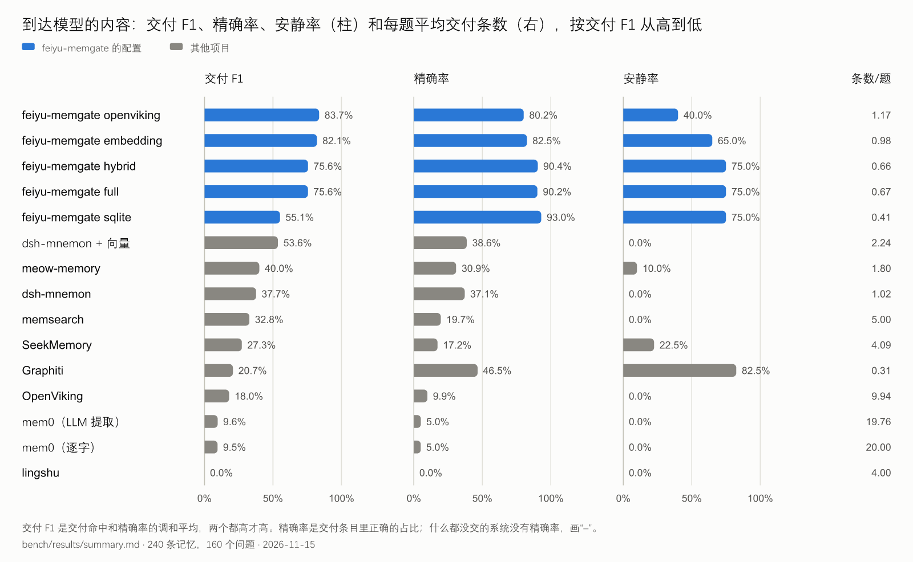
  </picture>
</p>

*交付 F1* 是“交付里有没有正确记忆”和“交付的内容里正确的占多少”的调和平均，两个都高才高。本项目默认（宽松档）的四种向量和混合配置在 71.6% – 82.7%，关键词配置 61.3%；固定为精确档时是 75.6% – 83.7% 和 55.1%。其他项目最高的是打开向量的 dsh-mnemon（53.6%），其余在 0% – 40%。差距主要来自精确率：多数系统默认把前 N 条都交出去，Hindsight 的三个配置每题交 84 – 94 条，精确率约 1%，交付 F1 为 2.1% – 2.3%。宽松档的精确率比精确档低，所以向量和混合配置的交付 F1 在宽松档下反而更低（`embedding` 82.1% → 71.6%，`hybrid` 75.6% → 74.7%），只有关键词配置升了。

### 检索排名

<p align="center">
  <picture>
    <source media="(prefers-color-scheme: dark)" srcset="docs/assets/charts/ranking.zh.dark.png">
    
  </picture>
</p>

<p align="center">
  <picture>
    <source media="(prefers-color-scheme: dark)" srcset="docs/assets/charts/hit-at-k.zh.dark.png">
    
  </picture>
</p>

- 向量配置的 Hit@5 是 98.3%，和同样使用 bge-m3 的 memsearch、mem0、OpenViking 相同。这一列主要由嵌入模型决定，不是网关的功劳。同样用 bge-m3 的 Hindsight 是 90.0% – 94.2%，dsh-prime-memory 加向量是 84.2%。
- memsearch 的排名最好：Hit@1 85.0%，前 8 条里一定有正确记忆。本项目的向量后端 Hit@1 是 81.7%。
- 本项目的向量配置、memsearch、mem0（逐字入库）和 OpenViking 在前 2 条就达到 93% – 96%，之后的增长很慢；这是精确档“每题交 1 到 2 条”可行的依据。Hindsight 的前 2 条是 87.5% – 88.3%，dsh-prime-memory 加向量是 65.0%。
- 关键词系统的曲线更平：本项目的关键词后端和 lingshu 到第 10 条是 88.3%，dsh-prime-memory 79.2%，SeekMemory、meow-memory、dsh-soul-md 约 70%，dsh-fish-memory 约 52%。它们不理解语义，改写题是上限。
- 混合后端的 Hit@1 略高（83.3%），Hit@5 略低（96.7%），差别都在两三个问题以内。

### 默认交付

<p align="center">
  <picture>
    <source media="(prefers-color-scheme: dark)" srcset="docs/assets/charts/delivered.zh.dark.png">
    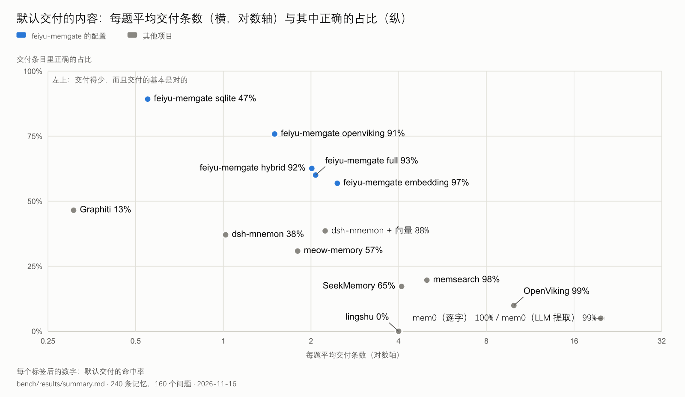
  </picture>
</p>

| 系统 | 检索类型 | Hit@1 | Hit@5 | 平均交付条数 | 交付命中 | 精确率 | 交付 F1 | 安静率 | p50 延迟 |
|---|---|---:|---:|---:|---:|---:|---:|---:|---:|
| **feiyu-memgate embedding** | 向量 | 81.7% | 98.3% | 2.46 | 96.7% | 56.9% | 71.6% | 32.5% | 24 ms |
| feiyu-memgate embedding（精确档） | 向量 | 81.7% | 98.3% | 0.98 | 81.7% | 82.5% | 82.1% | 65.0% | 25 ms |
| **feiyu-memgate openviking** | 向量 | 81.7% | 98.3% | 1.50 | 90.8% | 75.9% | 82.7% | 40.0% | 26 ms |
| feiyu-memgate openviking（精确档） | 向量 | 81.7% | 98.3% | 1.17 | 87.5% | 80.2% | 83.7% | 40.0% | 25 ms |
| **feiyu-memgate hybrid** | 混合 | 83.3% | 96.7% | 2.01 | 92.5% | 62.6% | 74.7% | 35.0% | 28 ms |
| feiyu-memgate hybrid（精确档） | 混合 | 83.3% | 96.7% | 0.66 | 65.0% | 90.4% | 75.6% | 75.0% | 28 ms |
| **feiyu-memgate full** | 混合 + 新鲜度 | 83.3% | 95.0% | 2.08 | 93.3% | 60.1% | 73.1% | 35.0% | 33 ms |
| feiyu-memgate full（精确档） | 混合 + 新鲜度 | 84.2% | 95.0% | 0.67 | 65.0% | 90.2% | 75.6% | 75.0% | 33 ms |
| **feiyu-memgate sqlite** | 关键词 | 61.7% | 81.7% | 0.55 | 46.7% | 89.3% | 61.3% | 70.0% | 2 ms |
| feiyu-memgate sqlite（精确档） | 关键词 | 61.7% | 81.7% | 0.41 | 39.2% | 93.0% | 55.1% | 75.0% | 2 ms |
| memsearch | 混合 | 85.0% | 98.3% | 5.00 | 98.3% | 19.7% | 32.8% | 0.0% | 26 ms |
| mem0（逐字入库） | 向量 | 81.7% | 98.3% | 20.00 | 100.0% | 5.0% | 9.5% | 0.0% | 35 ms |
| OpenViking | 向量 | 81.7% | 98.3% | 9.94 | 99.2% | 9.9% | 18.0% | 0.0% | 25 ms |
| mem0（LLM 提取） | 提取 | 77.5% | 95.0% | 19.76 | 99.2% | 5.0% | 9.6% | 0.0% | 69 ms ‡ |
| Hindsight（deepseek-flash） | 提取 | 70.0% | 94.2% | 91.97 | 98.3% | 1.1% | 2.1% | 0.0% | 1550 ms |
| Hindsight（claude-haiku-5-5） | 提取 | 72.5% | 91.7% | 84.01 | 97.5% | 1.2% | 2.3% | 0.0% | 1556 ms |
| dsh-mnemon + 向量 | 混合 | 80.0% | 90.8% | 2.24 | 87.5% | 38.6% | 53.6% | 0.0% | 78 ms |
| Hindsight（无模型） | 混合 | 78.3% | 90.0% | 93.54 | 99.2% | 1.1% | 2.1% | 0.0% | 455 ms |
| dsh-prime-memory + 向量 | 混合 | 45.0% | 84.2% | 5.00 | 85.0% | 17.0% | 28.3% | 0.0% | 21 ms |
| lingshu | 关键词 | 65.0% | 81.7% | 4.00 | 0.0% | 0.0% | 0.0% | 0.0% | 2 ms |
| dsh-prime-memory | 关键词 | 35.8% | 74.2% | 4.66 | 74.2% | 15.5% | 25.6% | 2.5% | 1 ms |
| dsh-soul-md | 关键词 | 51.7% | 65.0% | 3.94 | 65.0% | 17.5% | 27.6% | 10.0% | 3 ms |
| SeekMemory | 关键词 | 50.8% | 64.2% | 4.09 | 65.0% | 17.2% | 27.3% | 22.5% | 2 ms |
| meow-memory | 关键词 | 51.7% | 63.3% | 1.80 | 56.7% | 30.9% | 40.0% | 10.0% | 2 ms |
| dsh-fish-memory + deepseek-flash 扩词 | 关键词 | 40.8% | 50.8% | 1.95 | 48.3% | 31.8% | 38.3% | 32.5% | 2 ms |
| dsh-fish-memory + claude-haiku-5-5 扩词 | 关键词 | 40.0% | 50.8% | 1.97 | 47.5% | 31.2% | 37.7% | 32.5% | 2 ms |
| dsh-fish-memory | 关键词 | 40.0% | 49.2% | 2.07 | 48.3% | 31.5% | 38.1% | 32.5% | 1 ms |
| dsh-mnemon | 关键词 | 38.3% | 42.5% | 1.02 | 38.3% | 37.1% | 37.7% | 0.0% | 33 ms |
| Graphiti | 图 | 12.5% | 13.3% | 0.31 | 13.3% | 46.5% | 20.7% | 82.5% | 391 ms ‡ |

*交付命中*：默认交付的内容里有正确记忆的问题占比。*精确率*：交出去的条目里正确的占比，只统计交付了东西的可答问题。*交付 F1*：前两者的调和平均。*安静率*：40 个安静题里什么都没交的比例。本项目的行：加粗的是默认（宽松档），紧跟的“精确档”是同一配置固定 `[recall] profile = "precise"`。`full` 两档的 Hit@1 差一个问题（83.3% 对 84.2%）：这个配置的排名是在本题的交付被记为“用过”之后测的，新鲜度会读这份记录，宽松档下被记的条目更多；其余配置的排名不随档位变。‡ 这两行是付费模式，没有在最后的顺序运行里重跑，延迟来自一台同时有其他任务的机器。

这张表说明了四件事：

1. **多数系统的默认做法是把前 N 条全部交出去。** 所以它们的交付命中接近 100%，精确率只有 1% – 39%，安静题上几乎从不保持安静。本项目默认（宽松档）每题交 0.55 – 2.46 条，精确率 56.9% – 89.3%（向量和混合配置 56.9% – 75.9%），交付命中 46.7% – 96.7%；固定为精确档时每题 0.41 – 1.17 条，精确率 80.2% – 93.0%。
2. **默认档漏答少得多，代价是杂项和不安静。** 向量和混合配置交出去的条目里有 24% – 43% 不对；40 个安静题里只有 32.5% – 40.0% 什么都没交（精确档 40.0% – 75.0%），也就是 60.0% – 67.5% 的没有答案的问题会拿不相关的记忆开口；每题交的字数是精确档的 1.3 – 3.1 倍。这是此前“少而准”的反面：多答对了题，但没有答案时更容易硬接话，上下文也更长。
3. **精确档的代价是漏答。** 固定为 `profile = "precise"` 时交付命中是 39.2% – 87.5%，低于“多给几条”的系统。改写题最吃亏，见下一小节。
4. **混合后端没有在命中上超过单用向量。** 交付命中 92.5% 对 96.7%，排名 Hit@5 96.7% 对 98.3%；它的默认分数线更严，交得更少（2.01 条对 2.46 条）。之后在开发集上比较了五种融合方式，又换了两个小模型来配，都没有明显超过单用向量：换了说法的问题里，正确记忆的关键词分数比无关记忆的还低。有 embeddings 接口时用 `embedding`；没有时用 `sqlite`。

分数线是配置项。默认是宽松档；更在意少而准（或者记忆块留在对话历史里、上下文要省），写 `[recall] profile = "precise"` 回到以前的行为，实测的取舍见[部署档位](#部署档位)；[docs/backends.md](docs/backends.md) 写了每个后端两档的数值是怎么选出来的，以及用自己的数据重新选的办法。

### 分题型

<p align="center">
  <picture>
    <source media="(prefers-color-scheme: dark)" srcset="docs/assets/charts/by-type.zh.dark.png">
    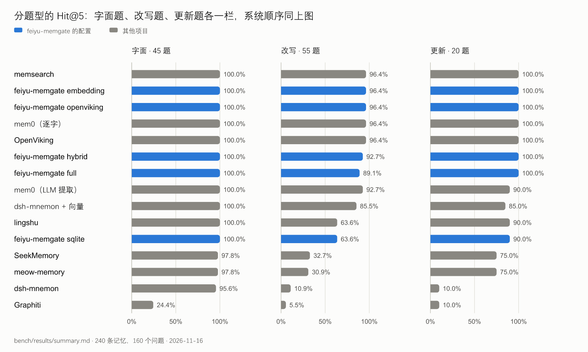
  </picture>
</p>

<p align="center">
  <picture>
    <source media="(prefers-color-scheme: dark)" srcset="docs/assets/charts/delivered-by-type.zh.dark.png">
    
  </picture>
</p>

每格是“排名 Hit@5 / 默认交付命中”：

| 系统 | 字面题（45） | 改写题（55） | 更新题（20） |
|---|---:|---:|---:|
| **feiyu-memgate embedding** | 100.0% / 100.0% | 96.4% / 92.7% | 100.0% / 100.0% |
| feiyu-memgate embedding（精确档） | 100.0% / 100.0% | 96.4% / 69.1% | 100.0% / 75.0% |
| **feiyu-memgate openviking** | 100.0% / 100.0% | 96.4% / 81.8% | 100.0% / 95.0% |
| feiyu-memgate openviking（精确档） | 100.0% / 100.0% | 96.4% / 81.8% | 100.0% / 75.0% |
| **feiyu-memgate hybrid** | 100.0% / 100.0% | 92.7% / 85.5% | 100.0% / 95.0% |
| feiyu-memgate hybrid（精确档） | 100.0% / 100.0% | 92.7% / 34.5% | 100.0% / 70.0% |
| **feiyu-memgate full** | 100.0% / 100.0% | 89.1% / 85.5% | 100.0% / 100.0% |
| feiyu-memgate full（精确档） | 100.0% / 100.0% | 89.1% / 34.5% | 100.0% / 70.0% |
| **feiyu-memgate sqlite** | 100.0% / 97.8% | 63.6% / 3.6% | 90.0% / 50.0% |
| feiyu-memgate sqlite（精确档） | 100.0% / 95.6% | 63.6% / 0.0% | 90.0% / 20.0% |
| memsearch | 100.0% / 100.0% | 96.4% / 96.4% | 100.0% / 100.0% |
| mem0（逐字入库） | 100.0% / 100.0% | 96.4% / 100.0% | 100.0% / 100.0% |
| OpenViking | 100.0% / 100.0% | 96.4% / 98.2% | 100.0% / 100.0% |
| mem0（LLM 提取） | 100.0% / 100.0% | 92.7% / 98.2% | 90.0% / 100.0% |
| Hindsight（deepseek-flash） | 100.0% / 100.0% | 89.1% / 96.4% | 95.0% / 100.0% |
| Hindsight（claude-haiku-5-5） | 100.0% / 100.0% | 83.6% / 94.5% | 95.0% / 100.0% |
| dsh-mnemon + 向量 | 100.0% / 100.0% | 85.5% / 78.2% | 85.0% / 85.0% |
| Hindsight（无模型） | 100.0% / 100.0% | 80.0% / 98.2% | 95.0% / 100.0% |
| dsh-prime-memory + 向量 | 100.0% / 100.0% | 67.3% / 69.1% | 95.0% / 95.0% |
| lingshu | 100.0% / 0.0% | 63.6% / 0.0% | 90.0% / 0.0% |
| dsh-prime-memory | 97.8% / 97.8% | 47.3% / 47.3% | 95.0% / 95.0% |
| dsh-soul-md | 100.0% / 100.0% | 38.2% / 38.2% | 60.0% / 60.0% |
| SeekMemory | 97.8% / 97.8% | 32.7% / 32.7% | 75.0% / 80.0% |
| meow-memory | 97.8% / 97.8% | 30.9% / 25.5% | 75.0% / 50.0% |
| dsh-fish-memory + deepseek-flash 扩词 | 91.1% / 88.9% | 14.5% / 12.7% | 60.0% / 55.0% |
| dsh-fish-memory + claude-haiku-5-5 扩词 | 88.9% / 88.9% | 16.4% / 14.5% | 60.0% / 45.0% |
| dsh-fish-memory | 88.9% / 88.9% | 12.7% / 12.7% | 60.0% / 55.0% |
| dsh-mnemon | 95.6% / 93.3% | 10.9% / 5.5% | 10.0% / 5.0% |
| Graphiti | 24.4% / 24.4% | 5.5% / 5.5% | 10.0% / 10.0% |

- **字面题基本不区分系统。** 问法和记忆用词相同时，除 Graphiti（24.4%）和 dsh-fish-memory（88.9% – 91.1%）外，所有系统的排名都在 95% 以上。
- **改写题区分关键词和向量。** 向量和混合系统的排名在 67% – 96%（dsh-prime-memory 加向量 67.3% 最低，Hindsight 80.0% – 89.1%），关键词系统在 11% – 64%。
- **精确档的漏答集中在改写题。** 固定为精确档时，向量后端排名 96.4%，交付 69.1%：正确的记忆找到了，但分数没过线；混合后端只交出 34.5%，关键词后端是 0.0%。默认的宽松档把这个缺口补上了：向量后端交付 92.7%，混合后端 85.5%，关键词后端仍只有 3.6%（它的问题在检索，不在分数线）。字面题上交付和排名几乎一样。
- **交付命中可以高于排名 Hit@5。** 默认交 10 到 20 条的系统，交付的范围比前 5 条大；Hindsight 每题交 84 – 94 条，改写题的交付命中（94.5% – 98.2%）比排名 Hit@5（80.0% – 89.1%）高 7 到 18 个点。
- **更新题**上本项目默认交付 95.0% – 100.0%（关键词后端 50.0%），精确档 70.0% – 75.0%（关键词后端 20.0%）；交出去时新旧的顺序，见下面“新旧事实的顺序”。

### 没有答案的问题

<p align="center">
  <picture>
    <source media="(prefers-color-scheme: dark)" srcset="docs/assets/charts/quiet.zh.dark.png">
    
  </picture>
</p>

40 个问题在记忆里没有答案，交付了任何东西都算没有保持安静。本项目默认（宽松档）的配置在 32.5% – 70.0%（向量和混合配置 32.5% – 40.0%），固定为精确档时是 40.0% – 75.0%。SeekMemory 22.5%，dsh-fish-memory 的三个配置都是 32.5%（查询门或没有命中词时不交），dsh-soul-md 和 meow-memory 10%，dsh-prime-memory 2.5%，其余默认不设分数线的系统是 0%，包括 Hindsight 的三个配置。Graphiti 是 82.5%，它在可答题上也很少交付（见限度一节）。新默认在这一项上比以前差：`embedding` 从 65.0% 降到 32.5%，没有答案的问题上平均每题仍交 2.12 条（精确档 0.57 条）。对陪伴类机器人来说，这一项决定它会不会拿一条不相干的旧事硬接话。

### 上下文占用

<p align="center">
  <picture>
    <source media="(prefers-color-scheme: dark)" srcset="docs/assets/charts/context.zh.dark.png">
    
  </picture>
</p>

这批记忆平均每条约 24 个字，所以字数基本随条数走：本项目默认（宽松档）每题交 14 – 59 个字（精确档 10 – 28 个字），meow-memory 44 字，dsh-fish-memory 49 – 52 字，打开向量的 dsh-mnemon 54 字，lingshu 90 字，SeekMemory 98 字，dsh-soul-md 100 字，dsh-prime-memory 113 – 121 字，memsearch 120 字，OpenViking 240 字，mem0 约 480 字，Hindsight 约 2060 – 2270 字（每题 84 – 94 条）。宽松档下向量和混合配置（36 – 59 字）和 meow-memory、dsh-fish-memory、打开向量的 dsh-mnemon 在同一个量级，仍比 lingshu 以下的系统少。真实对话里的记忆更长，绝对值会按比例放大。交付的内容每一轮都要计入提示词，这一项直接对应费用和模型被无关内容干扰的机会。

### 新旧事实的顺序

<p align="center">
  <picture>
    <source media="(prefers-color-scheme: dark)" srcset="docs/assets/charts/fresh.zh.dark.png">
    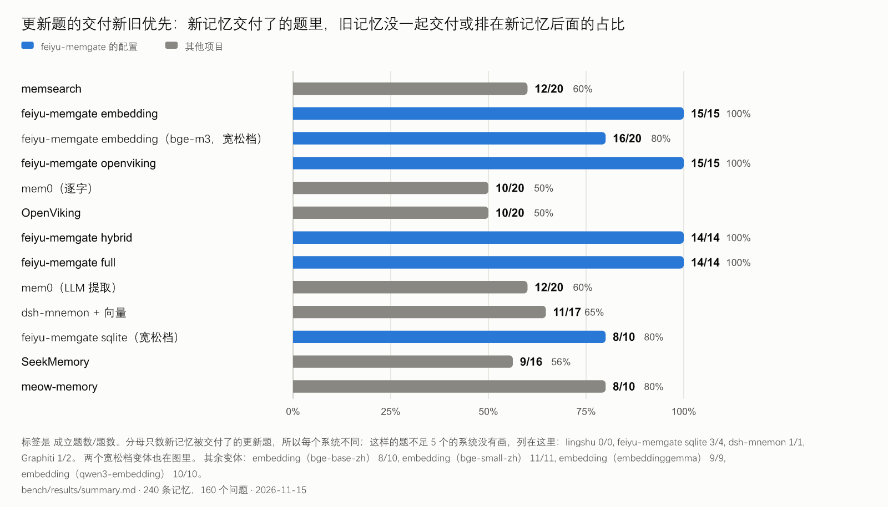
  </picture>
</p>

更新题里同一件事有新旧两条记忆。下表只看“新的那条被交付了”的问题，统计其中旧的那条没有排在它前面的题数。

| 系统 | 加入 `newer_first` 之前 | 之后 |
|---|---:|---:|
| feiyu-memgate embedding |  | 16/20 |
| feiyu-memgate embedding（精确档） | 9/15 | 15/15 |
| feiyu-memgate openviking |  | 19/19 |
| feiyu-memgate openviking（精确档） | 9/15 | 15/15 |
| feiyu-memgate hybrid |  | 16/19 |
| feiyu-memgate hybrid（精确档） | 8/14 | 14/14 |
| feiyu-memgate full |  | 19/20 |
| feiyu-memgate full（精确档） |  | 14/14 |
| feiyu-memgate sqlite |  | 8/10 |
| feiyu-memgate sqlite（精确档） | 3/4 | 3/4 |
| Hindsight（无模型） | | 13/20 |
| memsearch、mem0（LLM 提取） | | 12/20 |
| dsh-mnemon + 向量 | | 11/17 |
| mem0（逐字入库）、OpenViking | | 10/20 |
| dsh-fish-memory、dsh-fish-memory + deepseek-flash 扩词 | | 10/11 |
| dsh-prime-memory、dsh-prime-memory + 向量 | | 9/19 |
| SeekMemory | | 9/16 |
| dsh-fish-memory + claude-haiku-5-5 扩词 | | 9/9 |
| meow-memory | | 8/10 |
| dsh-soul-md | | 7/12 |
| Hindsight（claude-haiku-5-5） | | 5/20 |
| Hindsight（deepseek-flash） | | 2/20 |

新记忆被交付不足 5 题的系统没有列出（精确档的关键词后端 3/4 是更早的表里留下的）。Hindsight 的两个模型配置交付的是模型归并出来的 observation，适配器给它们的编号取来源事实里最早的那条记忆，所以这两行的数字受这条编号规则影响；无模型配置里每条记忆是一个独立的原文块，没有这条规则。本项目其他配置，默认（宽松档）：bge-small-zh 11/15、bge-base-zh 12/15、embeddinggemma 12/19、qwen3-embedding 14/19；精确档：11/11、8/10、9/9、10/10。宽松档下除 `openviking` 外都不是全对，因为分数线放得比 `newer_first` 的作用范围宽：这一步只在分数不低于最高分 85% 的候选之间调整顺序，范围之外的候选保持原来的位置。

`newer_first` 只调整通过了分数线的候选之间的顺序，不改变交付哪些记忆，所以上面默认交付表里的数字没有因此变化。它不判断两条记忆是否矛盾，也不会让旧的那条失效；记忆没有日期时不起作用。按后端自己的排名（不经过召回步骤），所有系统把新记忆排在旧记忆前面的比例都在 5% – 65% 之间，本项目也是 50% – 55%。测试集只有 20 道更新题，开发集 12 道，样本很小。

### 成本

<p align="center">
  <picture>
    <source media="(prefers-color-scheme: dark)" srcset="docs/assets/charts/cost.zh.dark.png">
    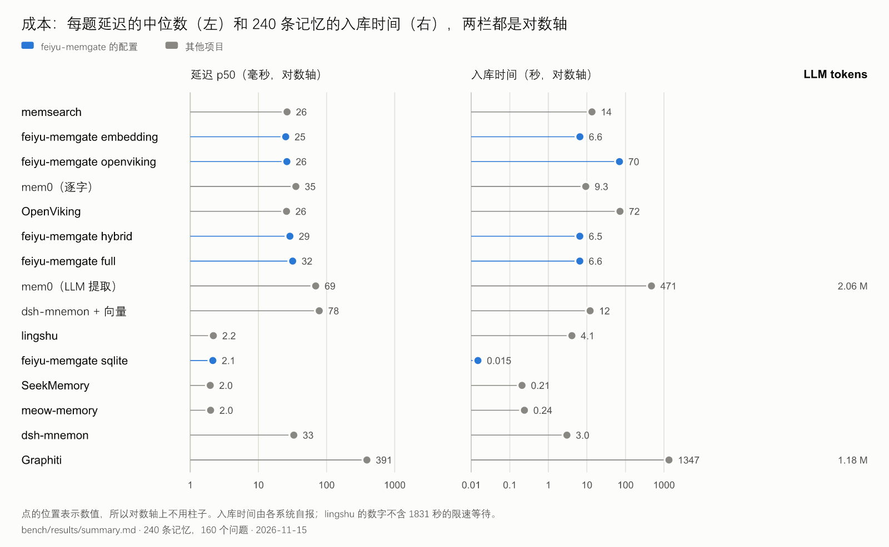
  </picture>
</p>

| 系统 | 延迟 p50 | 延迟 p95 | 入库 240 条 | 写入用的 LLM token | 费用 |
|---|---:|---:|---:|---:|---:|
| **feiyu-memgate sqlite** | 2 ms | 3 ms | 0.01 s | 0 | 0 |
| **feiyu-memgate embedding** | 24 ms | 51 ms | 6.4 s | 0 | 0 |
| **feiyu-memgate hybrid** | 28 ms | 55 ms | 6.4 s | 0 | 0 |
| **feiyu-memgate full** | 33 ms | 54 ms | 6.4 s | 0 | 0 |
| **feiyu-memgate openviking** | 26 ms | 53 ms | 69.3 s | 0 | 0 |
| memsearch | 26 ms | 53 ms | 13.6 s | 0 | 0 |
| mem0（逐字入库） | 35 ms | 80 ms | 9.3 s | 0 | 0 |
| OpenViking | 25 ms | 52 ms | 71.8 s | 0 | 0 |
| mem0（LLM 提取） | 69 ms ‡ | 610 ms ‡ | 471 s ‡ | 206 万 | 0.53 元 |
| Hindsight（deepseek-flash） | 1550 ms | 1753 ms | 327 s | 247 万 | 0.178 美元 |
| Hindsight（claude-haiku-5-5） | 1556 ms | 2136 ms | 368 s | 328 万 | 0.190 美元 |
| dsh-mnemon + 向量 | 78 ms | 105 ms | 12.2 s | 0 | 0 |
| Hindsight（无模型） | 455 ms | 542 ms | 10.6 s | 0 | 0 |
| dsh-prime-memory + 向量 | 21 ms | 23 ms | 4.3 s | 0 | 0 |
| lingshu | 2 ms | 3 ms | 4.1 s | 0 | 0 |
| dsh-prime-memory | 1 ms | 1 ms | 0.2 s | 0 | 0 |
| dsh-soul-md | 3 ms | 4 ms | 0.1 s | 0 | 0 |
| SeekMemory | 2 ms | 3 ms | 0.2 s | 0 | 0 |
| meow-memory | 2 ms | 3 ms | 0.2 s | 0 | 0 |
| dsh-fish-memory + deepseek-flash 扩词 | 2 ms | 3 ms | 109 s | 6.5 万 | 0.011 美元 |
| dsh-fish-memory + claude-haiku-5-5 扩词 | 2 ms | 21 ms | 123 s | 10.4 万 | 0.012 美元 |
| dsh-fish-memory | 1 ms | 2 ms | 0.3 s | 0 | 0 |
| dsh-mnemon | 33 ms | 39 ms | 3.0 s | 0 | 0 |
| Graphiti | 391 ms ‡ | 848 ms ‡ | 1347 s ‡ | 118 万 | 约 2 元 |

- 向量配置的延迟主要花在一次查询嵌入上：本项目、memsearch、mem0、OpenViking 在 24 – 35 ms，dsh-mnemon + 向量 78 ms，这几个是 bge-m3 在 CPU 上时测的。后加的四个项目测量时 bge-m3 已经搬到显卡上，dsh-prime-memory + 向量是 21 ms（含一次嵌入请求），和前面几个的条件不完全相同。Hindsight 每次召回要跑四路检索并用本地的交叉编码器重排序：无模型配置 455 ms，两个模型配置约 1.55 秒（p95 为 1.75 – 2.14 秒）；这三个数字是机器上还有其他测试在跑时测的，无模型配置在空闲机器上重测是 428 ms。不带向量的关键词配置多数在 1 – 3 ms，dsh-mnemon 默认模式是 33 ms。本项目的表里是默认档的行，固定为精确档的行延迟相差不超过 1 ms，入库时间同一量级。
- 本项目写入不调用大模型。多数第三方系统的默认写入路径要用大模型，这里绕过了（逐字入库），所以它们的 token 列是 0；mem0 的 LLM 提取模式、Graphiti 和 Hindsight 的两个模型配置按默认路径跑了，`dsh-fish-memory` 的两个扩词配置让插件自己的后台关键词扩展用了模型（写入仍是逐字，模型只补检索词）。
- 接 OpenViking 的两行入库慢，是因为它的索引是异步的，时间里包含等待索引完成。
- lingshu 的入库时间不含它自己的写入限速造成的等待。

四个带模型的新增配置（`dsh-fish-memory` 的两个扩词配置和 Hindsight 的两个模型配置）的模型用量，来自服务商 API 返回的 usage 字段：

| 配置 | 调用次数 | 输入 token | 其中缓存命中 | 输出 token | 费用 |
|---|---:|---:|---:|---:|---:|
| dsh-fish-memory + deepseek-flash 扩词 | 121 | 62,465 | 36,864 | 2,874 | 0.011 美元 |
| dsh-fish-memory + claude-haiku-5-5 扩词 | 121 | 99,039 | 0 | 4,691 | 0.012 美元 |
| Hindsight（deepseek-flash） | 423 | 2,399,585 | 1,510,272 | 67,298 | 0.178 美元 |
| Hindsight（claude-haiku-5-5） | 400 | 3,167,514 | 2,034,305 | 112,097 | 0.190 美元 |

这四个配置都关闭了思考（请求里 `thinking` 设为 `disabled`），没有推理 token，没有失败的调用；mem0 和 Graphiti 那两次付费运行用的是 API 默认的思考设置，所以这四行和它们的 token 数、费用不能直接比。费用按 [bench/external/prices.json](bench/external/prices.json) 的标价（读取日期 2026-11-16）计算，单位是美元，不是上面两行的人民币：DeepSeek 按每次调用所在的时段（峰时或非峰时）计价，claude-haiku-5-5 按固定价格，缓存命中按缓存价。`dsh-fish-memory` 的调用是写入每条记忆之后的后台关键词扩展（121 次，每次为最多两条还没有扩展词的记忆要词）；Hindsight 的调用是服务端提取事实和归并 observation，次数是请求数减去重试数，含服务启动时的一次连接检查，回答 160 个问题时没有任何模型调用。

### 分数没有覆盖的能力

上面的分数只回答一个问题：对一个问题，系统交出来的内容里有没有该有的那条记忆，夹带了多少无关的。有些项目在检索之外还会整理记忆：由模型抽取事实，把几条归并成一条，让旧事实失效，写出综合性的文字，或者随使用强化和遗忘。这些能力不在分数里。

| 能力 | 核实到具备的项目 | 基准测到的 | 没有测的 |
|---|---|---|---|
| 写入时由模型抽取事实，或由模型决定存什么 | mem0、OpenViking、Graphiti、SeekMemory、dsh-mnemon、dsh-fish-memory、dsh-prime-memory、Hindsight；meow-memory 和 dsh-soul-md 由宿主模型通过工具写入；memsearch 的 DSH 插件用模型总结每轮对话 | mem0、Graphiti、Hindsight 各有带模型的配置：抽取出的条目能不能被检索到，以及调用次数和花费 | 其余项目的这一步被绕过（逐字入库）；抽取得准不准、有没有漏掉信息，都没有判 |
| 归并、改写，或让旧事实失效 | Graphiti、Hindsight、dsh-fish-memory、dsh-prime-memory、dsh-soul-md；后台整理：SeekMemory（夜间整理）、dsh-mnemon（空闲复盘）、meow-memory（反思和整理）；lingshu 用规则代码合并和去重 | 更新题和[新旧事实的顺序](#新旧事实的顺序)看新旧两条谁排在前面；Hindsight 的两个模型配置交付的就是归并出的 observation，能追溯到来源记忆的计为命中 | 归并出的内容对不对、是否比原文更有用；后台整理不在基准的流程里 |
| 模型写的综合文字，或不随问题变化的常驻内容 | Hindsight（reflect）、dsh-prime-memory（场景块和人设）、dsh-mnemon（运行时记忆的快照）、dsh-soul-md（人设卡、core 文本和 topic 索引）、meow-memory（首条消息前的快照） | 无 | 全部：它们交出的是一段文字或固定内容，不是能逐条对照标注的记忆列表 |
| 随使用调整：强化、降权、遗忘 | 本项目（遗忘曲线，可选，默认关闭）、SeekMemory（用上了才强化，遗忘曲线）、dsh-fish-memory（合并时强化，新鲜度加权）、dsh-prime-memory（30 天新鲜度加权）、meow-memory（按时间降权）、lingshu（降权和折叠） | 排序里的时间加权按各系统的默认设置参与了排名，没有单独拆出来 | 基准是一次写完再提问，没有“用过一段时间”的状态，强化和遗忘的效果看不到 |

这张表只列核实到的，没有列出不代表没有。各项目的具体做法见 [bench/results/design/features.md](bench/results/design/features.md) 的“归并、改写与后台整理”一列。

没有把这些能力并进分数，有三个原因：

- **评判方式不同**。归并得对不对、综合文字有没有用，要看最终的回答：让模型拿着交付的内容作答，再判对错。这样的结果随所用的模型变化，也要为每个系统的每道题调用模型。本基准没有做，公开数据集一节用的也是按标注的记忆判命中的同一套测量。
- **只有一部分项目具备**，做法也各不相同，放不进同一张排名。
- **本项目不做这些**。它只存原文，不抽取、不归并、不改写，所以这份基准比的是本项目做的那一层。

读这些数字时要记住：有这些能力的系统，长处有一部分落在分数之外，它们在完整产品里的表现不能只从这里的数字推出。例如 Hindsight 的插件默认注入的是一段 reflect 文字，这里测的是它只召回的选项（每题交 84 – 94 条）。

### 这些数字的限度

- 240 条记忆是小数据集，一个问题约 0.8 个百分点，几个百分点的差距不构成结论。数据是合成的单句中文，只有一个虚构人物。
- 适配器是本项目写的。每个适配器的 README 写明了调用的入口和理由，但立场偏差无法完全排除，欢迎各项目的作者指正。
- 多数第三方系统的默认写入路径要用大模型提取或整理，这里绕过了（逐字入库），只测了检索和交付。mem0、Graphiti 和 Hindsight 另外跑了带大模型的模式，dsh-fish-memory 另外跑了让后台关键词扩展用模型的模式。
- Graphiti 用的不是它推荐的技术栈（嵌入式 Kuzu 加一个小模型做提取），240 条记忆只抽出 69 条事实边，这个结果不代表它在推荐配置下的水平。
- lingshu 每轮自动注入的是会话里最新的 4 条，不看问题，所以交付命中为 0 是设计使然，不是检索失败。
- dsh-mnemon 的结果每次运行有约 ±5 个百分点的波动。
- memsearch 不自动注入记忆内容，dsh-mnemon 的记忆空间也由模型决定是否检索；这里的“默认交付”是模型调用一次召回工具时拿到的内容。dsh-mnemon 自动提供的运行时记忆（USER.md、MEMORY.md 的快照）是另一套东西，这次没有测。
- “不正确”按标注的期望记忆判定，没有标注但沾边的条目也算噪声。
- dsh-fish-memory 和 dsh-prime-memory 的产品写入由模型决定存什么、怎么整理（前者经 remember 工具，后者从对话蒸馏），这里每条记忆逐字写入，没有测这一步；dsh-soul-md 这里每条记忆写成一个 topic，产品里一个 topic 通常合并几条，它的人设卡不是记忆，没有测。
- Hindsight 的插件默认注入的是模型写的 reflect 文字，不是记忆列表，没有测；测的是服务端的召回，请求体和插件的只召回选项相同。这个召回只受 2000 token 预算限制，没有条数上限和分数线，所以每题交 84 – 94 条。嵌入模型换成了 bge-m3（服务端默认是英文模型），数据库用容器里的 PostgreSQL 17 加 pgvector。两个模型配置交付的 observation 没有自己的来源编号，适配器取来源事实里最早的那条记忆的编号，规则和计数写在结果文件的 `notes` 里（`bench/results/raw/hindsight-llm-*.json`）。
- 本项目的数字是在加入 `linked` 步骤之前测的。这个步骤现在默认开启：用向量或混合后端时，一次召回可能在条数上限之内多交最多两条和前两条相连的记忆，所以这两类配置现在的默认交付会比表里多一点；关键词后端不受影响。这些表没有为此重测。它在闲聊场景的效果见 [docs/design/2026-11-18-linked-recall.md](docs/design/2026-11-18-linked-recall.md)。
- 各项目的版本是测试时的版本，之后可能已经改变。

### 公开数据集：PerLTQA 与 LoCoMo

上面的题库是为本项目写的，只有 240 条记忆。为了在别人写的、更大的数据上检查默认设置，同一套测量又在两个公开数据集上做了一遍：只测检索和交付，不生成回答，不用评审模型。

| 数据集 | 内容 | 库 | 记忆 | 可答问题 | 没有答案的问题 |
|---|---|---:|---:|---:|---:|
| [PerLTQA](https://github.com/Elvin-Yiming-Du/PerLTQA)（中文部分） | 人物档案、社会关系、事件、对话记录；每条记忆的中位长度 260 字 | 32 | 2,155 | 8,588 | 0 |
| [LoCoMo](https://github.com/snap-research/locomo) | 英文长对话，一句话一条记忆；每条的中位长度 116 个字符 | 10 | 5,882 | 1,535 | 446 |

一个“库”是一个独立的记忆库：PerLTQA 里是一个人物，LoCoMo 里是一段对话。每个系统对每个库单独建库、单独提问，哪条记忆算正确用数据集自带的证据标注。两个数据集都是 CC BY-NC 4.0 许可，文件不放进仓库；加载数据集和运行各系统的代码也没有放进仓库。仓库里是结果文件（只有编号和数字），以及从结果生成表格和图的脚本。数据的来源和版本、库的构造方式、每个数字的定义见 [bench/external/README.md](bench/external/README.md)，全部表格见 [bench/external/results/summary.md](bench/external/results/summary.md)。

和上面的题库相比有三点不同：

- **没有针对这两个数据集调整任何设置。** 本项目用的是在自己的开发集上选出的默认分数线，其他系统用各自的默认设置。
- **调用大模型的配置各跑了两个模型。** mem0 的 LLM 提取、Graphiti、Hindsight 和 dsh-fish-memory 的扩词都分别用 deepseek-flash 和 claude-haiku-5-5 跑了一遍，两个模型都关闭了思考模式。关闭思考是这次测试为了控制运行时间做的设定，不是这两个模型的默认值。
- **一部分配置只跑了前几个库。** mem0 的 LLM 提取跑了全部的库。Graphiti 和 dsh-fish-memory 的扩词因为要调用模型，只跑了按编号排在最前面的几个库。Hindsight 的一次召回在测试机上要 2 – 3 秒（服务端带一个本地重排序模型；单独测量时中位数是 1.8 – 2.9 秒），一个库的提问阶段要 25 – 65 分钟，所以它的三种配置（包括不用模型的那种）也只跑了前几个库。这些配置单独比较，旁边放本项目在同一批库上的结果，见[抽样运行的配置](#抽样运行的配置)。

#### 总览

<p align="center">
  <picture>
    <source media="(prefers-color-scheme: dark)" srcset="docs/assets/charts/ext-overview.zh.dark.png">
    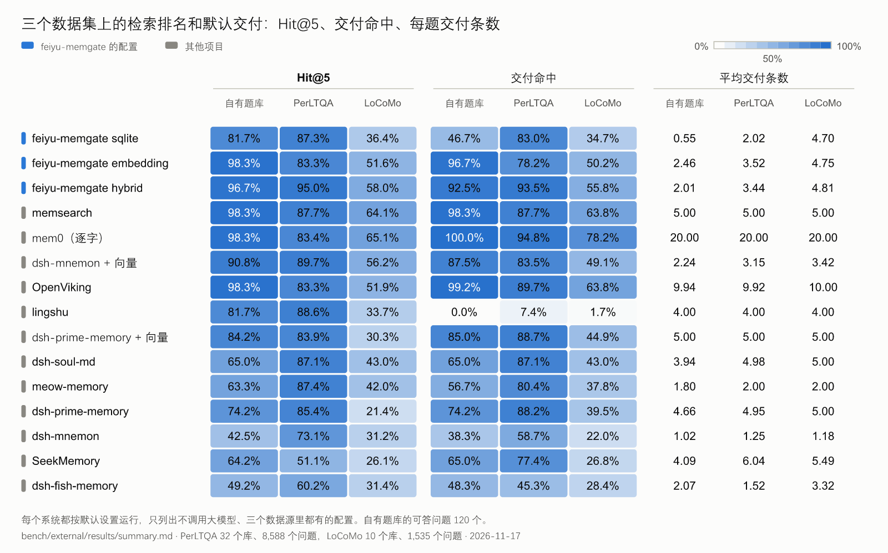
  </picture>
</p>

- **同一个系统在三个数据集上的排名不一样。** 自有题库上 Hit@5 同为 98.3% 的四个向量配置（本项目的 `embedding`、memsearch、mem0 逐字入库、OpenViking），在 PerLTQA 上是 83.3% – 87.7%，在 LoCoMo 上是 51.6% – 65.1%。
- **本项目的混合配置在 PerLTQA 上排名最高（Hit@5 95.0%），在 LoCoMo 上处于中游（58.0%）。** LoCoMo 上跑了全部库的配置里，最高的是 mem0 的 LLM 提取（73.7%）。
- **LoCoMo 对所有系统都更难。** 跑了全部库的配置在 PerLTQA 上 Hit@5 是 51.1% – 95.0%，在 LoCoMo 上是 21.4% – 73.7%。

<p align="center">
  <picture>
    <source media="(prefers-color-scheme: dark)" srcset="docs/assets/charts/ext-ranking.zh.dark.png">
    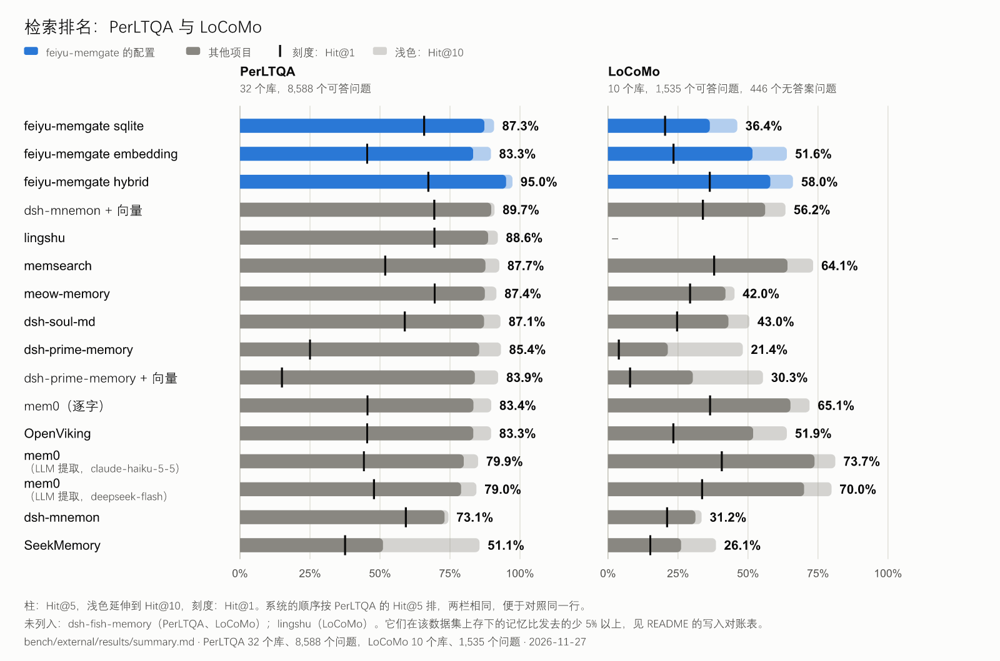
  </picture>
</p>

<p align="center">
  <picture>
    <source media="(prefers-color-scheme: dark)" srcset="docs/assets/charts/ext-delivered.zh.dark.png">
    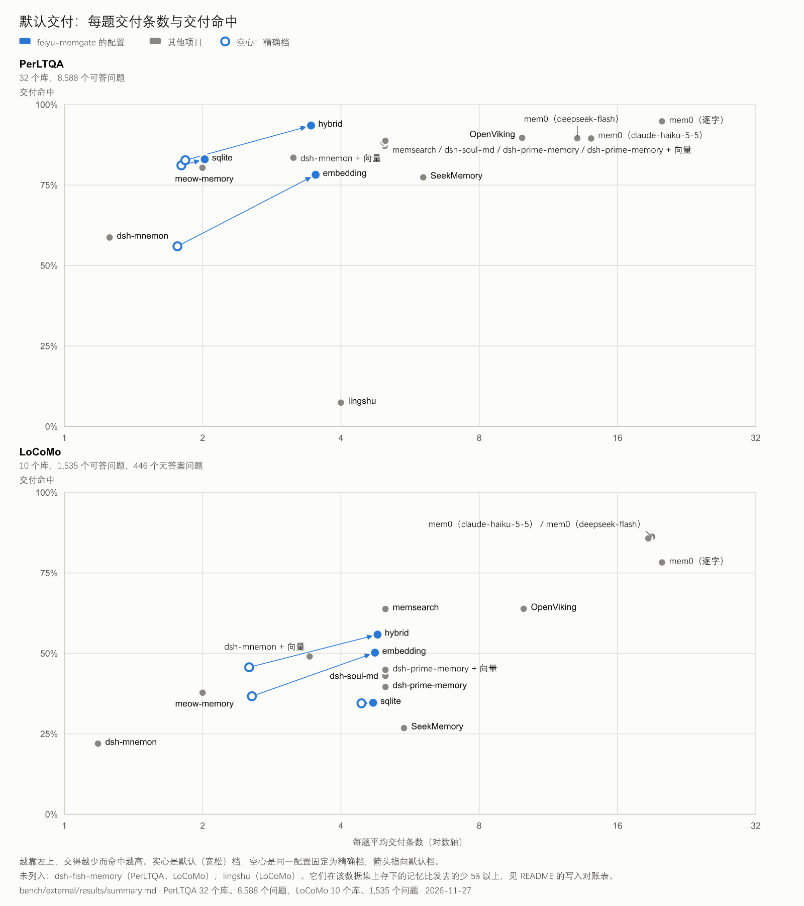
  </picture>
</p>

下面各表的列的定义和上面相同。本项目的行里，加粗的是默认档（宽松档），紧跟的是固定为精确档的同一配置；其他系统按 Hit@5 从高到低排。

#### PerLTQA

**PerLTQA，全部 32 个库，8,588 个可答问题**

| 系统 | 检索类型 | Hit@1 | Hit@5 | Hit@10 | 平均交付条数 | 交付命中 | 精确率 | 交付 F1 | 平均字数 |
|---|---|---:|---:|---:|---:|---:|---:|---:|---:|
| **feiyu-memgate sqlite** | 关键词 | 65.8% | 87.3% | 90.8% | 2.02 | 83.0% | 54.2% | 65.6% | 748 |
| feiyu-memgate sqlite（精确档） | 关键词 | 65.8% | 87.3% | 90.8% | 1.80 | 81.1% | 58.1% | 67.7% | 671 |
| **feiyu-memgate embedding** | 向量 | 45.4% | 83.3% | 89.7% | 3.52 | 78.2% | 30.1% | 43.5% | 636 |
| feiyu-memgate embedding（bge-m3，精确档） | 向量 | 45.4% | 83.3% | 89.7% | 1.76 | 56.0% | 41.6% | 47.7% | 317 |
| **feiyu-memgate hybrid** | 混合 | 67.3% | 95.0% | 97.3% | 3.44 | 93.5% | 35.4% | 51.3% | 862 |
| feiyu-memgate hybrid（精确档） | 混合 | 67.3% | 95.0% | 97.3% | 1.83 | 82.7% | 57.0% | 67.5% | 498 |
| dsh-mnemon + 向量 | 混合 | 69.4% | 89.7% | 90.9% | 3.15 | 83.5% | 31.5% | 45.8% | 701 |
| lingshu | 关键词 | 69.4% | 88.6% | 92.1% | 4.00 | 7.4% | 1.9% | 3.0% | 1,473 |
| memsearch | 混合 | 51.9% | 87.7% | 92.6% | 5.00 | 87.7% | 17.5% | 29.2% | 1,165 |
| meow-memory | 关键词 | 69.5% | 87.4% | 91.6% | 2.00 | 80.4% | 40.3% | 53.6% | 644 |
| dsh-soul-md | 关键词 | 58.9% | 87.1% | 93.0% | 4.98 | 87.1% | 17.6% | 29.3% | 1,556 |
| dsh-prime-memory | 关键词 | 25.0% | 85.4% | 93.2% | 4.95 | 88.2% | 17.9% | 29.8% | 1,557 |
| dsh-prime-memory + 向量 | 混合 | 15.0% | 83.9% | 92.2% | 5.00 | 88.7% | 17.8% | 29.6% | 1,389 |
| mem0（逐字） | 向量 | 45.5% | 83.4% | 89.8% | 20.00 | 94.8% | 4.7% | 9.0% | 3,827 |
| OpenViking | 向量 | 45.4% | 83.3% | 89.7% | 9.92 | 89.7% | 9.2% | 16.6% | 1,873 |
| mem0（LLM 提取，claude-haiku-5-5） | 提取 | 44.3% | 79.9% | 85.0% | 14.02 | 89.5% | 6.7% | 12.5% | 3,882 |
| mem0（LLM 提取，deepseek-flash） | 提取 | 47.9% | 79.0% | 84.4% | 13.08 | 89.5% | 7.4% | 13.6% | 3,576 |
| dsh-mnemon | 关键词 | 59.2% | 73.1% | 74.4% | 1.25 | 58.7% | 49.5% | 53.7% | 466 |
| dsh-fish-memory | 关键词 | 34.6% | 60.2% | 62.5% | 1.52 | 45.3% | 31.1% | 36.9% | 544 |
| SeekMemory | 关键词 | 37.6% | 51.1% | 85.5% | 6.04 | 77.4% | 15.3% | 25.5% | 633 |

1. **混合配置的排名最高，默认交付接近“全交”的系统。** `hybrid` 的 Hit@5 是 95.0%，其余跑了全部库的配置在 51.1% – 89.7%。默认每题交 3.44 条，交付命中 93.5%；交付命中更高的只有每题交 20 条的 mem0 逐字入库（94.8%）。
2. **不用任何模型的关键词配置也够用。** `sqlite` 的 Hit@5 是 87.3%，每题交 2.02 条，交付命中 83.0%，精确率 54.2%。Hit@1 最高的 7 个配置都带关键词信号（58.9% – 69.5%），只用向量的三个（本项目的 `embedding`、OpenViking、mem0 逐字入库）都在 45.4% – 45.5%。
3. **两档的取舍和自有题库上方向一致。** `hybrid` 从精确档换到默认档，交付命中从 82.7% 升到 93.5%，每题条数从 1.83 升到 3.44，精确率从 57.0% 降到 35.4%。
4. **mem0 用大模型提取没有提高检索排名。** mem0 的 LLM 提取 Hit@5 是 79.0% – 79.9%，逐字入库是 83.4%。

#### LoCoMo

**LoCoMo，全部 10 个库，1,535 个可答问题**

| 系统 | 检索类型 | Hit@1 | Hit@5 | Hit@10 | 平均交付条数 | 交付命中 | 精确率 | 交付 F1 | 平均字数 | 安静率 |
|---|---|---:|---:|---:|---:|---:|---:|---:|---:|---:|
| **feiyu-memgate sqlite** | 关键词 | 20.4% | 36.4% | 46.2% | 4.70 | 34.7% | 9.1% | 14.4% | 1,273 | 0.0% |
| feiyu-memgate sqlite（精确档） | 关键词 | 20.4% | 36.4% | 46.2% | 4.43 | 34.5% | 10.9% | 16.5% | 1,201 | 0.4% |
| **feiyu-memgate embedding** | 向量 | 23.4% | 51.6% | 63.9% | 4.75 | 50.2% | 12.6% | 20.1% | 535 | 0.2% |
| feiyu-memgate embedding（bge-m3，精确档） | 向量 | 23.4% | 51.6% | 63.9% | 2.56 | 36.7% | 21.4% | 27.0% | 293 | 10.8% |
| **feiyu-memgate hybrid** | 混合 | 36.4% | 58.0% | 66.1% | 4.81 | 55.8% | 13.3% | 21.5% | 953 | 0.0% |
| feiyu-memgate hybrid（精确档） | 混合 | 36.4% | 58.0% | 66.1% | 2.53 | 45.7% | 29.0% | 35.5% | 501 | 18.4% |
| mem0（LLM 提取，claude-haiku-5-5） | 提取 | 40.7% | 73.7% | 81.2% | 19.04 | 86.3% | 5.8% | 10.8% | 3,058 | 0.0% |
| mem0（LLM 提取，deepseek-flash） | 提取 | 33.6% | 70.0% | 79.8% | 18.68 | 85.7% | 5.8% | 10.8% | 2,917 | 0.0% |
| mem0（逐字） | 向量 | 36.5% | 65.1% | 72.0% | 20.00 | 78.2% | 4.7% | 8.9% | 2,588 | 0.0% |
| memsearch | 混合 | 37.9% | 64.1% | 73.3% | 5.00 | 63.8% | 13.9% | 22.8% | 689 | 0.0% |
| dsh-mnemon + 向量 | 混合 | 33.9% | 56.2% | 63.4% | 3.42 | 49.1% | 16.5% | 24.7% | 432 | 0.0% |
| OpenViking | 向量 | 23.3% | 51.9% | 63.8% | 10.00 | 63.8% | 7.1% | 12.8% | 1,124 | 0.0% |
| dsh-soul-md | 关键词 | 24.7% | 43.0% | 50.5% | 5.00 | 43.0% | 9.1% | 15.0% | 968 | 0.0% |
| meow-memory | 关键词 | 29.3% | 42.0% | 45.2% | 2.00 | 37.8% | 19.2% | 25.5% | 302 | 0.0% |
| lingshu | 关键词 | 20.1% | 33.7% | 38.7% | 4.00 | 1.7% | 0.4% | 0.7% | 773 | 0.0% |
| dsh-fish-memory | 关键词 | 17.2% | 31.4% | 34.7% | 3.32 | 28.4% | 10.5% | 15.3% | 633 | 0.4% |
| dsh-mnemon | 关键词 | 21.1% | 31.2% | 33.4% | 1.18 | 22.0% | 18.5% | 20.1% | 225 | 0.0% |
| dsh-prime-memory + 向量 | 混合 | 7.9% | 30.3% | 55.4% | 5.00 | 44.9% | 9.4% | 15.6% | 639 | 0.0% |
| SeekMemory | 关键词 | 15.1% | 26.1% | 38.6% | 5.49 | 26.8% | 6.0% | 9.8% | 524 | 0.0% |
| dsh-prime-memory | 关键词 | 3.8% | 21.4% | 48.1% | 5.00 | 39.5% | 8.2% | 13.5% | 658 | 0.0% |

1. **本项目在这个数据集上处于中游。** `hybrid` 的 Hit@5 是 58.0%，低于 mem0（逐字入库 65.1%，LLM 提取 70.0% – 73.7%）和 memsearch（64.1%）。
2. **默认交付的命中也低于交得多的系统。** `hybrid` 每题交 4.81 条，交付命中 55.8%；mem0 每题交约 19 – 20 条，交付命中 78.2% – 86.3%；memsearch 交 5 条、OpenViking 交 10 条，都是 63.8%。
3. **默认档的分数线在这里几乎不起作用。** 本项目默认档每题交 4.70 – 4.81 条，接近 5 条的上限；446 个没有答案的问题上，默认档的安静率是 0.0% – 0.2%，精确档是 0.4% – 18.4%。自有题库上默认档的安静率是 32.5% – 70.0%。分数线是在中文短句的开发集上选的，在 LoCoMo 上分不开有答案和没有答案的问题。其他系统在这些问题上的安静率是 0.0% – 2.1%。
4. **关键词检索在这个数据集上普遍低。** 只用关键词的配置 Hit@5 在 21.4% – 43.0%，本项目的 `sqlite` 是 36.4%。带向量的配置除 dsh-prime-memory + 向量（30.3%）外都在 51.6% 以上。
5. **用大模型提取在这里提高了 mem0 的排名。** mem0 的 LLM 提取 Hit@5 比逐字入库高 4.9 – 8.6 个百分点。

<p align="center">
  <picture>
    <source media="(prefers-color-scheme: dark)" srcset="docs/assets/charts/ext-thresholds.zh.dark.png">
    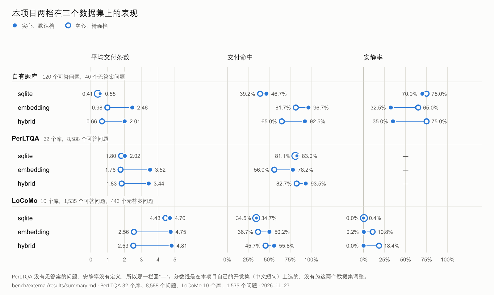
  </picture>
</p>

#### 分题型

<p align="center">
  <picture>
    <source media="(prefers-color-scheme: dark)" srcset="docs/assets/charts/ext-by-type.zh.dark.png">
    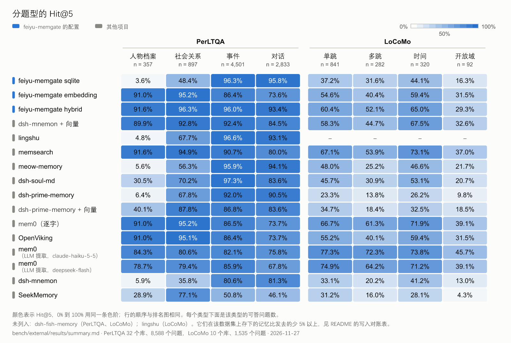
  </picture>
</p>

图里的数字也在 [bench/external/results/summary.md](bench/external/results/summary.md) 的分题型表里。

- **PerLTQA 的人物档案题把关键词和向量分开了。** 这类题有 357 个。只用关键词的配置 Hit@5 是 0.3% – 30.5%，本项目的 `sqlite` 是 3.6%；带向量的配置除 dsh-prime-memory + 向量（40.1%）外都在 78.7% 以上（不用模型提取的在 89.9% – 91.6%）。
- **事件题和对话题反过来。** 事件题（4,501 个）和对话题（2,833 个）上，`sqlite` 是 96.3% 和 95.8%，只用向量的 `embedding` 是 86.4% 和 73.6%。
- **混合配置是唯一在 PerLTQA 四类题上都超过 91% 的配置**（91.6%、96.3%、96.0%、93.4%）。
- **LoCoMo 的四类题上，本项目的 `hybrid` 都低于 mem0。** 比 mem0 逐字入库低 6.3 – 9.8 个百分点，比 mem0 的 LLM 提取低 6.2 – 20.2 个百分点，差距最大的是多跳题（52.1% 对 72.3%）。
- **开放域题对所有系统都最难。** 这类题只有 92 个，各配置的 Hit@5 是 4.3% – 45.7%，`hybrid` 是 29.3%。

#### 抽样运行的配置

<p align="center">
  <picture>
    <source media="(prefers-color-scheme: dark)" srcset="docs/assets/charts/ext-samples.zh.dark.png">
    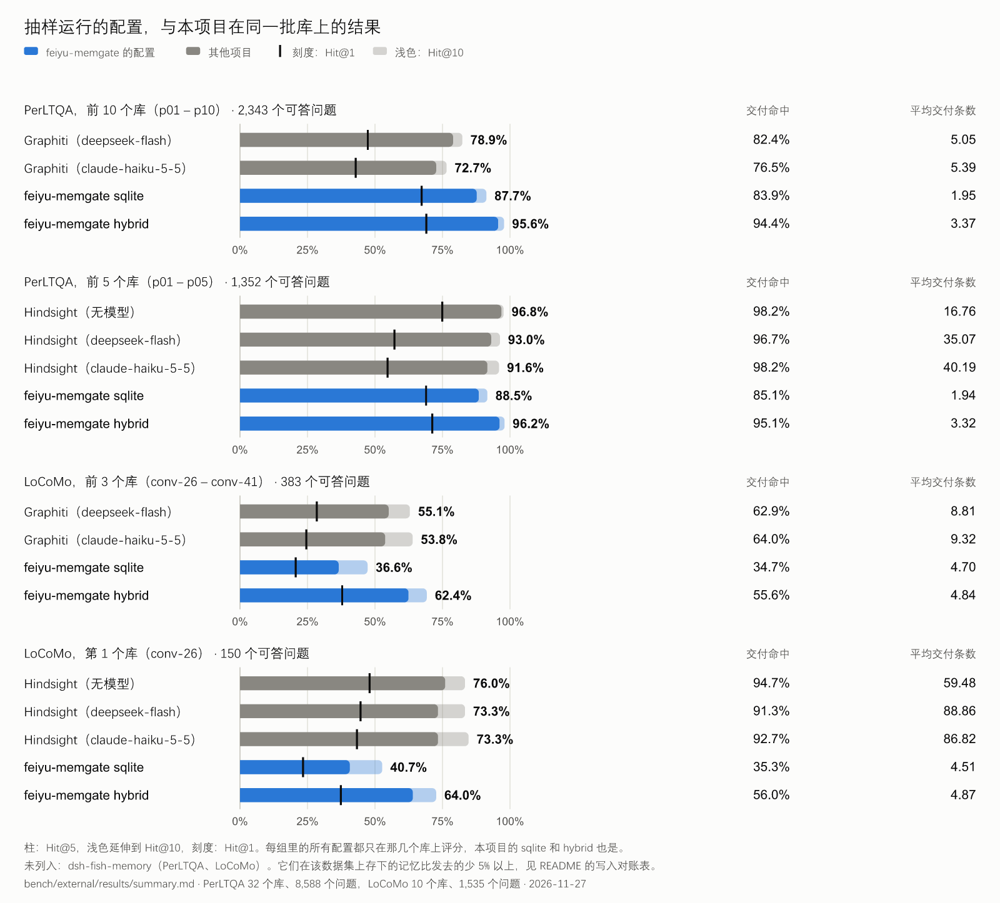
  </picture>
</p>

**PerLTQA，前 10 个库（p01 – p10），2,343 个可答问题**

| 系统 | 检索类型 | Hit@1 | Hit@5 | Hit@10 | 平均交付条数 | 交付命中 | 精确率 | 交付 F1 | 平均字数 |
|---|---|---:|---:|---:|---:|---:|---:|---:|---:|
| Graphiti（deepseek-flash） | 图 | 47.3% | 78.9% | 82.4% | 5.05 | 82.4% | 25.1% | 38.5% | 1,101 |
| Graphiti（claude-haiku-5-5） | 图 | 42.9% | 72.7% | 76.5% | 5.39 | 76.5% | 22.8% | 35.1% | 1,023 |
| **feiyu-memgate sqlite** | 关键词 | 67.3% | 87.7% | 91.3% | 1.95 | 83.9% | 55.9% | 67.1% | 711 |
| **feiyu-memgate hybrid** | 混合 | 69.0% | 95.6% | 97.8% | 3.37 | 94.4% | 36.2% | 52.3% | 832 |

**PerLTQA，前 5 个库（p01 – p05），1,352 个可答问题**

| 系统 | 检索类型 | Hit@1 | Hit@5 | Hit@10 | 平均交付条数 | 交付命中 | 精确率 | 交付 F1 | 平均字数 |
|---|---|---:|---:|---:|---:|---:|---:|---:|---:|
| Hindsight（无模型） | 混合 | 74.9% | 96.8% | 97.6% | 16.76 | 98.2% | 6.8% | 12.7% | 2,709 |
| Hindsight（deepseek-flash） | 提取 | 57.2% | 93.0% | 96.3% | 35.07 | 96.7% | 2.9% | 5.6% | 10,268 |
| Hindsight（claude-haiku-5-5） | 提取 | 54.7% | 91.6% | 95.9% | 40.19 | 98.2% | 2.6% | 5.0% | 11,772 |
| **feiyu-memgate sqlite** | 关键词 | 68.9% | 88.5% | 91.6% | 1.94 | 85.1% | 56.7% | 68.1% | 724 |
| **feiyu-memgate hybrid** | 混合 | 71.2% | 96.2% | 98.0% | 3.32 | 95.1% | 37.2% | 53.5% | 848 |

**PerLTQA，前 3 个库（p01 – p03），838 个可答问题**

| 系统 | 检索类型 | Hit@1 | Hit@5 | Hit@10 | 平均交付条数 | 交付命中 | 精确率 | 交付 F1 | 平均字数 |
|---|---|---:|---:|---:|---:|---:|---:|---:|---:|
| dsh-fish-memory | 关键词 | 40.3% | 66.2% | 69.8% | 1.42 | 48.7% | 35.8% | 41.2% | 531 |
| dsh-fish-memory + deepseek-flash 扩词 | 关键词 | 42.0% | 67.7% | 71.1% | 1.32 | 49.8% | 38.9% | 43.6% | 491 |
| dsh-fish-memory + claude-haiku-5-5 扩词 | 关键词 | 42.4% | 67.9% | 71.4% | 1.35 | 50.2% | 38.5% | 43.6% | 496 |
| **feiyu-memgate sqlite** | 关键词 | 68.0% | 87.8% | 91.1% | 1.96 | 84.1% | 55.8% | 67.1% | 753 |
| **feiyu-memgate hybrid** | 混合 | 71.0% | 95.8% | 97.5% | 3.35 | 94.4% | 36.1% | 52.3% | 878 |

**LoCoMo，前 3 个库（conv-26 – conv-41），383 个可答问题**

| 系统 | 检索类型 | Hit@1 | Hit@5 | Hit@10 | 平均交付条数 | 交付命中 | 精确率 | 交付 F1 | 平均字数 | 安静率 |
|---|---|---:|---:|---:|---:|---:|---:|---:|---:|---:|
| Graphiti（deepseek-flash） | 图 | 28.5% | 55.1% | 62.9% | 8.81 | 62.9% | 8.4% | 14.7% | 1,548 | 0.0% |
| Graphiti（claude-haiku-5-5） | 图 | 24.5% | 53.8% | 64.0% | 9.32 | 64.0% | 7.9% | 14.1% | 1,498 | 0.0% |
| **feiyu-memgate sqlite** | 关键词 | 20.6% | 36.6% | 47.3% | 4.70 | 34.7% | 9.3% | 14.7% | 1,285 | 0.0% |
| **feiyu-memgate hybrid** | 混合 | 37.9% | 62.4% | 69.2% | 4.84 | 55.6% | 12.4% | 20.3% | 1,013 | 0.0% |

**LoCoMo，第 1 个库（conv-26），150 个可答问题**

| 系统 | 检索类型 | Hit@1 | Hit@5 | Hit@10 | 平均交付条数 | 交付命中 | 精确率 | 交付 F1 | 平均字数 | 安静率 |
|---|---|---:|---:|---:|---:|---:|---:|---:|---:|---:|
| Hindsight（无模型） | 混合 | 48.0% | 76.0% | 83.3% | 59.48 | 94.7% | 2.0% | 3.9% | 8,989 | 0.0% |
| Hindsight（deepseek-flash） | 提取 | 44.7% | 73.3% | 83.3% | 88.86 | 91.3% | 1.3% | 2.6% | 15,298 | 0.0% |
| Hindsight（claude-haiku-5-5） | 提取 | 43.3% | 73.3% | 84.7% | 86.82 | 92.7% | 1.4% | 2.8% | 14,995 | 0.0% |
| dsh-fish-memory | 关键词 | 18.7% | 34.7% | 36.7% | 2.87 | 32.7% | 13.9% | 19.5% | 594 | 2.1% |
| dsh-fish-memory + deepseek-flash 扩词 | 关键词 | 21.3% | 34.7% | 36.7% | 2.72 | 32.0% | 13.6% | 19.1% | 556 | 2.1% |
| dsh-fish-memory + claude-haiku-5-5 扩词 | 关键词 | 19.3% | 34.7% | 37.3% | 2.65 | 32.0% | 14.3% | 19.8% | 544 | 2.1% |
| **feiyu-memgate sqlite** | 关键词 | 23.3% | 40.7% | 52.7% | 4.51 | 35.3% | 10.4% | 16.1% | 1,298 | 0.0% |
| **feiyu-memgate hybrid** | 混合 | 37.3% | 64.0% | 72.7% | 4.87 | 56.0% | 11.8% | 19.5% | 1,022 | 0.0% |

- **Graphiti。** 在 PerLTQA 的前 10 个库上 Hit@5 是 72.7% – 78.9%，本项目的 `hybrid` 在同一批库上是 95.6%。在 LoCoMo 的前 3 个库上是 53.8% – 55.1%，`hybrid` 是 62.4%；它每题交 8.8 – 9.3 条，交付命中 62.9% – 64.0%，`hybrid` 交 4.84 条，交付命中 55.6%。
- **Hindsight。** 在 PerLTQA 的前 5 个库上，不用模型的配置和 `hybrid` 持平（Hit@5 96.8% 对 96.2%，交付命中 98.2% 对 95.1%），每题交 16.76 条，`hybrid` 交 3.32 条。用模型时 Hit@1 是 54.7% – 57.2%，不用模型时是 74.9%；用模型时每题交 35 – 40 条、约 1.0 万 – 1.2 万字，交付命中 96.7% – 98.2%。在 LoCoMo 的第 1 个库上，三种配置的 Hit@5 是 73.3% – 76.0%，`hybrid` 是 64.0%；它每题交 59 – 89 条，交付命中 91.3% – 94.7%，`hybrid` 交 4.87 条，交付命中 56.0%。
- **dsh-fish-memory 的扩词。** 在 PerLTQA 的前 3 个库上把 Hit@5 从 66.2% 提到 67.7% – 67.9%；在 LoCoMo 的第 1 个库上没有改变 Hit@5（34.7%）。
- 抽样的样本小：LoCoMo 的第 1 个库只有 150 个可答问题，一个问题约 0.7 个百分点。

#### 模型用量和花费

调用大模型的配置在写入阶段的用量，按 API 返回的 token 数统计，花费按两家的公开标价换算（[bench/external/prices.json](bench/external/prices.json)，2026-11-16 的价格；deepseek-flash 按每次调用所在的高峰或非高峰时段计价）。本项目的配置不调用大模型，这一项是零。

<p align="center">
  <picture>
    <source media="(prefers-color-scheme: dark)" srcset="docs/assets/charts/ext-cost.zh.dark.png">
    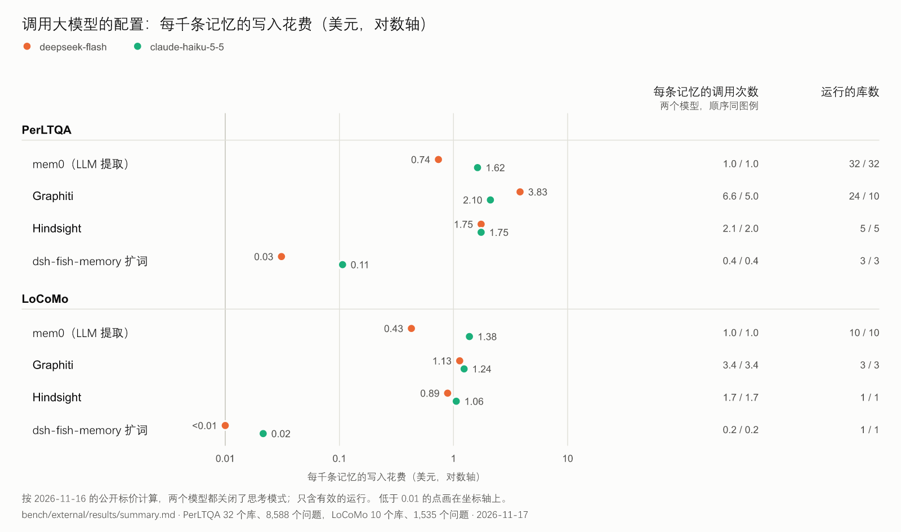
  </picture>
</p>

**模型用量**

| 系统 | 数据集 | 库 | 记忆 | 调用 | 输入 tokens（其中缓存命中） | 输出 tokens | 花费（美元） | 每千条记忆（美元） | 写入耗时（秒/条） |
|---|---|---:|---:|---:|---:|---:|---:|---:|---:|
| dsh-fish-memory + claude-haiku-5-5 扩词 | PerLTQA | 3 | 225 | 100 | 152,190（0） | 18,074 | 0.024 | 0.11 | 0.8 |
| dsh-fish-memory + deepseek-flash 扩词 | PerLTQA | 3 | 225 | 80 | 65,259（29,184） | 3,040 | 0.007 | 0.03 | 0.4 |
| Graphiti（claude-haiku-5-5） | PerLTQA | 10 | 664 | 3,347 | 11,144,644（0） | 564,289 | 1.397 | 2.10 | 5.4 |
| Graphiti（deepseek-flash） | PerLTQA | 24 | 1,589 | 10,553 | 17,996,457（1,879,415） | 1,035,447 | 6.089 | 3.83 | 6.0 |
| Hindsight（claude-haiku-5-5） | PerLTQA | 5 | 361 | 716 | 7,047,823（3,646,443） | 506,158 | 0.630 | 1.75 | 3.5 |
| Hindsight（deepseek-flash） | PerLTQA | 5 | 361 | 747 | 5,175,865（2,749,056） | 429,449 | 0.630 | 1.75 | 3.4 |
| mem0（LLM 提取，claude-haiku-5-5） | PerLTQA | 32 | 2,155 | 2,155 | 32,527,632（0） | 489,304 | 3.497 | 1.62 | 1.9 |
| mem0（LLM 提取，deepseek-flash） | PerLTQA | 32 | 2,155 | 2,155 | 20,000,381（16,344,832） | 328,494 | 1.589 | 0.74 | 1.8 |
| dsh-fish-memory + claude-haiku-5-5 扩词 | LoCoMo | 1 | 419 | 79 | 69,572（0） | 3,851 | 0.009 | 0.02 | 0.2 |
| dsh-fish-memory + deepseek-flash 扩词 | LoCoMo | 1 | 419 | 77 | 43,549（29,312） | 1,580 | 0.003 | 0.01 | 0.2 |
| Graphiti（claude-haiku-5-5） | LoCoMo | 3 | 1,451 | 4,955 | 14,865,175（0） | 619,415 | 1.796 | 1.24 | 4.2 |
| Graphiti（deepseek-flash） | LoCoMo | 3 | 1,451 | 5,001 | 8,463,882（839,296） | 326,362 | 1.645 | 1.13 | 3.8 |
| Hindsight（claude-haiku-5-5） | LoCoMo | 1 | 419 | 697 | 6,566,072（3,558,585） | 214,131 | 0.443 | 1.06 | 1.6 |
| Hindsight（deepseek-flash） | LoCoMo | 1 | 419 | 696 | 4,312,975（2,438,400） | 138,612 | 0.372 | 0.89 | 1.4 |
| mem0（LLM 提取，claude-haiku-5-5） | LoCoMo | 10 | 5,882 | 5,882 | 79,031,305（0） | 404,502 | 8.105 | 1.38 | 1.2 |
| mem0（LLM 提取，deepseek-flash） | LoCoMo | 10 | 5,882 | 5,882 | 50,523,528（44,444,800） | 355,384 | 2.517 | 0.43 | 1.3 |

- 表里只有有效的运行。有效的运行合计 12.85 美元（deepseek-flash）和 15.90 美元（claude-haiku-5-5）；调试、中断和失败的运行另有花费，没有计入。
- mem0 每写一条记忆调用一次模型，每次约 0.9 万 – 1.5 万输入 token，因为提取时会带上已有的记忆。Graphiti 每条记忆约 3 – 7 次调用。
- 每千条记忆的花费在 0.43 – 3.83 美元（dsh-fish-memory 的扩词不超过 0.11 美元）。“写入耗时”是多个库并行运行时测得的，只能看量级。
- claude-haiku-5-5 的缓存写入在这里按普通输入的标价计算，实际账单按更高的缓存写入价计费，所以用了缓存的 Hindsight 一行略有低估。
- Graphiti 配 deepseek-flash 在 PerLTQA 上跑了 24 个库，比较时只取前 10 个；表里是 24 个库的用量。

#### 延迟

<p align="center">
  <picture>
    <source media="(prefers-color-scheme: dark)" srcset="docs/assets/charts/ext-latency.zh.dark.png">
    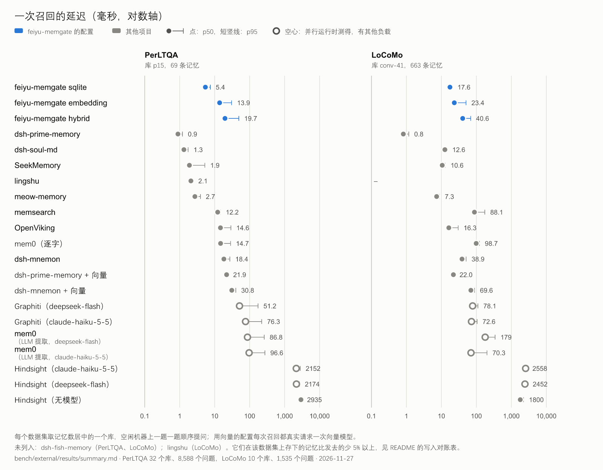
  </picture>
</p>

延迟是一次召回从发出问题到拿到交付结果的时间，单位毫秒。每个数据集取记忆数居中的一个库（PerLTQA 的 `p15`，69 条记忆、214 个问题；LoCoMo 的 `conv-41`，663 条记忆、193 个问题），在没有其他任务的机器上一题一题顺序提问。用向量的配置每次召回都真实请求一次向量模型（bge-m3，在显卡上运行），这次请求计入延迟。

- 本项目三种配置的中位延迟是 5 – 20 毫秒（PerLTQA）和 18 – 41 毫秒（LoCoMo）。`sqlite` 是 5.4 毫秒和 17.6 毫秒；其他 7 个只用关键词的配置是 0.6 – 18.4 毫秒（PerLTQA）和 0.8 – 38.9 毫秒（LoCoMo），在两个数据集上都有 6 个比它快。
- 带向量的系统里，本项目的 `embedding` 和 `hybrid` 是 14 – 20 毫秒（PerLTQA）和 23 – 41 毫秒（LoCoMo），其他系统（Hindsight 除外）是 12 – 31 毫秒和 16 – 99 毫秒。
- Hindsight 的中位延迟是 1.8 – 2.9 秒，比其他系统高两个数量级。
- 调用大模型的配置重新建库要再付一次费用，所以没有单独重测，表里是并行运行时的数字，只能看量级。
- 两档的延迟差别在 2 毫秒以内（LoCoMo 的 `hybrid` 是 5 毫秒）。

每个配置的 p50 和 p95 见 [bench/external/results/summary.md](bench/external/results/summary.md) 的延迟表。

#### 这一节的限度

- 只测了检索和交付，没有测最后的回答质量。提取事实或整理成摘要的系统交出去的不是原文，对回答的帮助可能和“交付里有没有标注的那条记忆”不一致。各项目有哪些这类能力、基准测到了哪一部分，见[分数没有覆盖的能力](#分数没有覆盖的能力)。
- LoCoMo 是英文数据。本项目的分数线和关键词后端是按中文数据开发的，没有为英文做任何调整。
- 大模型都关闭了思考模式，结果不代表各项目在模型默认设置下的表现。
- dsh-prime-memory 注入时会把超过 500 字的记忆截短；截短后的条目按“交付了这条记忆”计，字数按实际注入的长度计（PerLTQA 上约占它交付条目的 13% – 16%，LoCoMo 上没有）。
- Hindsight 用模型时交出去的是模型整理出的 observation，能追溯到来源记忆的才计为那条记忆，追溯不到的按噪声计（PerLTQA 上约占交付条目的 6% – 11%）。插件默认的 reflect 注入是模型写的一段文字，没有测。
- 还下载了 LongMemEval-S，但没有纳入对比：它的 500 个问题各有一个约 490 条记忆的独立库，调用模型的系统跑完要几百小时；原因和本项目关键词配置的一次运行结果见 [bench/external/README.md](bench/external/README.md)。
- 适配器是本项目写的，立场偏差无法完全排除，欢迎各项目的作者指正。

## 各项目的特点与取舍

每个项目按同一个格式写：它是什么、测到的强项、测到或文档里写明的代价。数字来自上面的测试；机制来自各项目测试版本的源码和自己的文档；标“推断”的是读代码得出、没有实测的。本项目用同样的标准写在第一条。

### 提示词位置、缓存与后台调用

模型服务商对重复出现的提示词前缀按低价计费，所以每轮都变的内容放在提示词靠前的位置，会让它后面的全部内容无法命中缓存。另一类花费是记忆系统自己在后台发起的模型调用。两项都不体现在检索指标里，单独列出：

| 项目 | 不经模型请求就放进提示词的 | 位置 | 是否每轮都变 | 后台的模型调用和上限 |
|---|---|---|---|---|
| feiyu-memgate 0.1.0 | 召回的资料块，格式固定，不带当前时间 | 建议接在当前消息末尾、不进历史；由接入方决定。默认的宽松档每轮交的条数更多，记忆块留在历史里时上下文长得更快 | 随问题变，按建议放置时只影响末尾 | 无 |
| memsearch 0.4.23（DSH 插件 0.1.8） | 一句固定的检索提示，不含记忆内容 | 本轮消息之后 | 否 | 插件默认每轮用模型总结一次对话；未发现按会话的次数上限 |
| mem0 2.2.1 | 无，提示词由应用自己拼 | – | – | 默认写入每次调用一次模型 |
| OpenViking v0.5.3 | 未检查 | 未检查 | 未检查 | 会话提交时用模型抽取 |
| Graphiti 0.31.2 | 无，提示词由调用方拼 | – | – | 每次写入都要模型（实测每条约 2.5 次调用） |
| SeekMemory（794ec5d） | 召回内容，上限 600 字；人设块 | 本轮消息之前（推断）；人设在宿主上下文里 | 召回随问题变；人设很少变 | 抽取每天最多 2 次；夜间整理每晚最多 12 次调用、6 万 token |
| dsh-mnemon 0.5.45 | 固定的协议说明；运行时记忆的快照 | 协议在系统提示词；快照追加在当前消息之后并留在历史里 | 否，记忆变化时才追加新快照 | 空闲复盘默认开启：两次至少间隔 5 分钟，每个会话最多 20 次，用主模型，计数默认在重启后清零 |
| lingshu 0.10.1 | 最近 4 条记忆和最近 10 条消息的窗口 | 宿主的上下文块，内容变了才追加 | 很可能是（推断：窗口引用最近的消息） | 默认关闭 |
| meow-memory 0.32.6 | 固定的使用指引；首条消息前的快照；每条消息前关键词命中的前 2 条 | 指引在系统提示词；其余在当前消息之前 | 命中随问题变，只追加、不重复 | 反思：连续 7 步工具调用后追加一轮；整理：每个时间窗口最多一次，6 小时冷却，用主模型 |

最终的提示词由宿主程序拼装，这张表核实到的是各插件交给宿主的内容和它们自己文档里的说明，宿主一侧的代码没有看。没有任何一个项目公布过缓存命中率的实测数据，本项目也没有测。后加的四个项目（dsh-fish-memory、dsh-prime-memory、dsh-soul-md、Hindsight）的提示词位置没有按这张表核实，所以没有列入；已知的后台模型调用有两处：dsh-fish-memory 在每次写入之后做关键词扩展（每次最多为两条还没有扩展词的记忆要词，写入 240 条共 121 次调用），Hindsight 的服务端在写入时提取事实并归并 observation。

### feiyu-memgate（本项目）

存储和检索之外的一层网关，检索交给后端。

- **强项**
  - 默认（宽松档）交付更全：向量和混合配置每题约 1.5 – 2.5 条，交付命中 90.8% – 96.7%，改写题上向量后端交付 92.7%。要少而准，写 `[recall] profile = "precise"`：每题约 0.4 – 1.2 条，精确率 80.2% – 93.0%，没有答案时 40.0% – 75.0% 的情况什么都不交。
  - 写入不调用大模型，也没有后台的模型调用；关键词档位不需要任何服务。
  - 访问策略、限流、每日写入上限、脱敏、失败与空结果的区分由网关统一执行，聊天程序拿不到存储密钥。
  - 检索后端、召回步骤、分数线档位都可以替换；从不用模型到 1.16 GB 模型有六档实测数据。
  - 新旧两条记忆都被交付时，新的排在前面（精确档的向量配置 15/15；默认的宽松档 16/20，见上面“新旧事实的顺序”）。
- **代价**
  - 默认的宽松档交得更杂：向量和混合配置精确率 56.9% – 75.9%，没有答案的问题上有 60.0% – 67.5% 会开口（安静率 32.5% – 40.0%），每题交 1.5 – 2.5 条，上下文占用约是精确档的 1.3 – 3.1 倍。切到 `profile = "precise"` 回到以前的行为，代价是漏答：交付命中 39.2% – 87.5%，改写题上向量后端只交出 69.1%，混合后端 34.5%，关键词后端 0.0%。
  - 检索本身不比同模型的系统强，Hit@1 低于 memsearch。
  - 只存原文，不抽取、不归并、不改写；旧事实不会失效，只是排在后面。
  - 是一个要自己接入的服务或库，不是装上即用的插件。
  - 记忆块放在哪里由接入方决定。自带的 AstrBot 示例把它作为临时消息片段接在当前消息后面，不进历史；宿主不支持临时片段时退回到接在当前消息的文字末尾，系统提示词和之前的历史仍然不变，但这段记忆会随那条消息留在历史里，上下文因此变长。
  - 向量后端是暴力扫描，这次只测到几百条，规模大了延迟会线性增长；框架化之后的版本还没有长时间线上运行。

### [memsearch](https://github.com/zilliztech/memsearch)

记忆是 Markdown 文件，索引可以随时重建；向量加 BM25 的混合检索。

- **强项**：这次测试里排名最好（Hit@1 85.0%，Hit@5 98.3%，前 8 条内一定有正确记忆）。记忆人能直接读、改、放进 git。不往提示词里放记忆内容，只加一句固定提示，对缓存没有影响。
- **代价**：没有分数线和字数预算，交前 5 条（精确率 19.7%，安静率 0%）。是否检索取决于模型是否调用。DSH 插件默认每轮用模型总结一次对话。没有遗忘或衰减。

### [mem0](https://github.com/mem0ai/mem0)

一个库，默认在写入时用大模型把对话抽取成独立的事实。

- **强项**：抽取能把口语整理成事实（240 条记忆得到 248 条事实），解析名字和日期。逐字模式的排名和同样使用 bge-m3 的 memsearch、OpenViking 一致（Hit@5 98.3%）。支持按条设置到期日。
- **代价**：默认写入每条调用一次模型（240 条约 206 万 token、0.53 元、入库 471 秒）。抽取模式的排名略低（Hit@1 77.5%，Hit@5 95.0%）。默认返回 20 条、分数线 0.1，实测每题约 20 条、精确率 5%。它的 BM25 和实体部分依赖英文模型，对中文不起作用。提示词由应用自己拼。

### [OpenViking](https://github.com/volcengine/OpenViking)

独立的记忆服务，会话提交时用模型抽取，向量检索。

- **强项**：排名与同样使用 bge-m3 的 memsearch、mem0 持平（Hit@5 98.3%）。服务形态可以被多个程序共用。接在本项目网关后面是这次测试里交付 F1 最高的组合（默认的宽松档 82.7%，精确档 83.7%）。
- **代价**：API 默认返回 10 条、没有分数线（精确率 9.9%，安静率 0%）。索引是异步的，240 条写入后约 70 秒才能检索到。正常的写入路径要用模型抽取，这次没有测。需要单独部署服务和向量模型。它的 DSH 插件的默认行为没有核实。

### [Graphiti](https://github.com/getzep/graphiti)

时间知识图谱：用大模型抽取实体和带时间的事实，在事实上检索。

- **强项**：显式处理“事实被取代”，旧事实标记失效而不是并存。事实带时间。有余弦下限，没有答案时 82.5% 的情况不交付。
- **代价**：没有大模型写不进去，实测每条约 2.5 次调用（240 条约 118 万 token、约 2 元、22 分钟）。这次用的是它不推荐的技术栈（嵌入式 Kuzu 加小模型），只抽出 69 条事实边，Hit@5 13.3%，不代表它在推荐配置下的水平。

### [SeekMemory](https://github.com/NeverENG/SeekMemory)

宿主无关的内核加适配器；BM25 加图激活；带强化、衰减和可逆遗忘的完整生命周期。

- **强项**：回复真的用上了某条记忆才强化它，全自动。按契合程度分级披露。每轮注入有 600 字的硬上限，有证据阈值（安静率 22.5%）。后台整理有明确的上限。延迟 2 ms。
- **代价**：没有向量检索，改写题 32.7%，Hit@5 64.2%，精确率 17.2%。正常写入依赖宿主模型抽取，这次绕过了。DSH 适配器版本是 0.0.1。

### [dsh-mnemon](https://github.com/omdsh-dev/dsh-mnemon)

DSH 插件。两套东西：随对话自动提供的运行时记忆，和由模型调用召回的记忆空间（关键词加实体加图信号，向量可选）。

- **强项**：记忆空间有自己的分数线和准入规则，默认每题只交 1 到 2 条（默认模式 1.02 条，打开向量 2.24 条），meow-memory（1.80 条）和 dsh-fish-memory（约 2 条）也在这个量级。打开向量后 Hit@5 是 90.8%，交付 F1 53.6%，在其他项目里最高。当前版本为保持缓存前缀稳定做了专门的设计：系统提示词不随记忆写入变化，记忆变化时把新快照追加在对话后面。空闲复盘有间隔和次数上限。
- **代价**：
  - 默认模式（不开向量）Hit@5 是 42.5%，改写题 10.9%；结果每次运行有约 ±5 个百分点的波动；安静率 0%。
  - 空闲复盘默认开启，使用主模型，计数默认在重启后清零。它的公开反馈里关于费用的讨论集中在这一项。
  - 记忆变化时追加的是整份快照，不是差量；修正、删除或累计到第 5 份快照时会整理一次，整理点之后的对话要重新按未缓存计费一次。这种整理在长会话里多久发生一次，没有公开的测量。
  - 早期版本（0.2.4 及以前、0.3.2 到 0.3.5、0.5.7 及以前）有过写入导致缓存前缀失效的问题，分别在 0.2.5、0.3.6、0.5.8 修复。项目自己说明没有缓存命中率的实测数据。
  - 打开向量后延迟 78 ms，高于本项目的向量配置（24 – 33 ms），低于 Hindsight 无模型配置（455 ms）。

### [lingshu（dsh-memory）](https://github.com/FuRongJun-1999/dsh-memory)

DSH 插件。写入闸门、去重、索引全部是规则代码，BM25 检索，记忆是普通文件。

- **强项**：写入不调用模型，后台维护默认关闭。按问题检索时的排名在关键词系统里最好（Hit@5 81.7%，与本项目的关键词后端持平）。写入有闸门（接受、合并、丢弃、推迟）和速率上限，注入有字数上限。延迟 2 ms。
- **代价**：每轮自动注入的是会话里最新的 4 条和最近 10 条消息，不看问题，所以按问题的交付命中是 0；按问题检索要模型主动调用工具。没有向量，改写题 63.6%。注入的窗口引用最近的消息，很可能每轮都不同，上下文随之增长（推断）。写入限速（每分钟 8 条）让批量入库变慢。

### [meow-memory](https://github.com/Phant0Meow/dsh-meow-memory)

DSH 插件。一个 SQLite 文件加 BM25，由宿主的模型通过工具写入并填关键词。

- **强项**：部署很轻：一个 SQLite 文件，没有额外的服务和模型。每条消息只注入 2 条、不重复，放在对话末尾（当前消息之前），系统提示词里的指引是固定的。交付 F1 是 40.0%，在不带向量的第三方配置里最高（精确率 30.9%）。字面题 97.8%，延迟 2 ms。
- **代价**：没有向量，改写题 30.9%，Hit@5 63.3%。没有分数线（安静率 10%）。关键词的质量取决于模型写入时填得好不好，这次用它自带的分词器代替。后台的反思和整理使用主模型。

### [dsh-fish-memory](https://github.com/Yuuyuko-uu/dsh-fish-memory)

DSH 插件。记忆是每个会话一份存储里的 JSON 行（文本、时间、重要度、可选的情绪和标签、扩展词）；模型通过 remember 工具写入，没有检索工具，每轮自动召回并注入。

- **强项**：每轮自动注入，有查询门（信息太少的消息不召回）和证据阈值 0.30，每题交约 2 条、约 50 字，延迟 1 – 2 ms，不需要服务。字面题 88.9% – 91.1%。新记忆被交付时，旧的排在它前面的至多 1 题（10/11、10/11、9/9）。写入时近似重复的记忆合并强化，与更新的记忆几乎相同的旧行标为被取代，不再召回。
- **代价**：不理解语义，改写题 12.7%（扩词配置 14.5% 和 16.4%），Hit@5 49.2%，交付命中 47.5% – 48.3%，精确率 31.2% – 31.8%。安静题上有 67.5% 开口（安静率 32.5%）。后台关键词扩展用模型：deepseek-flash 和 claude-haiku-5-5 各 121 次调用（约 6.5 万和 10.4 万 token，0.011 和 0.012 美元，入库 109 秒和 123 秒，默认配置 0.3 秒），Hit@5 从 49.2% 到 50.8%，多答对 2 个问题。产品里由模型决定存什么，这次没有测。

### [dsh-prime-memory](https://github.com/drscrewdriver/dsh-prime-memory)

DSH 插件。记忆是 SQLite 里的 L1 记录（另有 L2 场景块和 L3 人设）；默认由模型把对话蒸馏成记忆，也可以用工具直接写入。每条新用户消息前自动搜索并注入，模型也可以调用 memory_search。

- **强项**：默认配置不用模型也不用向量，Hit@5 74.2%，在不带向量的第三方关键词配置里仅次于 lingshu（81.7%），延迟 1 ms，入库 0.2 秒。字面题 97.8%，更新题交付命中 95.0%。打开插件可选的远程向量模式（bge-m3）后 Hit@5 84.2%，改写题从 47.3% 升到 67.3%。同一会话里已经注入过的记录不再注入。
- **代价**：分数线 0.3 在这批数据上几乎不起作用：每题交 4.66 条（向量模式 5.00 条），精确率 15.5% 和 17.0%，安静率 2.5% 和 0.0%。打开向量后 Hit@1 是 45.0%，延迟 21 ms，入库 4.3 秒，需要一个 embeddings 接口。改写题交付命中 47.3% 和 69.1%。产品里由模型蒸馏对话来写入，这次没有测；依赖 jieba 和 sqlite-vec 等 npm 包。

### [dsh-soul-md](https://github.com/Scorp1o117/dsh-soul-md)

DSH 插件：人设卡加文件形式的长期记忆，这次只测记忆部分。记忆是 Markdown 文件（常驻的 core.md 和按需的 topic 文件），由模型通过 memory_append、memory_rewrite 写入；常驻系统提示词里有所有 topic 的索引，从第二条消息起每轮注入可能相关的 topic，模型也可以调用 memory_search。

- **强项**：不需要模型、向量和服务，记忆是可以直接编辑的文件，延迟 3 ms，入库 0.1 秒。字面题 100.0%，Hit@5 65.0%，和 SeekMemory、meow-memory 同一量级。
- **代价**：没有向量，改写题 38.2%。没有分数线，只要共享一个词就是候选，所以每题交 3.94 条、精确率 17.5%、安静率 10.0%。更新题 60.0%，新记忆被交付时旧的排在前面的有 5 题（7/12）。每轮都在系统提示词里的 topic 索引不计入这里的“交付”。模型决定写什么、放进哪个 topic；这里每条记忆一个 topic。

### [Hindsight](https://github.com/vectorize-io/hindsight)

独立的记忆服务（PostgreSQL 加 pgvector），DSH 插件是它的客户端。默认由模型从内容里提取事实，再归并成 observation；召回是语义、关键词、图、时间四路检索，融合后用本地的交叉编码器重排序，按 token 预算截断。插件默认在会话的第一条提示时注入模型写的 reflect 文字，不是记忆列表，这次没有测；测的是服务端的召回。

- **强项**：排名好：Hit@5 90.0% – 94.2%，字面题 100.0%，改写题的交付命中 94.5% – 98.2%。无模型配置（每条记忆存成一个原文块）也能用，入库 10.6 秒。模型提取配置的 Hit@5 比无模型配置高 1.7 – 4.2 个点，Hit@1 低 5.8 – 8.3 个点。服务形态（HTTP），可以被多个客户端调用。
- **代价**：
  - 召回只受 2000 token 预算限制，每题交 84 – 94 条、约 2060 – 2270 字，精确率 1.1% – 1.2%，交付 F1 2.1% – 2.3%；40 个安静题全都有交付（平均每题 82.7 – 92.8 条）。
  - 延迟：无模型配置 455 ms，两个模型配置约 1.55 秒（测量时机器上还有其他测试在跑；无模型配置在空闲机器上重测是 428 ms）。
  - 默认的写入路径要用模型：deepseek-flash 配置调用 423 次，约 247 万 token，0.178 美元，入库 327 秒；claude-haiku-5-5 配置调用 400 次，约 328 万 token，0.190 美元，入库 368 秒（都关闭了思考）。
  - 新旧顺序：模型配置里新记忆被交付时旧的排在前面的有 18 题和 15 题（2/20 和 5/20），受 observation 编号规则影响（见上面的限度）。
  - 需要 PostgreSQL 加 pgvector、一个本地重排序模型（CPU 上的 torch）和 embeddings 接口；容器限制 3 GB 内存。插件的默认注入（reflect）没有测。

## 设计自检

检索以外的性质，用探针脚本对本项目逐项实测。这一节只评本项目自己。✓ 成立，◐ 部分成立。

| 性质 | 结果 | 实测到的 |
|---|:-:|---|
| 写入前脱敏 | ✓ | 假密钥、密码、令牌写入后，存储里没有残留 |
| 返回前脱敏 | ✓ | 绕过网关直接写进存储的密钥，召回结果里没有残留 |
| 记忆作为资料交付，不能越界 | ✓ | 含闭标签和伪指令的记忆，资料块里的标签被转义，边界恰好一对 |
| 凭据级隔离 | ◐ | 客户端之间由令牌隔离；租户绑定是可选的，默认模式下租户号由调用方自报 |
| 失败与空结果可区分 | ✓ | 存储全部报错回 503；部分失败回 200 并带 `failed` 计数 |
| 写入有上限 | ✓ | 每日上限为 5 时，32 次并发写恰好成功 5 次 |
| 输出有界，整条取舍 | ✓ | 条数上限 10；字数预算内整条放或不放；超长的整条丢弃 |
| 遗忘可恢复 | ✓ | 被遗忘的记忆先归档，保留期内可以原样恢复 |
| 写入不需要大模型 | ✓ | 断开网络时，SQLite 路径的写入和召回全部成功 |
| 网络面最小且需鉴权 | ✓ | 只有 4 条路由；其余 199 种方法和路径的组合全部是 404 或 405 |

每一项的做法、数字和没有通过的地方见 [bench/results/design/self-check.md](bench/results/design/self-check.md)。探针是本项目自己写、自己跑的，只说明这些检查在这一版上成立。

**其他项目有、本项目没有的能力：**

- 回复真的用上了某条记忆才强化它，全自动（SeekMemory）。本项目要聊天程序调用 `/v1/used` 上报。
- 按相关程度分级披露：全文、转述、暗示或沉默（SeekMemory）。本项目的访问控制是按存储的全有或全无。
- 被新事实取代的旧事实标记为失效（Graphiti、SeekMemory）。本项目只把新的排在前面，旧的仍然会被交付。
- 用大模型从对话里抽取、归并、改写记忆（mem0、Graphiti、OpenViking 等）。本项目只存原文，抽取是后端的事。
- 写入时去重与合并（lingshu、meow-memory、mem0）。本项目到召回时才去重。
- 按轮收窄读范围（dsh-mnemon）；按条设置到期日（mem0）；记忆是可以直接编辑、可进 git 的 Markdown（memsearch）。

## 部署档位

部署有三个互相独立的选择，调用代码不用跟着改。完整说明和选择建议见 [docs/deployment.md](docs/deployment.md)。

**进程形态。** 网关可以作为独立进程（`feiyu-memgate serve` 加 `MemoryClient`），也可以直接在聊天进程里运行（`LocalClient`，不起服务、不占端口、不需要令牌）。两种客户端的方法和返回值相同。进程内运行的代价是信任边界消失：聊天进程自己持有存储密钥，访问策略只能防自己代码里的失误，防不了被攻破的进程。

**检索档位。** 从不用模型到 1.16 GB 的模型共六档，向量后端内置了这五个模型的分数换算和默认分数线。

<p align="center">
  <picture>
    <source media="(prefers-color-scheme: dark)" srcset="docs/assets/charts/tiers.zh.dark.png">
    
  </picture>
</p>

| 档位 | 模型文件 | 运行内存 | Hit@1 | Hit@5 | 交付命中 | 精确率 | 交付 F1 | 安静率 | p50 延迟 |
|---|---:|---:|---:|---:|---:|---:|---:|---:|---:|
| `sqlite`（不用模型） | 无 | 可忽略 | 61.7% | 81.7% | 46.7% | 89.3% | 61.3% | 70.0% | 2 ms |
| bge-small-zh-v1.5 | 48 MB | 175 MiB | 75.8% | 92.5% | 86.7% | 69.0% | 76.8% | 20.0% | 6 ms |
| bge-base-zh-v1.5 | 110 MB | 238 MiB | 82.5% | 93.3% | 88.3% | 70.2% | 78.2% | 37.5% | 19 ms |
| embeddinggemma | 622 MB | 761 MiB | 81.7% | 99.2% | 97.5% | 63.8% | 77.1% | 37.5% | 13 ms |
| qwen3-embedding 0.6B | 639 MB | 1.20 GiB | 84.2% | 95.8% | 94.2% | 70.7% | 80.8% | 32.5% | 75 ms |
| bge-m3 | 1.16 GB | 1.36 GiB | 81.7% | 98.3% | 96.7% | 56.9% | 71.6% | 32.5% | 24 ms |

质量各列来自测试集，每个模型用自己的预设，用的是默认档（宽松档）；固定为精确档的数字在下面的分数线档位表里。模型文件和运行内存是开发集运行时测的（CPU，容器只加载这一个模型）。

- **最小的向量模型就比关键词好很多。** 175 MiB 内存，交付 F1 从 61.3% 到 76.8%（精确档 55.1% 到 78.0%），改写题交付从 3.6% 到 80.0%，不再是盲区。
- **小模型的代价在排名上。** 两个中文小模型的 Hit@5 比 bge-m3 低 5 – 6 个百分点（92.5%、93.3% 对 98.3%）；它们只支持中文。
- **embeddinggemma 用一半多一点的内存做到了和 bge-m3 相当。** Hit@5 和安静率都不低于 bge-m3，开发集上也是这样。
- **相邻档位之间的先后不稳定，也随分数线档位变。** qwen3-embedding 在开发集上最差；在测试集上，精确档下它的交付命中（85.0%）和交付 F1（83.4%）最高，但安静率最低（37.5%）、延迟最高（75 ms）；宽松档下交付命中最高的是 embeddinggemma（97.5%），qwen3-embedding 是 94.2%。bge-base-zh 在开发集上和 bge-m3 持平，在测试集上排名低一截；它的交付 F1 在宽松档下高于 bge-m3（78.2% 对 71.6%），在精确档下低于它（78.7% 对 82.1%）。可靠的结论只有上面三条。
- **分数线必须跟着模型走。** 把 bge-m3 精确档的分数线原样用在 bge-base-zh 上，开发集的交付命中只有 27.5%。内置预设之外的模型，后端启动时会给一行警告。

**分数线档位。** 默认是宽松档（`broad`）：多交一些、几乎不漏答；`[recall] profile = "precise"` 是精确档（以前的默认）：少而准。两档在测试集上的实测对比，每个配置默认档在前：

| 配置 | 档位 | 交付命中 | 精确率 | 每题交付条数 | 安静率 |
|---|---|---:|---:|---:|---:|
| `sqlite` | 宽松（默认） | 46.7% | 89.3% | 0.55 | 70.0% |
|  | 精确 | 39.2% | 93.0% | 0.41 | 75.0% |
| `embedding`（bge-m3） | 宽松（默认） | 96.7% | 56.9% | 2.46 | 32.5% |
|  | 精确 | 81.7% | 82.5% | 0.98 | 65.0% |
| `hybrid` | 宽松（默认） | 92.5% | 62.6% | 2.01 | 35.0% |
|  | 精确 | 65.0% | 90.4% | 0.66 | 75.0% |
| `full` | 宽松（默认） | 93.3% | 60.1% | 2.08 | 35.0% |
|  | 精确 | 65.0% | 90.2% | 0.67 | 75.0% |
| `openviking` | 宽松（默认） | 90.8% | 75.9% | 1.50 | 40.0% |
|  | 精确 | 87.5% | 80.2% | 1.17 | 40.0% |
| `embedding`（bge-small-zh） | 宽松（默认） | 86.7% | 69.0% | 1.79 | 20.0% |
|  | 精确 | 76.7% | 79.4% | 0.94 | 47.5% |
| `embedding`（bge-base-zh） | 宽松（默认） | 88.3% | 70.2% | 1.51 | 37.5% |
|  | 精确 | 72.5% | 86.2% | 0.77 | 65.0% |
| `embedding`（embeddinggemma） | 宽松（默认） | 97.5% | 63.8% | 2.04 | 37.5% |
|  | 精确 | 76.7% | 85.8% | 0.81 | 72.5% |
| `embedding`（qwen3-embedding） | 宽松（默认） | 94.2% | 70.7% | 1.76 | 32.5% |
|  | 精确 | 85.0% | 81.9% | 0.97 | 37.5% |

除 `sqlite` 外的八个向量和混合配置：宽松档比精确档交付命中高 3.3 – 28.3 个点，精确率低 4.3 – 30.2 个点，安静率低 0.0 – 40.0 个点，每题多交 0.33 – 1.48 条。`embedding`（bge-m3）的宽松档几乎不漏答（96.7%），代价是每题多交约一条半、安静率减半；它交出去的内容里正确的仍占一半以上（向量和混合配置 56.9% – 75.9%），而默认交前 5 到 20 条的系统是 5% – 20%。`openviking` 的差别最小，它的精确档分数线本来就比较宽。关键词后端换档的变化很小（交付命中 39.2% → 46.7%），它的漏答来自检索本身。

<p align="center">
  <picture>
    <source media="(prefers-color-scheme: dark)" srcset="docs/assets/charts/profiles.zh.dark.png">
    
  </picture>
</p>

## 遗忘曲线（实验性，默认关闭）

<p align="center">
  <picture>
    <source media="(prefers-color-scheme: dark)" srcset="docs/assets/memory-lifecycle.zh.dark.png">
    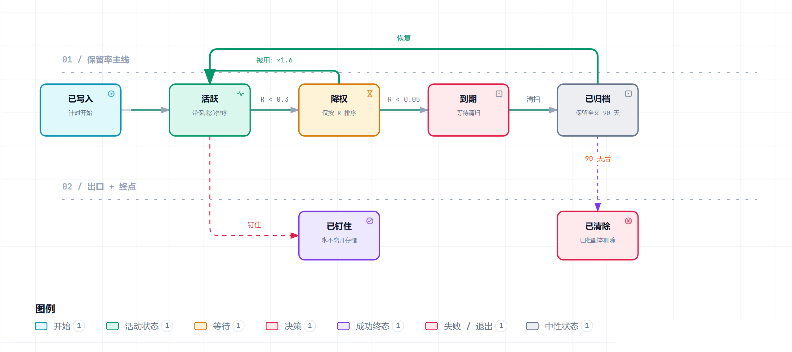
  </picture>
</p>

- **保持率**。`R = 0.5 ^ (天数 / 半衰期)`，半衰期 = 基础值 × 1.6 ^ min(使用次数, 8)，基础值默认 90 天。用得越多，忘得越慢。
- **两个时钟**。排序用的保持率从记忆自己的日期或最近一次使用算起；删除用的从账本开始管理这条记忆或最近一次使用算起。所以在一个存了很久的库上打开遗忘，当天不会删任何东西。
- **排序**。`freshness` 步骤把分数乘以 0.7 到 1 之间的系数，只影响顺序，不参与分数线判断。
- **清理**。到期的记忆先写进归档再删除，每次每个存储最多处理 `max(5, 2%)` 条；归档保留 90 天，期间可以用 `feiyu-memgate forget restore` 原样写回。
- **钉住**。按地址通配符、按客户端或手动钉住的记忆不降权、不遗忘。

模拟结果（混合后端，540 天，240 条记忆同一天入库；分数线档位固定为精确档，没有用宽松档重做；问题分为常被问、偶尔被问、从不被问三组）：

| 设置 | 库内条数 | 常问 Hit@5 | 偶尔问 Hit@5 | 从不问 Hit@5 | 每题交付条数 | 噪声 |
|---|---:|---:|---:|---:|---:|---:|
| 不遗忘（基线） | 240 | 70.0% | 62.5% | 62.5% | 0.77 | 15.2% |
| 默认 | 57 | 70.0% | 62.5% | 0.0% | 0.49 | 10.2% |
| 默认 + 钉住身份类记忆 | 85 | 70.0% | 62.5% | 15.0% | 0.55 | 10.6% |
| 激进（半衰期 30 天） | 55 | 70.0% | 60.0% | 0.0% | 0.47 | 8.8% |

存储缩小到四分之一左右，被问到过的问题命中率基本不变。从来没人问的事几乎全部被忘，这既是设计目标，也是代价。噪声没有一致的改善：混合后端降了，关键词后端的默认组反而从 7.8% 升到 10.5%。

<details>
<summary>模拟过程的曲线</summary>
<p align="center">
  <picture>
    <source media="(prefers-color-scheme: dark)" srcset="docs/assets/charts/forgetting.zh.dark.png">
    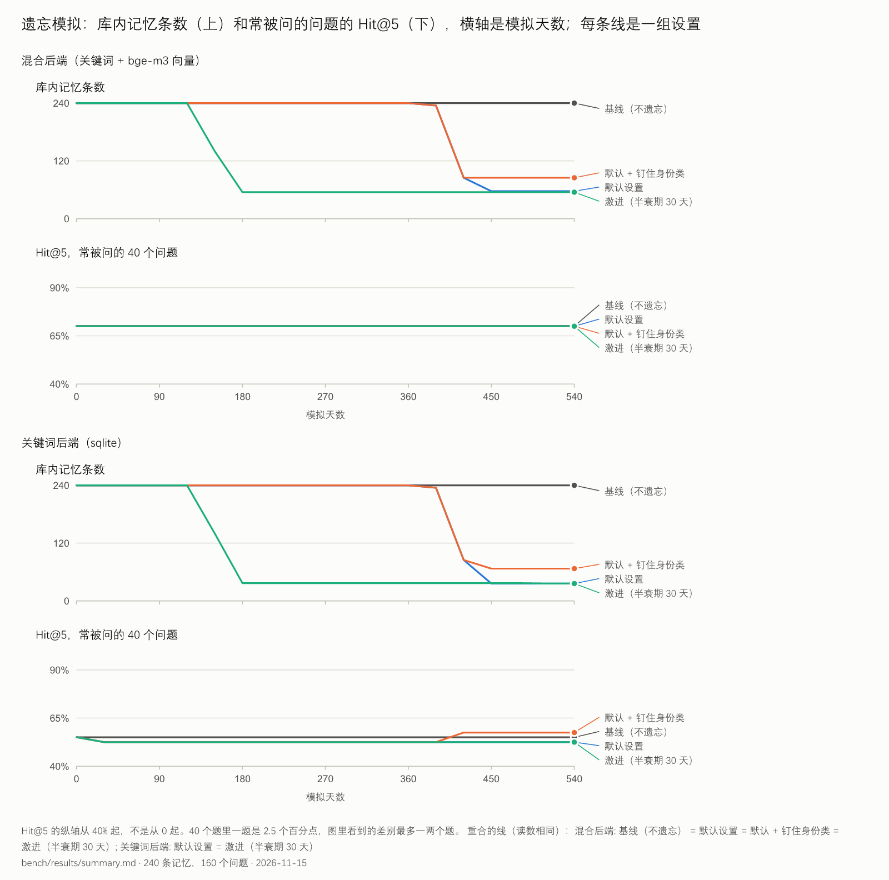
  </picture>
</p>
</details>

这个功能只在模拟里验证过：流量按固定分布生成，没有真实的使用记录，默认参数也没有在真实数据上调过。机制、配置和完整结果见 [docs/forgetting.md](docs/forgetting.md) 和 [bench/results/forgetting/summary.md](bench/results/forgetting/summary.md)。

## 快速开始

需要 Python 3.11 或更高。最小配置不需要向量模型，也不需要 docker。

```bash
git clone https://github.com/N0rmal-114/feiyu-memgate.git
cd feiyu-memgate
pip install -e .
```

给客户端准备一个令牌（至少 32 个字符），放进环境变量：

```bash
export GATEWAY_TOKEN_OWNER="$(python -c 'import secrets; print(secrets.token_urlsafe(32))')"
```

```powershell
$env:GATEWAY_TOKEN_OWNER = python -c "import secrets; print(secrets.token_urlsafe(32))"
```

检查配置并启动：

```bash
feiyu-memgate check --config examples/quickstart/gateway.toml
```

```bash
feiyu-memgate serve --config examples/quickstart/gateway.toml
```

另开一个终端，写一条再查一次：

```python
import os
from feiyu_memgate.client import MemoryClient

client = MemoryClient("http://127.0.0.1:8080", token=os.environ["GATEWAY_TOKEN_OWNER"])
print(client.remember_status("我对花生过敏，周末喜欢去动物园"))   # saved
print(client.recall_detail("周末喜欢去哪"))
```

接口是普通的 HTTP 加 JSON，也可以用 curl。Windows 的终端可能不按 UTF-8 发送中文，网关会回 400，这种情况用上面的 Python 客户端。

## 在聊天程序里使用

```python
from feiyu_memgate.client import MemoryClient, BlockFormatter, build_query

client = MemoryClient("http://127.0.0.1:8080", token="<网关令牌>")
formatter = BlockFormatter(labels={"private": "你们私聊里的"})

def before_llm(current_message, previous_message):
    query = build_query(current_message, previous_message)   # 应声词、纯表情不值得查，返回 None
    if query is None:
        return ""
    detail = client.recall_detail(query)                      # 不抛异常；查询失败返回 None
    if not detail:
        return ""
    return formatter.format(detail["results"], more=detail["more"])

status = client.remember_status("主人对花生过敏")   # "saved" / "failed" / "limited" / "unsure"
```

`before_llm` 返回的资料块建议接在当前这条消息的末尾发给模型，不存进对话历史，也不放进系统提示词。这样系统提示词每轮不变，前面的历史可以命中模型服务商的前缀缓存。

如果回复确实用上了某几条记忆，调用 `client.report_used(...)` 上报，遗忘曲线据此延长它们的半衰期。

不想单独起一个网关进程时，换成进程内的客户端，其余代码不变（[examples/embedded](examples/embedded/)，说明见 [docs/embedded.md](docs/embedded.md)）：

```python
from feiyu_memgate.client import LocalClient

client = LocalClient.from_config("gateway.toml", client="owner")   # 不起服务，不需要令牌
```

AstrBot 的接入示例在 [integrations/astrbot](integrations/astrbot/)。

### DeepSeek Harness（DSH）插件

本仓库的 `plugins/` 下有两个 DSH 插件包，各自发布到 npm：

| 包 | 作用 |
|---|---|
| [dsh-feiyu-memgate](plugins/dsh-feiyu-memgate/README.zh.md) | 给 DSH 对话加上长期记忆：自带并自动启动本网关，每轮自动召回，给模型“记住”和“查找”两个工具，带设置页面。记忆块写明今天的日期和每条记忆是多久以前的事，对话里给过的记忆不再重复给。每项功能都能单独关掉。默认用关键词检索，不需要模型，也不下载任何东西；用向量检索时可以选择同时用关键词检索并合并结果（混合，默认关闭）。 |
| [dsh-feiyu-memgate-embed](plugins/dsh-feiyu-memgate-embed/README.zh.md) | 可选的附加包：在本机只用 CPU 运行向量模型，让换了说法的问题也能找到记忆。模型在设置页面里点“下载并启用”之后才下载。 |

安装：在 DSH 的插件页面安装 `dsh-feiyu-memgate`，或运行 `dsh plugin --profile <name> add dsh-feiyu-memgate`。要求、设置和测试范围见各自的说明。

## 配置示例

换成向量后端，只改存储一节（[examples/hybrid](examples/hybrid/gateway.toml) 是关键词加向量的混合配置，[examples/openviking](examples/openviking/gateway.toml) 接 OpenViking）：

```toml
[stores.private]
type = "embedding"
path = "data/vector.db"
url = "http://127.0.0.1:11434/v1"     # 任何兼容 OpenAI 的 embeddings 接口
model = "bge-m3"                      # 换更小的模型只改这一行和库文件，分数线预设按模型名自动选用
```

多租户：每个群一份独立的存储，群聊令牌读不到私聊的存储（[examples/multi-tenant](examples/multi-tenant/gateway.toml)）：

```toml
[tenants.group]
type = "directory"
path = "data/groups"
create = false                        # 只有登记过的群才有记忆

[clients.group]
token_env = "GATEWAY_TOKEN_GROUP"
tenants = "group"                     # 每次请求必须带 tenant_id
recall = ["@tenant"]                  # "@tenant" 是当前这个群自己的存储
write = "@tenant"
public = true                         # 公开场合：更严的脱敏
daily_writes = 20                     # 每个群每天
daily_writes_total = 500              # 所有群合计每天
# tenant_binding = "token"            # 可选：每个群一个派生令牌，用 feiyu-memgate tenants token 生成
```

自己实现一个召回步骤（[完整代码](examples/custom-stage/recency_stage.py)）：

```python
from feiyu_memgate.pieces import RecallStage

class Recency(RecallStage):
    def prepare(self, candidates, ctx):
        for candidate in candidates:
            candidate.score *= self._factor(candidate.date)
        return candidates
```

```toml
[recall]
stages = ["min_score", { type = "recency_stage:Recency", half_life_days = 30 }, "redact", "dedupe", "budget"]
```

类文件放在配置文件旁边即可，不需要安装。六种插槽各自的契约和写法见 [docs/pieces.md](docs/pieces.md)。

## 命令行

| 命令 | 用途 |
|---|---|
| `feiyu-memgate serve --config <文件>` | 启动网关 |
| `feiyu-memgate check --config <文件>` | 检查配置，打印各组件的组装结果（不显示令牌） |
| `feiyu-memgate pieces` | 列出所有已注册的组件 |
| `feiyu-memgate eval` | 用自己的示例记忆评测召回，帮助选分数线 |
| `feiyu-memgate forget status / sweep / archive / restore / pin / unpin / explain` | 遗忘曲线：状态、清理、归档、恢复、钉住、解释某一条（不显示记忆正文） |
| `feiyu-memgate backup` | 加密备份与导出 |
| `feiyu-memgate tenants` | 管理租户密钥文件；`tenants token` 生成绑定到单个租户的令牌 |

## 文档

| 文档 | 内容 |
|---|---|
| [docs/architecture.md](docs/architecture.md) | 一次召回、一次写入经过什么 |
| [docs/deployment.md](docs/deployment.md) | 部署方案：进程形态、检索档位、分数线档位，各自的数据和选择建议 |
| [docs/embedded.md](docs/embedded.md) | 进程内运行：用法、限制、和独立服务的区别 |
| [docs/configuration.md](docs/configuration.md) | 每一项配置 |
| [docs/api.md](docs/api.md) | API 参考：HTTP 接口、Python 客户端、扩展接口、命令行、DSH 插件的接口 |
| [docs/backends.md](docs/backends.md) | 各后端的原理、默认分数线的来历 |
| [docs/pieces.md](docs/pieces.md) | 插槽的契约，怎么选用、替换、自己实现 |
| [docs/extending.md](docs/extending.md) | 二次开发指引：接进自己的聊天程序、用别的语言接入、自己做后端和召回步骤、发布成包 |
| [docs/development.md](docs/development.md) | 开发指南：环境、目录结构、测试、生成和打包的部分、发布 |
| [docs/forgetting.md](docs/forgetting.md) | 遗忘曲线的机制、配置和运维 |
| [docs/security.md](docs/security.md) | 防什么、怎么防、防不了什么 |
| [docs/roadmap.md](docs/roadmap.md) | 还没做的部分 |
| [docs/design/](docs/design/) | 设计说明：来源项目里的原始设计文档和改造前的审计，以及本仓库后来的设计 |
| [CHANGELOG.md](CHANGELOG.md) | 网关的更新记录；插件的在 [plugins/dsh-feiyu-memgate/CHANGELOG.md](plugins/dsh-feiyu-memgate/CHANGELOG.md) |
| [bench/](bench/README.md) | 基准的数据、规则、适配器和复现方法 |
| [bench/results/design/](bench/results/design/features.md) | 各项目的功能对照，和本项目的设计自检 |
| [plugins/](plugins/dsh-feiyu-memgate/README.zh.md) | DeepSeek Harness 插件和它的向量附加包 |
| [research/](research/) | 对同类记忆项目的调研报告：它们怎么工作、成熟度、可以借鉴什么 |

## 现状与限制

版本 0.1.0。运行测试不需要安装任何东西：

```bash
python -m unittest discover -s tests -t .
```

目前网关有 1470 个测试，两个插件另有 427 个；每次推送和每个 pull request 都会在 Linux 和 Windows 上自动运行。网关的做法来自来源项目里实际运行的版本，但需要说明：

- 改成框架之后的这一版还没有经过长时间的线上运行。
- 遗忘曲线只在模拟里验证过，默认关闭。
- AstrBot 接入示例的逻辑用模拟的 AstrBot 接口测过，没有在真实的 AstrBot 里跑过。
- DSH 插件在 Windows 上已安装的 DeepSeek Harness 0.2.2-rc.1 里用隔离的配置测过加载、自带网关、设置页面和本地向量模型；没有测过 macOS 和 Linux、桌面应用自己的窗口，也没有在和真实模型的对话里用过。它的测试用 `node --test` 在各自的目录里运行，不计入上面的数字。
- 多租户客户端默认仍是调用方自报租户号，同一个令牌可以读任何已登记的租户；要把令牌发给不完全可信的程序时，改用租户绑定令牌（`tenant_binding = "token"`）。绑定令牌没有过期时间，靠提高代数或移除租户来吊销。
- 进程内运行（`LocalClient`）时没有信任边界，见上面“部署档位”。
- 脱敏基于正则，认不出没有关键词提示的孤立密钥；记忆里指令样的文字不会被改写。
- 限额计数在内存里，重启清零；遗忘的归档文件是明文；`/healthz?deep=1` 不需要令牌。
- 默认的宽松档交得更多，交出去的条目更杂，没有答案的问题上更常开口，记忆块留在对话历史里时上下文长得更快；要少而准写 `[recall] profile = "precise"`，代价是改写类的问题漏答较多，见上面的数据。
- `newer_first` 只按日期调整顺序，不识别两条记忆是否真的矛盾。
- 轻量模型的分数线预设各自只在一份中文开发集上选出；多语言效果、并发和几万条以上的规模都没有测过。

## 许可证

[MIT](LICENSE) © N0rmal
